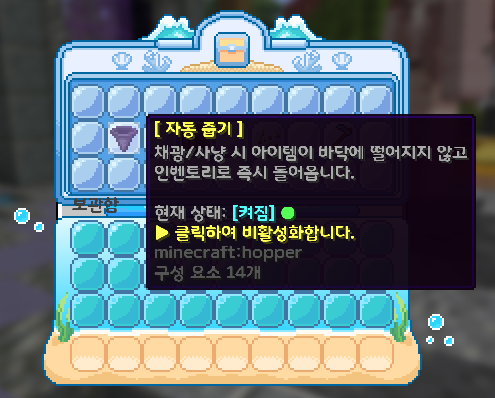

# 🥇 랭크 (Rank System)

서버의 랭크 시스템은 **AuraSkills 총합 레벨**, **상위 4대 주력 스킬 레벨**, 그리고 **코인**을 종합 심사하여 순차적으로 승급하는 핵심 성장 시스템입니다.

승급 시 각종 서버 편의 기능 해금, 칭호 및 전용 리소스팩 뱃지가 부여되며, 전 서버에 축하 공지가 브로드캐스트됩니다.

---

## 📌 명령어 안내

<table>
  <thead>
    <tr>
      <th width="160">명령어</th>
      <th width="160">별칭 (Alias)</th>
      <th>설명</th>
    </tr>
  </thead>
  <tbody>
    <tr>
      <td><strong>/rank</strong></td>
      <td><code>/랭크</code>, <code>/fodzm</code></td>
      <td>랭크 승급 심사 GUI 창을 엽니다.</td>
    </tr>
    <tr>
      <td><strong>/rank reload</strong></td>
      <td><code>/rank 리로드</code></td>
      <td>랭크 설정 파일(<code>config.yml</code>)을 다시 불러옵니다. (관리자 전용)</td>
    </tr>
  </tbody>
</table>

---

## 🌟 주력 스킬 심사제 안내

* **자유로운 육성 지원**: 기존의 특정 생활 스킬(채광, 농사, 낚시, 사냥) 강제 방식을 탈피하여, 유저가 육성한 **전체 15종 AuraSkills 중 레벨이 가장 높은 상위 4개 스킬**이 목표 기준치를 달성했는지를 자동 판정합니다.
  * **지원 스킬 15종 전수 조사**:
    * 생활: `농사`, `채집`, `채광`, `낚시`, `발굴`
    * 전투/신체: `궁술`, `방어`, `전투`, `지구력`, `민첩`
    * 전문/마법: `연금술`, `마법부여`, `마법`, `치유`, `단조`
  * *판정 예시*: 기준치가 30레벨일 때, 플레이어의 스킬 중 `치유 45, 낚시 38, 전투 35, 마법부여 31`이라면 상위 4개 스킬이 모두 30 이상이므로 즉시 합격 처리됩니다.
* **원클릭 심사 GUI**: `/랭크` 입력 시 심사 창에서 총합 레벨, 1~4위 주력 스킬 진행도, 필요 코인이 실시간 초록색(`<green>`)/빨간색(`<red>`)으로 표시되며 원클릭으로 승급할 수 있습니다.

---

## 📊 랭크 승급 조건 및 단계별 상세 안내



### 📊 랭크 승급 종합 조건표 (7단계)

<table>
  <thead>
    <tr>
      <th width="140">랭크명</th>
      <th align="center" width="110">총합 레벨</th>
      <th align="center" width="150">주력 스킬 기준치 (상위 4개 각각)</th>
      <th align="right" width="160">소모 코인</th>
      <th>주요 혜택 및 해금</th>
    </tr>
  </thead>
  <tbody>
    <tr>
      <td><mark style="color:red;"><strong>루비</strong></mark></td>
      <td align="center">0</td>
      <td align="center">0</td>
      <td align="right">1,000,000 코인</td>
      <td>튜토리얼 통과 시 즉시 승급 / 기본 시민 등급</td>
    </tr>
    <tr>
      <td><mark style="color:orange;"><strong>산호</strong></mark></td>
      <td align="center">150</td>
      <td align="center">15</td>
      <td align="right">1,000,000 코인</td>
      <td><strong>자동 줍기</strong> (<code>/util</code>) · <strong>전리품 가방</strong> (<code>/전리품가방</code>) <strong>가상 도구</strong> (작업대/엔더상자/모루) <strong>홈 4개</strong> · <strong>토지 2개</strong> · <strong>경매장 7개</strong> · <strong>워프 대기 4초</strong></td>
    </tr>
    <tr>
      <td><mark style="color:yellow;"><strong>골드</strong></mark></td>
      <td align="center">300</td>
      <td align="center">30</td>
      <td align="right">3,000,000 코인</td>
      <td><strong>자동 조합</strong> (<code>/util</code>) · <strong>2차 전직 자격</strong> <strong>홈 5개</strong> · <strong>토지 3개</strong> · <strong>경매장 10개</strong> · <strong>개인 상점 15개</strong> · <strong>워프 대기 3초</strong></td>
    </tr>
    <tr>
      <td><mark style="color:green;"><strong>에메랄드</strong></mark></td>
      <td align="center">500</td>
      <td align="center">45</td>
      <td align="right">10,000,000 코인</td>
      <td><strong>자동 심기</strong> (<code>/util</code>) <strong>홈 5개</strong> · <strong>토지 한도 확장</strong> · <strong>경매장 15개</strong> · <strong>개인 상점 15개</strong> · <strong>워프 대기 2초</strong></td>
    </tr>
    <tr>
      <td><mark style="color:blue;"><strong>사파이어</strong></mark></td>
      <td align="center">750</td>
      <td align="center">60</td>
      <td align="right">30,000,000 코인</td>
      <td><strong>휴대용 셜커 오픈</strong> · <strong>전용 뱃지/칭호</strong> <strong>홈 7개</strong> · <strong>토지 한도 확장</strong> · <strong>경매장 20개</strong> · <strong>개인 상점 25개</strong> · <strong>워프 대기 1초</strong></td>
    </tr>
    <tr>
      <td><mark style="color:violet;"><strong>자수정</strong></mark></td>
      <td align="center">1,050</td>
      <td align="center">75</td>
      <td align="right">100,000,000 코인</td>
      <td><strong>자수정 뱃지/칭호</strong> <strong>홈 8개</strong> · <strong>토지 한도 확장</strong> · <strong>경매장 25개</strong> · <strong>개인 상점 25개</strong> · <strong>워프 대기 1초</strong></td>
    </tr>
    <tr>
      <td><mark style="color:purple;"><strong>무지개</strong></mark></td>
      <td align="center">1,400</td>
      <td align="center">90</td>
      <td align="right">500,000,000 코인</td>
      <td><strong>서버 최고 존엄 무지개 뱃지/칭호</strong> <strong>홈 10개</strong> · <strong>토지 최고 한도</strong> · <strong>경매장 30개</strong> · <strong>개인 상점 40개</strong> · <strong>워프 대기 0초 (즉시 이동)</strong></td>
    </tr>
  </tbody>
</table>



### <mark style="color:red;">RUBY (루비)</mark>

* **승급 조건 요약**:
  * **필요 총합 레벨**: <code>0</code>
  * **주력 스킬 기준치**: <code>0</code> (상위 4개 스킬)
  * **소모 코인**: <code>1,000,000 코인</code> *(튜토리얼 암호 통과 시 무료 즉시 승급)*
* **🎁 주요 혜택 및 해금**:
  * **기본 시민 등급**: 튜토리얼 탈출 시 부여되는 기본 시민 랭크
  * **전용 뱃지**: 기본 서버 플레이 및 루비 랭크 뱃지 부여
  * **거래 편의**: 개인 상점(체스트샵) 기본 최대 10개 설치 및 운영 가능



### <mark style="color:orange;">CORAL (산호)</mark>

* **승급 조건 요약**:
  * **필요 총합 레벨**: <code>150</code>
  * **주력 스킬 기준치**: 상위 4개 각 <code>15</code> 이상
  * **소모 코인**: <code>1,000,000 코인</code>
* **🎁 주요 혜택 및 해금**:
  * **휴대용 가상 도구 해금**:
    * **가상 작업대** (<code>/작업대</code>, <code>/craft</code>): 작업대 블록 없이 언제 어디서나 3×3 조합대를 엽니다.
    * **가상 엔더상자** (<code>/엔더</code>, <code>/enderchest</code>): 어디서든 개인 엔더상자 보관함을 엽니다.
    * **가상 모루** (<code>/모루</code>, <code>/anvil</code>): 어디서든 모루 창을 열어 장비 수리 및 결합이 가능합니다.
  * **자동 편의 기능**:
    * **자동 줍기** (<code>/util</code>): 블록 채굴 및 몬스터 처치 시 드롭 아이템이 인벤토리로 즉시 자동 흡수됩니다.
    * **전리품 가방** (<code>/전리품가방</code>): 지정된 전리품이 가상 창고에 자동 보관됩니다.
  * **거점 및 토지 확장**:
    * **개인 홈 확장**: <code>/sethome</code>으로 저장 가능한 개인 거점 위치가 **최대 4개**로 확장됩니다.
    * **토지 생성 확장**: 개인이 소유/생성할 수 있는 토지(마을)가 **최대 2개**로 확장됩니다.
  * **거래 편의**:
    * **경매장 동시 등록 7개**: 개인 경매장(<code>/경매장</code>)에 동시에 출품 등록할 수 있는 아이템 슬롯이 **최대 7개**로 증가합니다.
  * **이동 편의**:
    * **텔레포트 대기시간 단축**: 홈, 스폰, 워프, 서버 이동 등 텔레포트 이동 시 대기시간이 **4초**로 단축됩니다.



### <mark style="color:yellow;">GOLD (골드)</mark>

* **승급 조건 요약**:
  * **필요 총합 레벨**: <code>300</code>
  * **주력 스킬 기준치**: 상위 4개 각 <code>30</code> 이상
  * **소모 코인**: <code>3,000,000 코인</code>
* **🎁 주요 혜택 및 해금**:
  * **자동 편의 기능**:
    * **자동 조합** (<code>/util</code>): 인벤토리 내 광석/작물이 9개 모이면 작업대 없이 즉시 압축 블록으로 자동 변환됩니다.
  * **직업 전문화**:
    * **2번째 전문직 전직 자격**: AuraSkills 총합 레벨 300 달성으로 전문직 2차 전직이 가능해집니다.
  * **거점 및 토지 확장**:
    * **개인 홈 확장**: <code>/sethome</code>으로 저장 가능한 개인 거점 위치가 **최대 5개**로 확장됩니다.
    * **토지 생성 확장**: 개인이 소유/생성할 수 있는 토지(마을)가 **최대 3개**로 확장됩니다.
  * **거래 편의**:
    * **경매장 동시 등록 10개**: 개인 경매장(<code>/경매장</code>)에 동시에 출품 등록할 수 있는 아이템 슬롯이 **최대 10개**로 증가합니다.
    * **개인 상점(체스트샵) 15개**: 월드에 설치하여 운영 가능한 무인 상점 보관함이 **최대 15개**로 확장됩니다.
  * **이동 편의**:
    * **텔레포트 대기시간 단축**: 홈, 스폰, 워프, 서버 이동 등 텔레포트 이동 시 대기시간이 **3초**로 단축됩니다.



### <mark style="color:green;">EMERALD (에메랄드)</mark>

* **승급 조건 요약**:
  * **필요 총합 레벨**: <code>500</code> *(기존 600에서 완화)*
  * **주력 스킬 기준치**: 상위 4개 각 <code>45</code> 이상
  * **소모 코인**: <code>10,000,000 코인</code>
* **🎁 주요 혜택 및 해금**:
  * **자동 편의 기능**:
    * **자동 심기** (<code>/util</code>): 다 자란 농작물 수확 시 또는 벌목 시 씨앗/묘목을 자리에 즉시 자동 재식립합니다.
  * **거점 및 토지 확장**:
    * **개인 홈 유지**: <code>/sethome</code>으로 저장 가능한 개인 거점 위치 **최대 5개** 유지
    * **토지 한도 확장**: 에메랄드 등급 전용 토지(마을) 생성 및 청크 한도가 확장됩니다.
  * **거래 편의**:
    * **경매장 동시 등록 15개**: 개인 경매장(<code>/경매장</code>)에 동시에 출품 등록할 수 있는 아이템 슬롯이 **최대 15개**로 증가합니다.
    * **개인 상점(체스트샵) 15개**: 무인 상점 보관함 **최대 15개** 설치 유지
  * **이동 편의**:
    * **텔레포트 대기시간 단축**: 홈, 스폰, 워프, 서버 이동 등 텔레포트 이동 시 대기시간이 **2초**로 단축됩니다.



### <mark style="color:blue;">SAPPHIRE (사파이어)</mark>

* **승급 조건 요약**:
  * **필요 총합 레벨**: <code>750</code> *(기존 900에서 완화)*
  * **주력 스킬 기준치**: 상위 4개 각 <code>60</code> 이상
  * **소모 코인**: <code>30,000,000 코인</code>
* **🎁 주요 혜택 및 해금**:
  * **휴대용 가상 기능 해금**:
    * **원격 셜커 상자 오픈**: 셜커 상자를 손에 든 상태에서 `Shift + 좌클릭` 시 바닥에 설치하지 않고 상자 인벤토리를 즉시 엽니다.
  * **전용 뱃지 & 칭호**:
    * **사파이어 뱃지 및 전용 칭호**가 부여됩니다.
  * **거점 및 토지 확장**:
    * **개인 홈 확장**: <code>/sethome</code>으로 저장 가능한 개인 거점 위치가 **최대 7개**로 확장됩니다.
    * **토지 한도 확장**: 사파이어 등급 전용 토지(마을) 생성 및 청크 한도가 확장됩니다.
  * **거래 편의**:
    * **경매장 동시 등록 20개**: 개인 경매장(<code>/경매장</code>)에 동시에 출품 등록할 수 있는 아이템 슬롯이 **최대 20개**로 대폭 증가합니다.
    * **개인 상점(체스트샵) 25개**: 월드에 설치하여 운영 가능한 무인 상점 보관함이 **최대 25개**로 대폭 확장됩니다.
  * **이동 편의**:
    * **텔레포트 대기시간 단축**: 홈, 스폰, 워프, 서버 이동 등 텔레포트 이동 시 대기시간이 **1초**로 초고속 단축됩니다.
  * **랭커 명예**: 서버 상위 랭커 명예 획득



### <mark style="color:violet;">AMETHYST (자수정)</mark>

* **승급 조건 요약**:
  * **필요 총합 레벨**: <code>1,050</code> *(기존 1,300에서 완화)*
  * **주력 스킬 기준치**: 상위 4개 각 <code>75</code> 이상
  * **소모 코인**: <code>100,000,000 코인</code>
* **🎁 주요 혜택 및 해금**:
  * **전용 뱃지 & 칭호**:
    * **자수정 뱃지 및 전용 칭호**가 부여됩니다.
  * **거점 및 토지 확장**:
    * **개인 홈 확장**: <code>/sethome</code>으로 저장 가능한 개인 거점 위치가 **최대 8개**로 확장됩니다.
    * **토지 한도 확장**: 자수정 등급 전용 토지(마을) 생성 및 청크 한도가 확장됩니다.
  * **거래 편의**:
    * **경매장 동시 등록 25개**: 개인 경매장(<code>/경매장</code>)에 동시에 출품 등록할 수 있는 아이템 슬롯이 **최대 25개**로 대폭 증가합니다.
    * **개인 상점(체스트샵) 25개**: 무인 상점 보관함 **최대 25개** 설치 유지
  * **이동 편의**:
    * **텔레포트 대기시간 단축**: 홈, 스폰, 워프, 서버 이동 등 텔레포트 이동 시 대기시간이 **1초**로 유지됩니다.
  * **상위 권한**: 상위 콘텐츠 권한 및 전 서버 랭커 인증



### <mark style="color:red;">R</mark><mark style="color:orange;">A</mark><mark style="color:yellow;">I</mark><mark style="color:green;">N</mark><mark style="color:cyan;">B</mark><mark style="color:blue;">O</mark><mark style="color:violet;">W</mark> (무지개)

* **승급 조건 요약**:
  * **필요 총합 레벨**: <code>1,400</code> *(기존 1,800에서 완화)*
  * **주력 스킬 기준치**: 상위 4개 각 <code>90</code> 이상
  * **소모 코인**: <code>500,000,000 코인</code>
* **🎁 주요 혜택 및 해금**:
  * **서버 최고 존엄 명예**:
    * **무지개 뱃지 및 전 서버 최고 존엄 전용 칭호**가 부여됩니다.
    * 달성 시 전 서버 네트워크 브로드캐스트 축하 송출
  * **거점 및 토지 확장**:
    * **개인 홈 확장**: <code>/sethome</code>으로 저장 가능한 개인 거점 위치가 **최대 10개**로 확장됩니다.
    * **토지 최고 한도 해금**: 무지개 등급 전용 최고 한도 토지(마을) 생성 및 청크 한도가 적용됩니다.
  * **거래 편의**:
    * **경매장 동시 등록 30개**: 개인 경매장(<code>/경매장</code>)에 동시에 출품 등록할 수 있는 아이템 슬롯이 **최대 30개**로 최대치까지 확장됩니다.
    * **개인 상점(체스트샵) 40개**: 월드에 설치하여 운영 가능한 무인 상점 보관함이 **최대 40개**로 대규모 확장됩니다.
  * **이동 편의**:
    * **텔레포트 대기시간 면제 (0초 즉시 이동)**: 대기시간(Warmup) 없이 홈, 스폰, 워프, 서버 이동 시 **0초 즉시 이동**합니다.



---

## 🛠️ 랭크 해금 유틸리티 및 특수 편의 기능

랭크 승급을 통해 단계별로 해금되는 5대 핵심 유틸리티와 휴대용 가상 도구들의 상세 가이드입니다.

### 1. 🌟 5대 핵심 유틸리티 (`/유틸리티` - 자유 토글)

채팅창에 **/유틸리티** (또는 `/유틸`, `/utility`)를 입력하면 해금된 편의 기능을 언제든 자유롭게 켜고 끌(On/Off) 수 있는 설정 창이 열립니다.

<table>
  <thead>
    <tr>
      <th width="180">명령어</th>
      <th width="200">별칭 (Alias)</th>
      <th>설명</th>
    </tr>
  </thead>
  <tbody>
    <tr>
      <td><strong>/utility</strong></td>
      <td><code>/유틸리티</code>, <code>/유틸</code>, <code>/dbxlf</code></td>
      <td>자동 줍기, 자동 조합, 자동 심기, 작물 보호, 전리품 가방 토글 설정 창을 엽니다.</td>
    </tr>
  </tbody>
</table>

<figure><figcaption></figcaption></figure>

<table>
  <thead>
    <tr>
      <th width="140">편의 기능</th>
      <th align="center" width="130">해금 등급</th>
      <th>기능 설명 및 상세 안내</th>
      <th width="240">참고 사항</th>
    </tr>
  </thead>
  <tbody>
    <tr>
      <td><strong>자동 줍기</strong></td>
      <td align="center"><mark style="color:orange;"><strong>산호 등급</strong></mark> (총합 150Lv)</td>
      <td>블록을 캐거나 몬스터를 처치했을 때 드롭된 아이템이 바닥에 떨어지지 않고 <strong>인벤토리로 즉시 자동 수납됩니다.</strong></td>
      <td>인벤토리 공간 부족 시 바닥에 정상 드롭됩니다.</td>
    </tr>
    <tr>
      <td><strong>전리품 가방</strong></td>
      <td align="center"><mark style="color:orange;"><strong>산호 등급</strong></mark> (총합 150Lv)</td>
      <td>광물, 농작물 등 지정된 전리품을 인벤토리 슬롯 대신 <strong>무제한급 가상 창고에 자동으로 차곡차곡 적립</strong>합니다. • <strong>가방 열기</strong>: <code>/전리품가방</code> (또는 <code>/lootbag</code>)</td>
      <td>GUI 창을 열어 보관된 전리품을 원하는 만큼 언제든 인벤토리로 꺼낼 수 있습니다.</td>
    </tr>
    <tr>
      <td><strong>자동 조합</strong></td>
      <td align="center"><mark style="color:yellow;"><strong>골드 등급</strong></mark> (총합 300Lv)</td>
      <td>인벤토리에 광물이나 작물이 9개 모이면 <strong>작업대 없이 인벤토리 안에서 자동으로 압축 블록으로 변환</strong>됩니다.</td>
      <td>채광 및 대규모 농사 시 인벤토리 슬롯 부족을 방지합니다.</td>
    </tr>
    <tr>
      <td><strong>자동 심기</strong></td>
      <td align="center"><mark style="color:green;"><strong>에메랄드 등급</strong></mark> (총합 500Lv)</td>
      <td><strong>① 농작물</strong>: 다 자란 밀, 당근, 감자 등을 캐면 인벤토리의 씨앗을 소모해 그 자리에 즉시 다시 심어줍니다. <strong>② 나무 묘목</strong>: 흙 위에 자란 나무의 맨 밑동 원목을 베면 인벤토리의 해당 묘목을 소모해 <strong>나무가 있던 자리에 자동으로 묘목을 심어줍니다!</strong></td>
      <td>수확 또는 벌목 시 인벤토리 내 씨앗/묘목이 소모됩니다.</td>
    </tr>
    <tr>
      <td><strong>작물 보호</strong></td>
      <td align="center"><mark style="color:green;"><strong>에메랄드 등급</strong></mark> (총합 500Lv)</td>
      <td>덜 자란 미성숙 작물 및 줄기 블록의 좌클릭 실수 파괴를 방지합니다.</td>
      <td>밭을 다시 갈아엎고 싶을 때는 <strong><code>Shift(웅크리기) + 좌클릭</code></strong>을 하면 보호를 풀고 강제로 부술 수 있습니다!</td>
    </tr>
  </tbody>
</table>

---

### 2. 🧰 휴대용 가상 도구 및 원격 보관함

작업대나 모루, 엔더상자를 찾아 스폰이나 거점으로 돌아갈 필요 없이 언제 어디서나 손안에서 창을 엽니다.

<table>
  <thead>
    <tr>
      <th width="180">명령어 / 조작법</th>
      <th width="200">별칭 (Alias)</th>
      <th align="center" width="130">해금 등급</th>
      <th>상세 설명</th>
    </tr>
  </thead>
  <tbody>
    <tr>
      <td><strong>/ct</strong></td>
      <td><code>/작업대</code>, <code>/table</code>, <code>/craft</code></td>
      <td align="center"><mark style="color:orange;"><strong>산호 등급</strong></mark></td>
      <td>바닥 설치 필요 없이 3×3 작업대 창을 즉시 엽니다.</td>
    </tr>
    <tr>
      <td><strong>/ender</strong></td>
      <td><code>/엔더상자</code>, <code>/enderchest</code>, <code>/엔더</code></td>
      <td align="center"><mark style="color:orange;"><strong>산호 등급</strong></mark></td>
      <td>어디서든 개인 엔더 상자 보관함을 즉시 엽니다.</td>
    </tr>
    <tr>
      <td><strong>/모루</strong></td>
      <td><code>/anvil</code>, <code>/ahfn</code></td>
      <td align="center"><mark style="color:orange;"><strong>산호 등급</strong></mark></td>
      <td>설치형 모루 없이 휴대용 수리/결합 모루 창을 즉시 엽니다.</td>
    </tr>
    <tr>
      <td><strong>Shift + 좌클릭</strong></td>
      <td><em>(셜커 상자 손에 든 상태)</em></td>
      <td align="center"><mark style="color:blue;"><strong>사파이어 등급</strong></mark></td>
      <td>셜커 상자를 바닥에 설치하지 않고 손에 든 채로 27칸 상자 인벤토리를 원격으로 즉시 엽니다.</td>
    </tr>
  </tbody>
</table>
