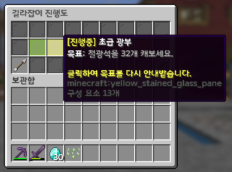
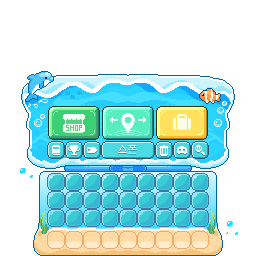

# 🧭 튜토리얼

### 문서 목차

1. [튜토리얼 탈출 방법](02..md#id-1)
2. [길라잡이](02..md#id-2)
3. 단축키 및 채팅 기능
4. 기본 규칙
5. 경고 및 벌점

***

### 1. 튜토리얼 탈출 방법

서버에 처음 접속하면 회색 등급 상태로 튜토리얼 월드에 오게 됩니다.

* 튜토리얼 중엔 다른 플레이어와의 채팅, 블록 설치 및 파괴, 아이템 버리기 및 줍기, 일반 명령어 사용이 불가합니다.
* 탈출 방법은 다음과 같습니다.
  1. 튜토리얼 표지판과 가이드 설명을 따라 이동하면서 안내된 **암호**를 확인합니다.
  2. 채팅창에 **`/암호 <숫자>`** (예: `/암호 1234`)를 입력합니다.
  3. 암호가 맞으면 즉시 루비 등급으로 승급하며, 스폰으로 전송됩니다.
* <mark style="color:$danger;background-color:$warning;">**암호는 1101입니다. [/암호 1101]**</mark>

<figure><figcaption></figcaption></figure>

***

### 2. 길라잡이 (총 32단계 성장 가이드)

튜토리얼을 통과하여 스폰에 도착하면 화면 상단 보스바와 전용 GUI를 통해 **총 32단계 길라잡이 퀘스트**를 진행할 수 있습니다.

* **명령어**: `/길라잡이`, `/rlffkwkqdl`, `/guidance`
* **진행 방식**: 1단계부터 순서대로 목표를 달성하면 즉시 보상이 지급되며 다음 단계가 자동으로 열립니다.
  * 코인 보상은 달성 즉시 계좌로 입금되며, 열쇠·경험치 책·인챈트 북 보상은 **우편함(`/우편함`)**으로 지급됩니다.
  * 이미 달성해 둔 스킬 레벨이나 직업 레벨이 있는 경우 `/길라잡이` 창을 열면 진행도가 즉시 자동 반영됩니다.

<figure><figcaption></figcaption></figure>

#### 📋 길라잡이 1 ~ 32단계 전체 목표 및 보상 목록



<table>
  <thead>
    <tr>
      <th width="80" align="center">단계</th>
      <th width="140">목표 명칭</th>
      <th>달성 조건</th>
      <th width="180">달성 보상</th>
    </tr>
  </thead>
  <tbody>
    <tr>
      <td align="center"><strong>1단계</strong></td>
      <td><strong>첫 걸음</strong></td>
      <td>채팅창에 <code>/길라잡이</code> (또는 <code>/rlffkwkqdl</code>) 입력하여 창 열기</td>
      <td>💰 <strong>10,000 코인</strong></td>
    </tr>
    <tr>
      <td align="center"><strong>2단계</strong></td>
      <td><strong>서버 둘러보기</strong></td>
      <td>채팅창에 <code>/메뉴</code> (또는 <code>/menu</code>) 입력하여 기본 GUI 확인</td>
      <td>🗝️ <strong>일반 열쇠 1개</strong></td>
    </tr>
    <tr>
      <td align="center"><strong>3단계</strong></td>
      <td><strong>나만의 거점</strong></td>
      <td><code>/마을 생성</code> (또는 <code>/l create</code>) 명령어 입력하여 사용법 확인</td>
      <td>💰 <strong>5,000 코인</strong></td>
    </tr>
    <tr>
      <td align="center"><strong>4단계</strong></td>
      <td><strong>영토 점유</strong></td>
      <td><code>/마을 점유</code> (또는 <code>/l claim</code>) 명령어 입력하여 사용법 확인</td>
      <td>🗝️ <strong>일반 열쇠 1개</strong></td>
    </tr>
    <tr>
      <td align="center"><strong>5단계</strong></td>
      <td><strong>동료 구하기</strong></td>
      <td><code>/마을 초대</code> (또는 <code>/l trust</code>) 명령어 입력하여 사용법 확인</td>
      <td>💰 <strong>5,000 코인</strong></td>
    </tr>
    <tr>
      <td align="center"><strong>6단계</strong></td>
      <td><strong>길 잃음 방지</strong></td>
      <td><code>/마을 스폰변경</code> (또는 <code>/l setspawn</code>) 명령어로 거점 지정법 확인</td>
      <td>💰 <strong>5,000 코인</strong></td>
    </tr>
    <tr>
      <td align="center"><strong>7단계</strong></td>
      <td><strong>귀환</strong></td>
      <td><code>/마을 스폰이동</code> (또는 <code>/l spawn</code>) 명령어로 마을 귀환해보기</td>
      <td>💰 <strong>5,000 코인</strong></td>
    </tr>
    <tr>
      <td align="center"><strong>8단계</strong></td>
      <td><strong>생존의 기본</strong></td>
      <td>야생에서 주변의 나무(원목) <strong>16개</strong> 캐기</td>
      <td>💰 <strong>10,000 코인</strong></td>
    </tr>
    <tr>
      <td align="center"><strong>9단계</strong></td>
      <td><strong>초급 광부</strong></td>
      <td>철광석(심층암 철광석 포함) <strong>32개</strong> 캐기</td>
      <td>🗝️ <strong>일반 열쇠 1개</strong></td>
    </tr>
    <tr>
      <td align="center"><strong>10단계</strong></td>
      <td><strong>풍요로운 대지</strong></td>
      <td>다 자란 밀 <strong>10개</strong> 수확하기</td>
      <td>🗝️ <strong>일반 열쇠 1개</strong></td>
    </tr>
    <tr>
      <td align="center"><strong>11단계</strong></td>
      <td><strong>첫 번째 사냥</strong></td>
      <td>좀비 <strong>5마리</strong> 사냥하기</td>
      <td>🗝️ <strong>일반 열쇠 1개</strong></td>
    </tr>
    <tr>
      <td align="center"><strong>12단계</strong></td>
      <td><strong>초급 낚시꾼</strong></td>
      <td>낚시를 통해 물고기 <strong>5마리</strong> 낚기</td>
      <td>🗝️ <strong>일반 열쇠 1개</strong></td>
    </tr>
  </tbody>
</table>



<table>
  <thead>
    <tr>
      <th width="80" align="center">단계</th>
      <th width="140">목표 명칭</th>
      <th>달성 조건</th>
      <th width="180">달성 보상</th>
    </tr>
  </thead>
  <tbody>
    <tr>
      <td align="center"><strong>13단계</strong></td>
      <td><strong>직업의 시작</strong></td>
      <td><code>/직업</code> (또는 <code>/jobs</code>) 명령어를 입력하여 생활 직업 목록 확인</td>
      <td>💰 <strong>10,000 코인</strong></td>
    </tr>
    <tr>
      <td align="center"><strong>14단계</strong></td>
      <td><strong>성장의 결실</strong></td>
      <td>생활 직업(광부·농부·어부·사냥꾼) 중 하나 <strong>2레벨</strong> 달성</td>
      <td>📖 <strong>경험치 2,000</strong></td>
    </tr>
    <tr>
      <td align="center"><strong>15단계</strong></td>
      <td><strong>나만의 특성</strong></td>
      <td><code>/직업 특성</code> (또는 <code>/특성</code>) 명령어를 입력하여 직업 특성 창 열기</td>
      <td>🗝️ <strong>레어 열쇠 1개</strong></td>
    </tr>
    <tr>
      <td align="center"><strong>16단계</strong></td>
      <td><strong>일일 의뢰</strong></td>
      <td><code>/직업 의뢰</code> (또는 <code>/의뢰</code>) 명령어를 입력하여 일일 의뢰 목록 확인</td>
      <td>🌟 <strong>별 뽑기 열쇠 16개</strong></td>
    </tr>
    <tr>
      <td align="center"><strong>17단계</strong></td>
      <td><strong>나의 계급</strong></td>
      <td><code>/랭크</code> (또는 <code>/rank</code>) 명령어를 입력하여 현재 등급 확인</td>
      <td>📖 <strong>경험치 2,000</strong></td>
    </tr>
    <tr>
      <td align="center"><strong>18단계</strong></td>
      <td><strong>도구의 발전</strong></td>
      <td>작업대를 이용해 <strong>다이아몬드 곡괭이 1개</strong> 제작</td>
      <td>🗝️ <strong>일반 열쇠 1개</strong></td>
    </tr>
    <tr>
      <td align="center"><strong>19단계</strong></td>
      <td><strong>뜨거운 화로</strong></td>
      <td>화로에서 <strong>구운 소고기 1개</strong> 꺼내기</td>
      <td>🗝️ <strong>일반 열쇠 1개</strong></td>
    </tr>
    <tr>
      <td align="center"><strong>20단계</strong></td>
      <td><strong>나의 잠재력</strong></td>
      <td><code>/스킬</code> (또는 <code>/sk</code>) 명령어를 입력하여 내 스킬·스탯 확인</td>
      <td>🗝️ <strong>일반 열쇠 1개</strong></td>
    </tr>
    <tr>
      <td align="center"><strong>21단계</strong></td>
      <td><strong>새로운-주괴</strong></td>
      <td>용광로에서 <strong>강철 주괴 1개</strong> 제련하여 꺼내기</td>
      <td>🗝️ <strong>일반 열쇠 1개</strong></td>
    </tr>
    <tr>
      <td align="center"><strong>22단계</strong></td>
      <td><strong>나만의 칭호</strong></td>
      <td><code>/칭호</code> (또는 <code>/cldgh</code>) 명령어를 입력하여 칭호 확인</td>
      <td>🏷️ <strong>[새로운] 칭호</strong></td>
    </tr>
    <tr>
      <td align="center"><strong>23단계</strong></td>
      <td><strong>더 강력한 장비</strong></td>
      <td><code>/인챈트</code> (또는 <code>/인챈터</code>) 명령어를 입력하여 커스텀 인챈트 확인</td>
      <td>💰 <strong>5,000 코인</strong></td>
    </tr>
    <tr>
      <td align="center"><strong>24단계</strong></td>
      <td><strong>단단한 방어</strong></td>
      <td>작업대에서 <strong>다이아몬드 상의(흉갑) 1개</strong> 제작</td>
      <td>🗝️ <strong>일반 열쇠 1개</strong></td>
    </tr>
  </tbody>
</table>



<table>
  <thead>
    <tr>
      <th width="80" align="center">단계</th>
      <th width="140">목표 명칭</th>
      <th>달성 조건</th>
      <th width="180">달성 보상</th>
    </tr>
  </thead>
  <tbody>
    <tr>
      <td align="center"><strong>25단계</strong></td>
      <td><strong>첫 거래와 경제</strong></td>
      <td><code>/상점</code> (<code>/shop</code>) 또는 <code>/돈</code> (<code>/coin</code>) 명령어로 상점과 재산 확인</td>
      <td>🗝️ <strong>레어 열쇠 1개</strong></td>
    </tr>
    <tr>
      <td align="center"><strong>26단계</strong></td>
      <td><strong>유저 거래소</strong></td>
      <td><code>/경매장</code> (또는 <code>/ah</code>) 명령어를 입력하여 유저 거래소 확인</td>
      <td>🗝️ <strong>에픽 열쇠 1개</strong></td>
    </tr>
    <tr>
      <td align="center"><strong>27단계</strong></td>
      <td><strong>생명의 탄생</strong></td>
      <td>동물에게 먹이를 주어 <strong>10마리</strong> 번식시키기</td>
      <td>🗝️ <strong>일반 열쇠 1개</strong></td>
    </tr>
    <tr>
      <td align="center"><strong>28단계</strong></td>
      <td><strong>네더라이트</strong></td>
      <td>네더에서 <strong>고대 잔해 4개</strong> 채굴하기</td>
      <td>🗝️ <strong>레어 열쇠 1개</strong></td>
    </tr>
    <tr>
      <td align="center"><strong>29단계</strong></td>
      <td><strong>종합 스킬 마스터</strong></td>
      <td>스킬 레벨 총합 <strong>30</strong> 달성하기</td>
      <td>🗝️ <strong>에픽 열쇠 1개</strong></td>
    </tr>
    <tr>
      <td align="center"><strong>30단계</strong></td>
      <td><strong>생활의 달인</strong></td>
      <td>생활 직업(광부·농부·어부·사냥꾼) 중 하나 <strong>3레벨</strong> 달성</td>
      <td>📘 <strong>A등급 커스텀 인챈트 북</strong></td>
    </tr>
    <tr>
      <td align="center"><strong>31단계</strong></td>
      <td><strong>전문가의 길</strong></td>
      <td><code>/직업 가입</code> 명령어를 입력하여 전문 직업 가입 방법 확인</td>
      <td>📖 <strong>경험치 5,000</strong></td>
    </tr>
    <tr>
      <td align="center"><strong>32단계</strong></td>
      <td><strong>장인 정신</strong></td>
      <td>전문 직업(대장장이·요리사·연금술사·마법부여사) 중 하나 <strong>5레벨</strong> 달성</td>
      <td>📙 <strong>S등급 커스텀 인챈트 북 3개</strong></td>
    </tr>
  </tbody>
</table>



***

### 3. 단축키 및 채팅 기능

**서버 메뉴 열기**

* 어느 서버에서든 웅크리기 키(Shift)와 왼손들기 키(F)키를 누르시면 서버 메뉴가 열립니다.
* 다른 채널이나 서버로 이동할 때는 채팅창에 `/서버` 를 입력하시면 됩니다.

<table>
  <tr>
    <td align="center"></td>
    <td align="center"></td>
  </tr>
</table>

**자동 한글 변환 기능**

* 영문 입력 상태에서 문장 맨 앞에 마침표(.)를 입력하고 영타를 치면 자동으로 한글로 변환되어 전송됩니다.\
  예) .ghksdudgkqslek -> 환영합니다

**채팅 채널**

* 채팅 채널의 종류는 총 5개가 있습니다. 아래 명령어로 특정 채널에서 대화하거나, 뒤에 `끄기 / 켜기` 를 붙여 해당 채널의 메세지를 켜고 끌 수 있습니다. 
* **전체 채팅** - `/전체 [메세지]` 모든 서버에 전송하는 메세지 입니다.
* **지역 채팅** - `/지역 [메세지]` 자신의 주변 유저에게만 전송되는 메세지입니다.
* **거래 채팅** - `/거래 [메세지]` 아이템이나 인력을 사고 팔 때 사용하는 메세지입니다.
* **질문 채팅** - `/질문 [메세지]` 궁금한 것을 물어볼 때 사용하는 메세지입니다.
* **답변 채팅** - `/답변 [메세지]` 위 채팅에 답변을 줄 때 사용하는 메세지입니다.

***

### 4. 기본 규칙

* 서버의 원활한 이용과 매너 있는 플레이를 위해 [서버 규정](../info/rule.md)을 준수해야 합니다.
* 비매너 행위, 비인가 프로그램(핵/매크로) 사용, 사기 등 규정 위반 시 벌점 및 제재가 적용됩니다.
* 랭크 승급 조건 및 단계별 혜택은 **[🥇 랭크](07-1.md)** 가이드를 참고하시기 바랍니다.

***

### 5. 경고 및 벌점

* 규정 위반 시 위반 경중에 따라 벌점이 부여됩니다.
* 벌점이 누적 10점 이상에 도달하면 서버에서 일정 기간 추방(밴) 조치됩니다.
* 벌점은 부여된 시점으로부터 90일 경과 시 자동으로 소멸됩니다. (자세한 내용은 [서버 규정](../info/rule.md#벌점-시스템) 참고)

***
