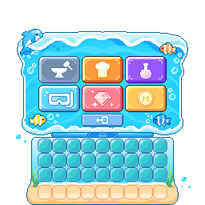
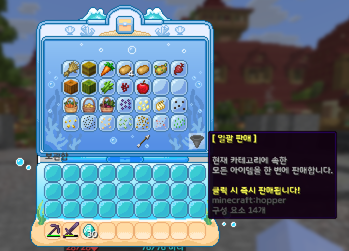
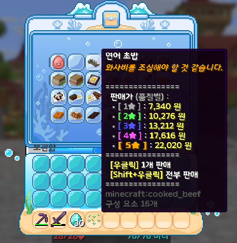
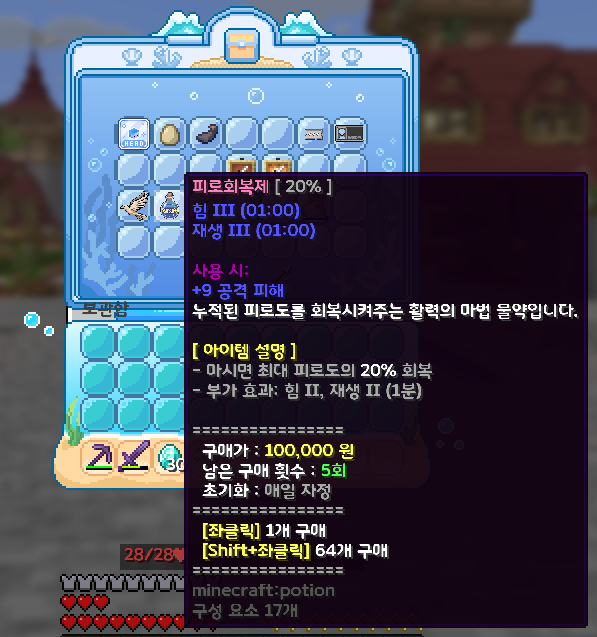

# 🛒 상점

<table>
  <tr>
    <td align="center"></td>
    <td align="center"></td>
  </tr>
</table>

> **안내**: 서버 공식 중앙 상점(ShopCore)의 카테고리별 이용법, 스마트 마우스 조작법, 즉시 손 판매(`/판매`), 카테고리 일괄 판매(호퍼)의 3대 보호 시스템, 그리고 실시간 동적 시세 및 자정 회복 체계에 대한 종합 가이드입니다.\
> 🌟 **경제 시스템 바로가기**: [**🪙 경제 명령어**](./) | [**⚖️ 경매장**](03-3.md) | [**📦 체스트샵**](03-4.md)

***

## 📑 목차 바로가기

1. [🛒 상점 기본 명령어 & 카테고리 바로가기](03-2.md#1--상점-기본-명령어--카테고리-바로가기)
2. [🎮 상점 마우스 스마트 조작법](03-2.md#2--상점-마우스-스마트-조작법)
3. [🤲 손에 든 것 즉시 판매 (`/판매`) & 경매장 연동](03-2.md#3--손에-든-것-즉시-판매-판매--경매장-연동)
4. [📥 카테고리 일괄 판매 (호퍼) & 3대 아이템 보호](03-2.md#4--카테고리-일괄-판매-호퍼--3대-아이템-보호)
5. [📈 실시간 동적 변동 시세 & 자정(00:00) 회복 시스템](03-2.md#5--실시간-동적-변동-시세--자정0000-회복-시스템)
6. [⏰ 거래 한도 및 정각 초기화 주기](03-2.md#6--거래-한도-및-정각-초기화-주기)

***

## 1. 🛒 상점 기본 명령어 & 카테고리 바로가기

서버에서 수급한 채광 광물, 농작물, 몬스터 전리품, 요리, 건축 블록, 기타 소모품 등을 사고파는 중앙 공식 상점입니다.

<table><thead><tr><th width="160">명령어</th><th width="180">별칭 (Alias)</th><th width="240">사용 형식</th><th>설명</th></tr></thead><tbody><tr><td><strong>/상점</strong></td><td><code>/shop</code>, <code>/tkdwja</code></td><td><code>/상점</code></td><td>상점 메인 카테고리 선택 메뉴 GUI를 엽니다. (한/영 오타 지원)</td></tr><tr><td><strong>/상점 &#x3C;분야></strong></td><td><code>/shop &#x3C;category></code></td><td><code>/상점 &#x3C;분야> [페이지]</code></td><td>특정 분야 상점으로 다이렉트 이동합니다. (예: <code>/상점 farm 2</code>)</td></tr><tr><td><strong>/추천상점</strong></td><td><code>/voteshop</code>, <code>/추천샵</code></td><td><code>/추천상점</code></td><td>당일 서버 추천(Vote)을 완료한 유저 전용 특별 상점을 즉시 엽니다.</td></tr></tbody></table>

***

## 2. 🎮 상점 마우스 스마트 조작법

상점 메뉴 내에서 마우스 클릭 방식에 따라 낱개 거래부터 한 세트(64개) 구매, 인벤토리 전량 판매까지 신속하게 처리할 수 있으며, 시스템이 잔액과 공간을 스스로 계산하는 스마트 보정 기능이 탑재되어 있습니다.

<table><thead><tr><th width="160">마우스 조작</th><th width="150">동작</th><th>💡 스마트 자동 보정 기능</th></tr></thead><tbody><tr><td><strong>마우스 좌클릭</strong></td><td><strong>1개 구매</strong></td><td>선택한 아이템을 1개 단품으로 즉시 구매합니다.</td></tr><tr><td><strong>Shift + 좌클릭</strong></td><td><strong>64개 (1세트) 구매</strong></td><td>소지 코인 부족, 인벤토리 잔여 슬롯 부족, 혹은 일일 구매 한도 잔여량이 64개 미만인 경우, <strong>구매 가능한 최대 수량을 스스로 계산</strong>하여 안전하게 구매합니다.</td></tr><tr><td><strong>마우스 우클릭</strong></td><td><strong>1개 판매</strong></td><td>인벤토리에서 해당 아이템을 1개 단품으로 판매합니다.</td></tr><tr><td><strong>Shift + 우클릭</strong></td><td><strong>보유 전량 판매</strong></td><td>인벤토리에 보유 중인 해당 아이템을 전부 일괄 판매합니다. 일일 판매 한도가 설정된 경우 <strong>남은 한도 수량까지만 자동 판매</strong>되어 한도 초과 손실을 방지합니다.</td></tr></tbody></table>

***

## 3. 🤲 손에 든 것 즉시 판매 (`/판매`) & 경매장 연동

상점 창을 열고 해당 품목을 일일이 찾아다닐 필요 없이, 손에 판매할 아이템을 쥔 상태에서 명령어 하나로 인벤토리 내 동일 품목을 1초 만에 일괄 판매합니다.

<table><thead><tr><th width="160">명령어</th><th width="160">별칭 (Alias)</th><th width="200">사용 형식</th><th>설명</th></tr></thead><tbody><tr><td><strong>/판매</strong></td><td><code>/sellhand</code>, <code>/vksao</code></td><td><code>/판매</code></td><td>손에 든 아이템과 동일한 인벤토리 내 모든 아이템을 상점에 즉시 판매합니다.</td></tr><tr><td><strong>/판매 &#x3C;가격></strong></td><td><code>/sellhand &#x3C;가격></code></td><td><code>/판매 &#x3C;희망가격> [수량]</code></td><td>뒤에 숫자를 적으면 상점에 팔리지 않고, <strong>[유저 개인 경매장](03-3.md)</strong>으로 자동 연결되어 해당 가격에 즉시 출품 등록됩니다.</td></tr></tbody></table>

> 💡 **스마트 연동 팁**: `/판매`를 단독으로 쓰면 **공식 상점 매도**, `/판매 50000`처럼 금액을 붙이면 **유저 경매장(`/ah sell 50000`) 출품**으로 자동 분기되어 매우 편리합니다.

***

## 4. 📥 카테고리 일괄 판매 (호퍼) & 3대 아이템 보호

각 상점 카테고리 창 우측 하단(53번 슬롯)에 배치된 \*\*`[ 일괄 판매 ]` (호퍼 아이콘)\*\*를 클릭하면, 내 인벤토리에 들어 있는 해당 카테고리의 모든 잡템과 자원을 한 번에 일괄 매도합니다.

<figure><figcaption></figcaption></figure>

### 🛡️ 소중한 아이템 보호를 위한 3중 안전장치

실수로 귀중한 장비나 한정 아이템이 매도되는 대참사를 방지하기 위해 상시 자동 작동하는 안전 시스템입니다:

1. **인챈트 장비 자동 보호**:
   * 마법부여(바닐라 및 커스텀 인챈트)가 부여된 도구, 무기, 방어구는 일괄 판매 대상에서 **원천 제외**됩니다.
2. **이름 변경(모루) 아이템 보호**:
   * 모루를 통해 플레이어가 직접 이름을 커스텀한 바닐라 아이템은 소중한 기념품으로 판정되어 판매되지 않습니다. _(※ 서버 공식 커스텀 아이템은 정상 판매됩니다.)_
3. **일일 판매 한도 품목 자동 제외**:
   * 하루 판매량 제한이 걸려 있는 특수 품목은 일괄 판매로 실수 소진되지 않도록 호퍼 판매에서 제외되며, 직접 개별 우클릭이나 `/판매`로만 판매됩니다.

***

## 5. 📈 실시간 동적 변동 시세 & 자정(00:00) 회복 시스템

서버 상점의 경제는 유저들의 수요와 공급에 따라 시세가 유기적으로 호흡하는 **동적 가격 책정(Dynamic Pricing)** 시스템을 채택하고 있습니다.

* **실시간 시세 변동 메커니즘**:
  * 유저들의 **매도량이 집중**되는 품목은 시장 공급 과잉으로 매입 단가가 점진적으로 하락합니다.
  * 유저들의 **매수가 집중**되는 품목은 수요 폭증으로 판매 단가가 상승합니다.
  * 가격 폭등이나 폭락을 방지하기 위해 모든 아이템에는 사전 설정된 **최저가(`min-price`)** 및 **최고가(`max-price`)** 안전선이 적용됩니다.
* **자정 시세 회복 (가속 회복 시스템)**:
  * **매일 밤 00:00(자정 KST)**, 서버가 전날의 거래 기록을 정밀 분석합니다.
  * 하루 동안 거래가 전혀 발생하지 않았거나 침체된 품목은 본래의 기준 가격(`base-price`)을 향해 자동으로 가격이 회복됩니다.
  * 거래가 발생하지 않은 일수가 길어질수록(방치 누적) 회복 속도가 가속화되어 정상 시세를 빠르게 회복합니다.

<figure><figcaption></figcaption></figure>

***

## 6. ⏰ 거래 한도 및 정각 초기화 주기

특정 자원의 독점 매점매석이나 시장 인플레이션을 예방하기 위해 품목별로 1인당 구매 및 판매 한도가 책정되어 있습니다.

* **기준 시각**: 모든 거래 한도는 개인의 거래 시각과 관계없이 **대한민국 표준시(KST) 밤 00:00(자정) 정각**에 일괄 초기화됩니다.
* **주기별 초기화 상세**:
  * **매일 초기화 (`1d`)**: 언제 거래하든 **익일 밤 00:00 정각**에 한도가 100% 회복됩니다.
  * **주간 초기화 (`7d`)**: 매주 다가오는 **월요일 밤 00:00 정각**에 전원 일괄 리셋됩니다.
  * **월간 초기화 (`30d` / `1m`)**: 매월 **1일 밤 00:00 정각**에 초기화됩니다.

<figure><figcaption></figcaption></figure>
