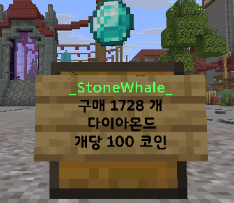

# 📦 체스트샵

> **📌 30초 핵심 요약**
> * **경제 시스템**: **[🪙 경제 명령어](./)** | **[🛒 상점](03-2.md)** | **[⚖️ 경매장](03-3.md)**
> * **24시간 무인 개인 상점**: 상자·통·셜커 상자 위에 3D 실물 홀로그램이 뜨며 주인이 오프라인이어도 자동 거래됩니다.
> * **보호 필수**: 외부인 파괴·도난 방지를 위해 **[🏰 마을](../04..md)** 보호 구역 내부에 설치하세요.

<table>
  <tr>
    <td align="center"></td>
    <td align="center"></td>
  </tr>
</table>

---

## 📑 목차 바로가기

1. [🛠️ 체스트샵 개설 및 이용 방법](#1-️-체스트샵-개설-및-이용-방법)
2. [⚙️ 상점 관리 및 핵심 명령어](#2-️-상점-관리-및-핵심-명령어)

---

## 1. 🛠️ 체스트샵 개설 및 이용 방법

* **개설 4단계 (상점주)**:
  1. 안전한 구역에 **일반 상자 · 통 · 셜커 상자** 설치 후 판매할 물품을 안에 넣습니다.
  2. 등록할 아이템을 손에 든 채 **상자를 좌/우클릭**합니다.
  3. 채팅창 안내에 따라 **1개당 단가(숫자)**를 입력하면 개설 완료! *(예: `500` 입력)*
* **구매자 이용 방법**:
  * **좌클릭**: 품목, 단가, 주인, 잔여 재고 상세 정보 채팅 출력
  * **우클릭**: 채팅창에 **구매 수량(숫자)** 입력 시 즉시 결제 및 지급

---

## 2. ⚙️ 상점 관리 및 핵심 명령어

* **재고 관리**: 상점 주인은 일반 상자처럼 우클릭해 재고를 넣고 뺄 수 있으며 *(재고 0개 시 홀로그램 `품절 (Out of Stock)` 표시)*, 부착된 표지판을 우클릭해 옵션을 조작할 수 있습니다.
* *(※ 매입 상점 운영 시 유저에게 지급할 충분한 코인을 계좌에 보유해야 정상 매입됩니다.)*

| 한글 명령어 | 기본 명령어 | 사용 형식 *(상자를 바라보고 입력)* | 설명 |
| :--- | :--- | :--- | :--- |
| **`/구매상자`** | `/qs buy` | `/구매상자`, `/구매상점` | **매입 모드** 전환 (유저들에게서 지정 단가로 아이템 구매) |
| **`/판매상자`** | `/qs sell` | `/판매상자`, `/판매상점` | **판매 모드** 전환 (유저들에게 아이템 판매) |
| **`/가격`** | `/qs amount` | `/가격 <금액>` | 개당 거래 가격 수정 *(예: `/가격 1200`)* |
| **`/상점지우기`** | `/qs remove` | `/상점지우기` | 체스트샵 해제 및 일반 상자로 환원 |
| **`/체스트샵`** | `/qs`, `/quickshop` | `/체스트샵` | 체스트샵 도움말 및 관리 기능 확인 |
