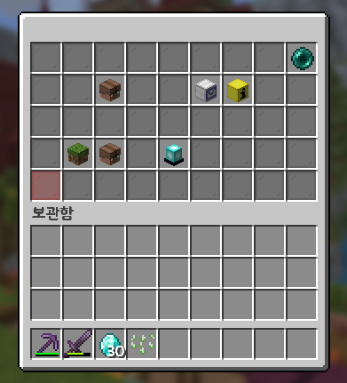
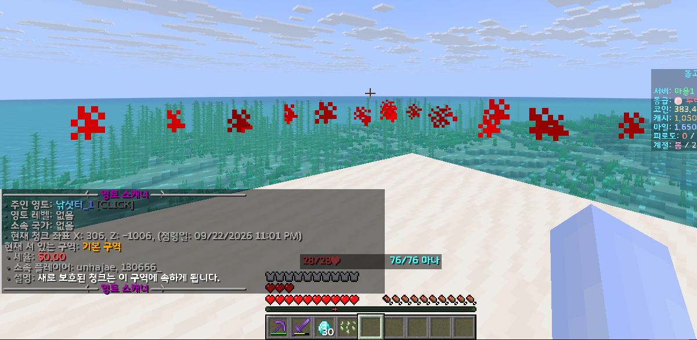

# 🏰 마을 시스템

<figure><figcaption></figcaption></figure>

> **📌 30초 핵심 요약**
> * **핵심 명령어**: `/마을` (`/lands`, `/l`, `/akdmf`) · 즉시 귀환 **`/마을스폰`** (영타 `/akdmfmvmhs`)
> * **영토 보호**: 마을을 만들면 현재 서 있는 청크(16×16)가 첫 영토이자 스폰으로 설정되어 약탈을 원천 차단합니다.
> * **확장 비용**: 신규 청크 점유는 기본 **10,000원**부터 시작해 확장마다 **1.1배**씩 증가합니다 (`10,000 ➔ 11,000 ➔ 12,100 ...`).


**💡 명령어를 다 외우실 필요가 없습니다!**  
`/마을` GUI에서 클릭만으로 대부분 관리할 수 있으며, 처음에는 `/마을 생성`과 `/마을 점유` 두 가지만 아셔도 충분합니다.


<!-- [🎬 GIF 추천 #3] /마을 생성 및 /마을 점유 시 청크 경계선 파티클 표시 3초 컷 -->

---

## 📑 목차 바로가기

1. [🚩 영토 생성 · 점유 · 경계선 확인](#1--영토-생성--점유--경계선-확인)
2. [👥 주민 · 초대 응답 · 스폰 이동 · 마을 관리 명령어](#2--주민--초대-응답--스폰-이동--마을-관리-명령어)

---

## 1. 🚩 영토 생성 · 점유 · 경계선 확인

<figure><figcaption></figcaption></figure>

| 기능 | 한글 명령어 | 기본 영문 명령어 | 설명 |
| :--- | :--- | :--- | :--- |
| **메인 메뉴** | `/마을` (`/l`, `/akdmf`) | `/lands` | 토지, 주민, 설정 통합 GUI 창 열기 |
| **마을 생성 / 캠프** | `/마을 생성 <이름>` / `/마을 캠프생성` | `/lands create <이름>` / `createcamp` | 정식 마을 또는 소규모 임시 거점 생성 *(초기 1청크+스폰 자동 지정)* |
| **영토 점유 / 해제** | `/마을 점유` (`/마을 확장`) / `점유해제` | `/lands claim` / `/lands unclaim` | 현재 16×16 청크를 영토로 점유하거나 야생으로 반환 |
| **점유 목록 / 경계 / 지도** | `/마을 점유목록` · `경계` · `지도` | `/lands claimlist` · `view` · `map` | 점유 좌표 조회, 16×16 파티클 토글, 주변 청크 미니맵 출력 |

* 기본 영문 축약(`/land create`, `/land claim`, `/land trust`, `/land untrust`, `/land view`, `/land info`, `/land ban`) 및 타 채널 유저 닉네임 탭 자동완성도 지원됩니다.

---

## 2. 👥 주민 · 초대 응답 · 스폰 이동 · 마을 관리 명령어

* **안전 텔레포트 연동**: `/마을스폰` 등 마을 이동 시 인벤토리가 선저장된 후 웜업을 거쳐 안전하게 이동합니다 *(대기 중 움직이거나 피격 시 취소)*.

| 분류 | 한글 명령어 | 기본 영문 명령어 | 설명 |
| :--- | :--- | :--- | :--- |
| **주민 관리** | `/마을 초대 <닉>` · `/마을 추방 <닉>` | `/lands trust` · `/lands untrust` | 마을 주민 초대 및 추방(권한 박탈) |
| **역할 · 소유권 · 조회** | `/마을 역할변경` · `소유권이전` · `유저` | `/lands setrole` · `setowner` · `player` | 역할(관리자 등) 지정, 촌장 양도, 유저 소속/기여도 조회 |
| **초대 응답 · 탈퇴 · 채팅** | `/마을 수락` · `거절` · `초대목록` · `탈퇴` · `채팅` | `/lands accept` · `deny` · `invites` · `leave` · `chat` | 초대 수락/거절, 초대장 확인, 탈퇴, 마을 비공개 채팅 토글 |
| **스폰 이동 · 탈출** | **`/마을스폰`** · `/마을 스폰변경` · `탈출` · `야생` | `/lands spawn` · `setspawn` · `unstuck` · `wild` | 마을 스폰 귀환·변경, 남의 마을/벽 갇힘 탈출, 야생 이동 |
| **운영 · 플래그 · 랭킹** | `/마을 메뉴` · `정보` · `목록` · `랭킹` · `편집` · `이름변경` · `삭제` | `/lands menu` · `info` · `list` · `top` · `edit` · `rename` · `delete` | 세금·플래그(폭발/화재/스폰) 편집, 목록/TOP 랭킹, 개명/삭제 |
