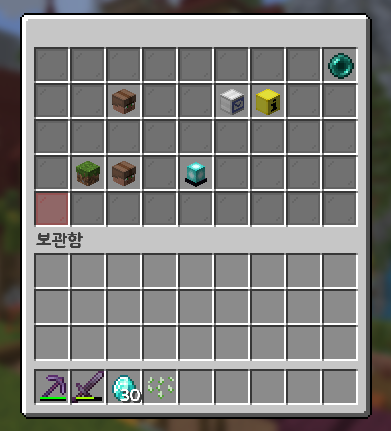

# 🏰 마을 시스템

<figure><figcaption></figcaption></figure>

> **안내**: 내 소중한 건축물과 창고를 테러와 약탈로부터 100% 안전하게 지키고, 친구들과 함께 거대한 제국을 건설할 수 있는 **마을 시스템** 가이드입니다.  
> 서버 전용 한글 명령어가 지원되어 복잡한 영문 명령어 대신 **/마을** 단축키 하나로 모든 토지 설정, 확장, 주민 초대, 스폰 이동이 가능합니다.

---

## 📑 목차 바로가기
1. [🚪 마을 메인 메뉴 열기 (`/마을`, `/lands`)](#1--마을-메인-메뉴-열기-마을-lands)
2. [🏗️ 내 마을 만들기 & 캠프 생성](#2-️-내-마을-만들기--캠프-생성)
3. [🚩 영토 점유 & 확장 & 경계선 확인 (`/마을 점유`, `/마을 경계`)](#3--영토-점유--확장--경계선-확인-마을-점유-마을-경계)
4. [👥 주민 초대 & 역할 설정 & 소유권 이전](#4--주민-초대--역할-설정--소유권-이전)
5. [📬 초대 응답 & 마을 탈퇴 & 마을 채팅](#5--초대-응답--마을-탈퇴--마을-채팅)
6. [🚀 마을 스폰 이동 & 안전 탈출 (`/마을스폰`, `/마을 탈출`)](#6--마을-스폰-이동--안전-탈출-마을스폰-마을-탈출)
7. [⚙️ 마을 관리 · 플래그 편집 · 랭킹](#7-️-마을-관리--플래그-편집--랭킹)

---

## 1. 🚪 마을 메인 메뉴 열기 (`/마을`, `/lands`)

채팅창에 **/마을**을 입력하면 토지 점유, 주민 관리, 설정 등을 마우스 클릭으로 손쉽게 조작할 수 있는 전용 GUI가 열립니다.

<table>
  <thead>
    <tr>
      <th width="200">명령어</th>
      <th width="180">alias</th>
      <th width="140">기능</th>
      <th>설명</th>
    </tr>
  </thead>
  <tbody>
    <tr>
      <td><strong>/lands</strong></td>
      <td><code>/마을</code>, <code>/l</code>, <code>/akdmf</code></td>
      <td>메인 메뉴 열기</td>
      <td>마을 관리, 설정, 영토 현황을 한눈에 볼 수 있는 메인 GUI를 엽니다.</td>
    </tr>
  </tbody>
</table>

<이미지> *(마을 메인 통합 GUI 화면)*

---

## 2. 🏗️ 내 마을 만들기 & 캠프 생성

토지를 점유하여 외부 플레이어의 블록 파괴 및 보관함 열람을 차단하려면 마을을 생성해야 합니다.

<table>
  <thead>
    <tr>
      <th width="200">명령어</th>
      <th width="180">alias</th>
      <th width="140">기능</th>
      <th>설명</th>
    </tr>
  </thead>
  <tbody>
    <tr>
      <td><strong>/lands create &lt;이름&gt;</strong></td>
      <td><code>/마을 생성 &lt;이름&gt;</code>, <code>/마을 todtjd</code></td>
      <td>정식 마을 생성</td>
      <td>현재 서 있는 위치를 중심으로 새로운 정식 마을을 생성합니다.</td>
    </tr>
    <tr>
      <td><strong>/lands createcamp</strong></td>
      <td><code>/마을 캠프생성</code>, <code>/마을 zoaQmtodtjd</code></td>
      <td>임시 캠프 생성</td>
      <td>소규모 임시 거점(캠프)을 생성하여 즉시 토지를 보호합니다.</td>
    </tr>
  </tbody>
</table>

* **초기 생성 시 주의**: 마을을 생성하면 현재 서 있는 청크(16×16 블록)가 자동으로 마을의 첫 번째 영토가 되며, 해당 위치가 기본 마을 스폰으로 설정됩니다.

---

## 3. 🚩 영토 점유 & 확장 & 경계선 확인 (`/마을 점유`, `/마을 경계`)

주변 청크를 마을 영토로 추가 점유할 수 있습니다.
* **토지 확장 비용**: 신규 청크 확장 시 기본 10,000원부터 시작하며, 확장 횟수마다 1.1배씩 비용이 증가합니다 (10,000원 ➔ 11,000원 ➔ 12,100원 ...).
* 기본 영문 명령어(<code>/land create</code>, <code>/land claim</code>, <code>/land trust</code>, <code>/land untrust</code>, <code>/land view</code>, <code>/land info</code>, <code>/land ban</code>)도 동일하게 사용할 수 있습니다.

<table>
  <thead>
    <tr>
      <th width="200">명령어</th>
      <th width="180">alias</th>
      <th width="140">기능</th>
      <th>설명</th>
    </tr>
  </thead>
  <tbody>
    <tr>
      <td><strong>/lands claim</strong></td>
      <td><code>/마을 점유</code>, <code>/마을 확장</code>, <code>/마을 wjadb</code></td>
      <td>현재 청크 점유</td>
      <td>현재 서 있는 청크(16×16)를 내 마을 영토로 즉시 확장 점유합니다.</td>
    </tr>
    <tr>
      <td><strong>/lands unclaim</strong></td>
      <td><code>/마을 점유해제</code>, <code>/마을 wjadbgowp</code></td>
      <td>영토 점유 해제</td>
      <td>현재 서 있는 청크의 점유를 취소하여 일반 야생으로 되돌립니다.</td>
    </tr>
    <tr>
      <td><strong>/lands claimlist</strong></td>
      <td><code>/마을 점유목록</code>, <code>/마을 wjadbahrfhr</code></td>
      <td>점유 목록 확인</td>
      <td>내 마을이 점유하고 있는 모든 청크 좌표 목록을 확인합니다.</td>
    </tr>
    <tr>
      <td><strong>/lands view</strong></td>
      <td><code>/마을 경계</code>, <code>/마을 rurdP</code></td>
      <td>경계선 표시 토글</td>
      <td>현재 서 있는 영토의 16×16 경계선 파티클을 켜거나 끕니다.</td>
    </tr>
    <tr>
      <td><strong>/lands map</strong></td>
      <td><code>/마을 지도</code>, <code>/마을 wleh</code></td>
      <td>주변 지도 출력</td>
      <td>채팅창에 내 주변 청크 점유 현황을 미니맵 기호로 출력합니다.</td>
    </tr>
  </tbody>
</table>

<이미지> *(토지 경계선 파티클 시각화 화면 및 채팅창 미니맵)*

---

## 4. 👥 주민 초대 & 역할 설정 & 소유권 이전

마을에 주민을 초대하고 역할을 설정하여 권한을 분담할 수 있습니다.  
서버 간 동기화가 지원되므로 다른 채널 또는 서버에 접속 중인 유저의 닉네임도 탭(Tab) 자동완성으로 입력할 수 있습니다.

<table>
  <thead>
    <tr>
      <th width="200">명령어</th>
      <th width="180">alias</th>
      <th width="140">기능</th>
      <th>설명</th>
    </tr>
  </thead>
  <tbody>
    <tr>
      <td><strong>/lands trust &lt;닉네임&gt;</strong></td>
      <td><code>/마을 초대 &lt;닉네임&gt;</code>, <code>/마을 cheo</code></td>
      <td>주민 초대</td>
      <td>대상 유저에게 마을 초대장을 보내며, 수락 시 마을 이용 권한이 부여됩니다.</td>
    </tr>
    <tr>
      <td><strong>/lands untrust &lt;닉네임&gt;</strong></td>
      <td><code>/마을 추방 &lt;닉네임&gt;</code>, <code>/마을 cnqkd</code></td>
      <td>주민 추방</td>
      <td>소속된 주민을 추방하고 마을 영토 접근 및 건축 권한을 박탈합니다.</td>
    </tr>
    <tr>
      <td><strong>/lands setrole &lt;닉네임&gt; &lt;역할&gt;</strong></td>
      <td><code>/마을 역할변경</code>, <code>/마을 durgkfqurud</code></td>
      <td>주민 역할 변경</td>
      <td>주민의 역할(관리자, 일반 주민 등)을 변경하여 권한을 세분화합니다.</td>
    </tr>
    <tr>
      <td><strong>/lands setowner &lt;닉네임&gt;</strong></td>
      <td><code>/마을 소유권이전</code>, <code>/마을 thdbRnjsdlwjs</code></td>
      <td>촌장 권한 양도</td>
      <td>마을의 최고 소유권(촌장 지위)을 다른 유저에게 완전히 넘깁니다.</td>
    </tr>
    <tr>
      <td><strong>/lands player [닉네임]</strong></td>
      <td><code>/마을 유저</code>, <code>/마을 dbwj</code></td>
      <td>유저 정보 조회</td>
      <td>대상 유저가 소속된 마을, 역할, 기여도 정보를 조회합니다.</td>
    </tr>
  </tbody>
</table>

---

## 5. 📬 초대 응답 & 마을 탈퇴 & 마을 채팅

타 마을 초대 수락/거절, 탈퇴 및 마을 전용 채팅 기능입니다.

<table>
  <thead>
    <tr>
      <th width="200">명령어</th>
      <th width="180">alias</th>
      <th width="140">기능</th>
      <th>설명</th>
    </tr>
  </thead>
  <tbody>
    <tr>
      <td><strong>/lands accept [마을]</strong></td>
      <td><code>/마을 수락</code>, <code>/마을 tnfkr</code></td>
      <td>마을 초대 수락</td>
      <td>도착한 마을 초대를 수락하고 해당 마을의 주민으로 가입합니다.</td>
    </tr>
    <tr>
      <td><strong>/lands deny [마을]</strong></td>
      <td><code>/마을 거절</code>, <code>/마을 rjwejf</code></td>
      <td>마을 초대 거절</td>
      <td>도착한 마을 초대를 거절합니다.</td>
    </tr>
    <tr>
      <td><strong>/lands invites</strong></td>
      <td><code>/마을 초대목록</code>, <code>/마을 cheoahrfhr</code></td>
      <td>초대 목록 확인</td>
      <td>현재 내게 도착한 마을 초대 목록을 GUI로 확인합니다.</td>
    </tr>
    <tr>
      <td><strong>/lands leave</strong></td>
      <td><code>/마을 탈퇴</code>, <code>/마을 xkfxhl</code></td>
      <td>소속 마을 탈퇴</td>
      <td>현재 소속되어 있는 마을에서 탈퇴합니다.</td>
    </tr>
    <tr>
      <td><strong>/lands chat</strong></td>
      <td><code>/마을 채팅</code>, <code>/마을 codxld</code></td>
      <td>마을 채팅 토글</td>
      <td>마을 주민들끼리만 소통하는 비공개 마을 채널 채팅을 켜거나 끕니다.</td>
    </tr>
  </tbody>
</table>

---

## 6. 🚀 마을 스폰 이동 & 안전 탈출 (`/마을스폰`, `/마을 탈출`)

서버의 텔레포트 보호 시스템이 연동되어 있어, 마을 이동 시 **인벤토리가 100% 안전하게 선저장**된 후 웜업을 거쳐 순간이동합니다.

<table>
  <thead>
    <tr>
      <th width="200">명령어</th>
      <th width="180">alias</th>
      <th width="140">기능</th>
      <th>설명</th>
    </tr>
  </thead>
  <tbody>
    <tr>
      <td><strong>/lands spawn</strong></td>
      <td><strong>/마을스폰</strong>, <code>/마을 스폰이동</code></td>
      <td>마을 스폰 이동</td>
      <td>내 마을 또는 지정된 마을의 스폰 지점으로 안전하게 순간이동합니다.</td>
    </tr>
    <tr>
      <td><strong>/lands setspawn</strong></td>
      <td><code>/마을 스폰변경</code>, <code>/마을 tmvhsqusrud</code></td>
      <td>스폰 지점 변경</td>
      <td>현재 서 있는 위치를 내 마을의 새로운 스폰 지점으로 지정합니다.</td>
    </tr>
    <tr>
      <td><strong>/lands unstuck</strong></td>
      <td><code>/마을 탈출</code>, <code>/마을 xkfcnf</code></td>
      <td>갇힘 안전 탈출</td>
      <td>권한이 없는 남의 마을이나 벽 속에 갇혔을 때 가장 가까운 야생으로 안전하게 탈출합니다.</td>
    </tr>
    <tr>
      <td><strong>/lands wild</strong></td>
      <td><code>/마을 야생</code>, <code>/마을 ditod</code></td>
      <td>마을 야생 이동</td>
      <td>마을과 연결된 안전한 야생 구역으로 순간이동합니다.</td>
    </tr>
  </tbody>
</table>

* 💡 **단축키 안내**: 이동할 때는 긴 명령어 대신 **/마을스폰** (영타 `/akdmfmvmhs`) 단축 명령어로 가장 빠르게 이동할 수 있습니다!
* ⚠️ **순간이동 주의사항**: 이동 대기 시간 동안 움직이거나 피격당하면 이동이 취소되므로 제자리에 서 계셔야 합니다!

---

## 7. ⚙️ 마을 관리 · 플래그 편집 · 랭킹

<table>
  <thead>
    <tr>
      <th width="200">명령어</th>
      <th width="180">alias</th>
      <th width="140">기능</th>
      <th>설명</th>
    </tr>
  </thead>
  <tbody>
    <tr>
      <td><strong>/lands menu</strong></td>
      <td><code>/마을 메뉴</code>, <code>/마을 apsb</code></td>
      <td>상세 관리창 열기</td>
      <td>마을 설정, 세금, 플래그를 관리하는 종합 창을 엽니다.</td>
    </tr>
    <tr>
      <td><strong>/lands info [마을]</strong></td>
      <td><code>/마을 정보</code>, <code>/마을 wjdqh</code></td>
      <td>마을 정보 조회</td>
      <td>현재 서 있는 땅 또는 지정 마을의 영토 크기, 촌장, 주민 수를 확인합니다.</td>
    </tr>
    <tr>
      <td><strong>/lands list</strong></td>
      <td><code>/마을 목록</code>, <code>/마을 ahrfhr</code></td>
      <td>전체 마을 목록</td>
      <td>서버에 등록된 전체 마을 목록을 페이지별로 열람합니다.</td>
    </tr>
    <tr>
      <td><strong>/lands top</strong></td>
      <td><code>/마을 랭킹</code>, <code>/마을 fodzld</code></td>
      <td>마을 랭킹 확인</td>
      <td>영토 규모, 주민 수, 레벨을 종합한 마을 TOP 랭킹을 확인합니다.</td>
    </tr>
    <tr>
      <td><strong>/lands edit</strong></td>
      <td><code>/마을 편집</code>, <code>/마을 vusewlq</code></td>
      <td>플래그 설정 편집</td>
      <td>마을 내 화재 확산, 폭발 피해, 몬스터 스폰 등 플래그를 설정합니다.</td>
    </tr>
    <tr>
      <td><strong>/lands rename &lt;이름&gt;</strong></td>
      <td><code>/마을 이름변경</code>, <code>/마을 dlfmaqurud</code></td>
      <td>마을 이름 변경</td>
      <td>내 마을의 이름을 새로운 이름으로 변경합니다.</td>
    </tr>
    <tr>
      <td><strong>/lands delete</strong></td>
      <td><code>/마을 삭제</code>, <code>/마을 tkrwp</code></td>
      <td>마을 영구 삭제</td>
      <td>내 마을을 해체하고 모든 영토 점유를 초기화합니다.</td>
    </tr>
  </tbody>
</table>
