# ⚒️ 아이템 및 조합법

> **📌 30초 핵심 요약**
> * **수급 범위**: 3×3 작업대 압축 바구니/금속 블록 · 차원 특수 광석 제련 · 1~5티어 합금 12종 · 농경 설비 · 수중 통발 6단계 · 전문 설비 3종
> * **조합 이미지 보기**: 각 섹션 하단의 **접기 토글(`🖼️ 조합법 이미지 펼쳐보기`)**을 클릭하면 인게임 제작 화면을 확인할 수 있습니다.

---

## 📑 목차 바로가기

1. [🧺 압축 보관 바구니 · 금속 블록 & 차원 광석 제련](#1--압축-보관-바구니--금속-블록--차원-광석-제련)
2. [🧪 1~5티어 합금 혼합물 & 용광로 제련표 (12종)](#2--15티어-합금-혼합물--용광로-제련표-12종)
3. [🌾 농경 설비 & 농사 도구 (스프링클러 · 물뿌리개 · 온실)](#3--농경-설비--농사-도구-스프링클러--물뿌리개--온실)
4. [🐟 수중 통발 (물고기 덫 6단계)](#4--수중-통발-물고기-덫-6단계)
5. [🪨 특수 작업대 및 핵심 설비 (3종)](#5--특수-작업대-및-핵심-설비-3종)

---

## 1. 🧺 압축 보관 바구니 · 금속 블록 & 차원 광석 제련

* **9개 상호 압축**: 3×3 작업대에 9개를 채워 압축하며, 제작대에 올리면 언제든 9개로 분해됩니다.
  * **농작물/기타**: `순무·계란·감자·당근 바구니`, `씨앗 묶음`, `사탕수수 묶음(예정)`, `석탄 블록(숯 × 9)`, `화약 블록(화약 × 9)`
  * **커스텀 금속 6종 (원석 블록·주괴 블록)**: `주석`, `은`, `니켈`, `텅스텐`, `백금`, `티타늄` — 원석 블록을 화로(10초) 또는 용광로(5초)에 구우면 **주괴 블록 1개**로 일괄 제련!
  * **바닐라 원석 블록 대량 제련**: `철 원석 블록`(6.3 XP) · `금 원석 블록`(9.0 XP) · `구리 원석 블록`(6.3 XP) ➔ 용광로 40초 제련 시 **주괴 블록 1개**
* **🌌 차원 특수 철·금 광석 제련**: **네더 철 광석**, **엔드 철 광석**, **엔드 금 광석**은 일반 채굴 시 `철/금 조각 2~4개`가 드롭되며, **섬세한 손길**로 채굴 후 화로(10초)·용광로(5초)에 구우면 **주괴 1개**(`0.7~1.0 XP`)를 얻습니다.

🖼️ 압축 바구니 · 커스텀 원석/주괴 블록 조합법 이미지 펼쳐보기

<table>
  <thead>
    <tr>
      <th width="160">품목</th>
      <th width="160">재료 (3×3 ×9)</th>
      <th align="center">조합법 이미지</th>
    </tr>
  </thead>
  <tbody>
    <tr><td><strong>순무 바구니</strong></td><td>순무 × 9</td><td align="center">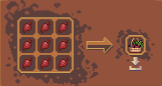</td></tr>
    <tr><td><strong>계란 바구니</strong></td><td>달걀 × 9</td><td align="center">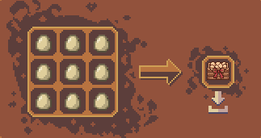</td></tr>
    <tr><td><strong>감자 바구니</strong></td><td>감자 × 9</td><td align="center">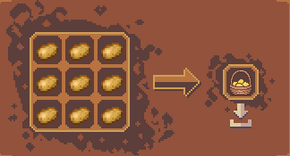</td></tr>
    <tr><td><strong>당근 바구니</strong></td><td>당근 × 9</td><td align="center">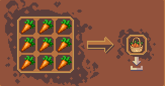</td></tr>
    <tr><td><strong>씨앗 묶음</strong></td><td>밀 씨앗 × 9</td><td align="center">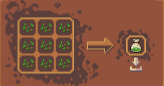</td></tr>
    <tr><td><strong>석탄 블록</strong></td><td>숯 × 9</td><td align="center">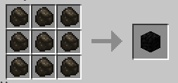</td></tr>
  </tbody>
</table>

<table>
  <thead>
    <tr>
      <th width="120">금속</th>
      <th align="center" width="44%">원석 블록 (원석 × 9)</th>
      <th align="center" width="44%">주괴 블록 (주괴 × 9)</th>
    </tr>
  </thead>
  <tbody>
    <tr><td><strong>주석</strong></td><td align="center">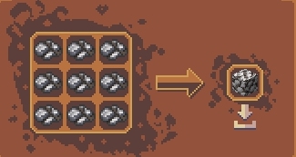</td><td align="center">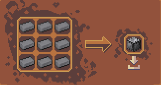</td></tr>
    <tr><td><strong>은</strong></td><td align="center">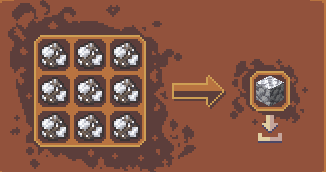</td><td align="center">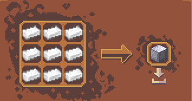</td></tr>
    <tr><td><strong>니켈</strong></td><td align="center">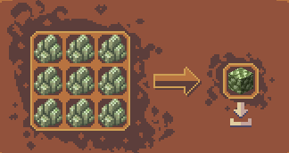</td><td align="center">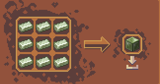</td></tr>
    <tr><td><strong>텅스텐</strong></td><td align="center">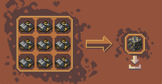</td><td align="center">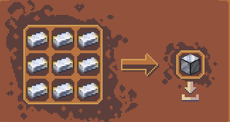</td></tr>
    <tr><td><strong>백금</strong></td><td align="center">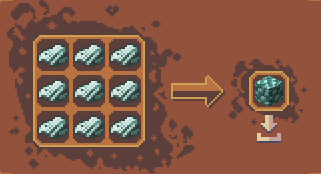</td><td align="center">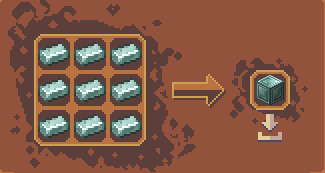</td></tr>
    <tr><td><strong>티타늄</strong></td><td align="center">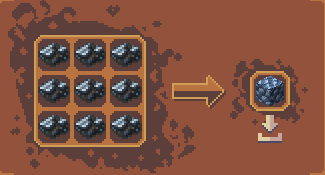</td><td align="center">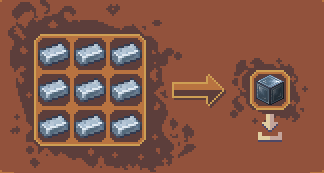</td></tr>
  </tbody>
</table>

---

## 2. 🧪 1~5티어 합금 혼합물 & 용광로 제련표 (12종)

작업대에서 **`주괴 금형 틀`**과 원자재를 무정형 배합해 혼합물을 만든 뒤 **용광로**에 구워 완성합니다 *(1~3티어 광물은 원석·주괴 양방향 배합 지원)*.

| 티어 (시간 / EXP) | 합금 주괴 | 혼합물 무정형 배합 재료 (`주괴 금형 틀` + ...) | 주요 용도 |
| :---: | :--- | :--- | :--- |
| **1티어** (60초 / 40 XP) | ⭐ **강철** | 철 원석(또는 주괴) 2 + 석탄(또는 목탄) 2 | **강철 망치**, +1~5강 강화 |
| **1티어** (60초 / 40 XP) | **청동** | 구리 원석(주괴) 4 + 주석 원석(주괴) 1 | 인바 재료, 기초 기계 |
| **1티어** (60초 / 40 XP) | **일렉트럼** | 금 원석(주괴) 2 + 은 원석(주괴) 2 | 백색금·열합금 재료 |
| **2티어** (180초 / 160 XP) | ⭐ **텅스텐 강철** | 강철 주괴 4 + 텅스텐 원석(주괴) 3 | **텅스텐 망치**, +6~10강, 구슬[4] |
| **2티어** (180초 / 160 XP) | **인바** | 강철 주괴 4 + 청동 주괴 3 + 니켈 원석(주괴) 1 | 열합금 재료 |
| **2티어** (180초 / 160 XP) | **백색금** | 일렉트럼 주괴 4 + 백금 원석(주괴) 3 | 엔더리움 재료, 구슬[5] |
| **3티어** (600초 / 400 XP) | ⭐ **티타늄 합금** | 텅스텐 강철 2 + 티타늄 원석(주괴) 6 | **티타늄 망치**, +11~15강, 오리칼쿰 재료 |
| **3티어** (600초 / 400 XP) | **열합금** | 인바 주괴 3 + 일렉트럼 주괴 1 + 블레이즈 가루 4 | 플라즈마·오리칼쿰 재료, 구슬[5/6] |
| **3티어** (600초 / 400 XP) | **엔더리움** | 백색금 주괴 4 + 엔더 진주 4 | 플라즈마 합금 재료 |
| **4티어** (1,000초 / 1,200 XP) | ⭐ **플라즈마 합금** | 엔더리움 주괴 4 + 열합금 주괴 4 | **플라즈마 망치**, +16~20강, 스텔라리움 재료 |
| **4티어** (1,000초 / 1,200 XP) | **오리칼쿰** | 티타늄 합금 주괴 4 + 열합금 주괴 4 | **스텔라리움 재료**, 구슬[6/7] |
| **5티어** (1,500초 / 11,000 XP) | ⭐ **스텔라리움** | 오리칼쿰 주괴 2 + 플라즈마 합금 주괴 2 | **스텔라리움 망치**, 구슬[7] |

🖼️ 1~5티어 합금 혼합물 12종 작업대 배치 이미지 펼쳐보기

<table>
  <thead>
    <tr>
      <th width="160">합금명</th>
      <th align="center" width="42%">원석(또는 석탄) 배합</th>
      <th align="center" width="42%">주괴(또는 목탄) 배합</th>
    </tr>
  </thead>
  <tbody>
    <tr><td><strong>강철</strong></td><td align="center">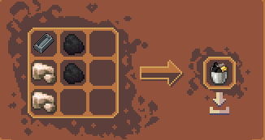</td><td align="center">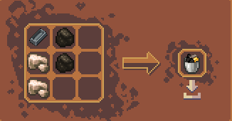</td></tr>
    <tr><td><strong>청동</strong></td><td align="center">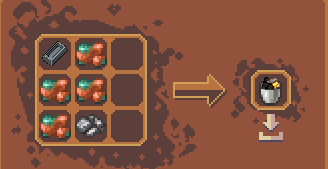</td><td align="center">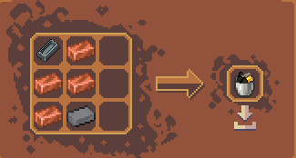</td></tr>
    <tr><td><strong>일렉트럼</strong></td><td align="center">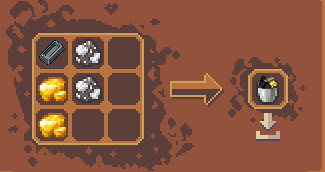</td><td align="center">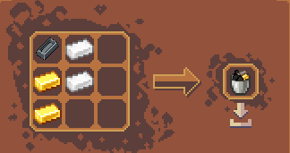</td></tr>
    <tr><td><strong>텅스텐 강철</strong></td><td align="center">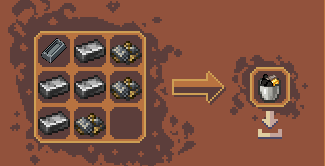</td><td align="center">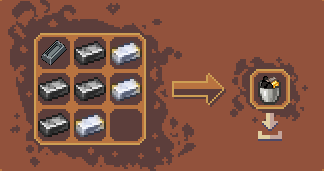</td></tr>
    <tr><td><strong>인바</strong></td><td align="center">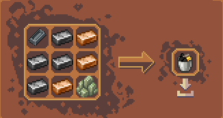</td><td align="center">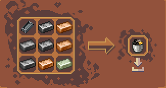</td></tr>
    <tr><td><strong>백색금</strong></td><td align="center">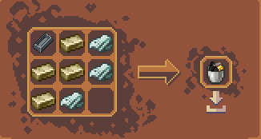</td><td align="center">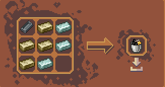</td></tr>
    <tr><td><strong>티타늄 합금</strong></td><td align="center">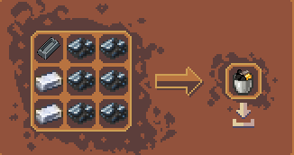</td><td align="center">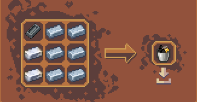</td></tr>
    <tr><td><strong>열합금 / 엔더리움</strong></td><td align="center">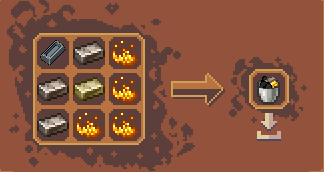</td><td align="center">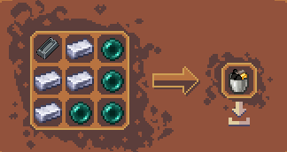</td></tr>
    <tr><td><strong>플라즈마 / 오리칼쿰</strong></td><td align="center">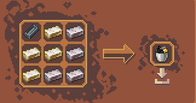</td><td align="center">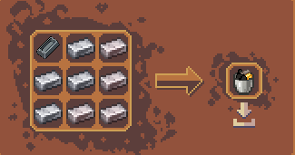</td></tr>
    <tr><td><strong>스텔라리움</strong></td><td align="center" colspan="2">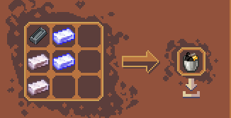</td></tr>
  </tbody>
</table>

---

## 3. 🌾 농경 설비 & 농사 도구 (스프링클러 · 물뿌리개 · 온실)

* **주의**: 1단계 스프링클러 및 1단계 물뿌리개에는 물 양동이가 아닌 **일반 빈 양동이**를 사용합니다.

| 분류 | 티어 / 아이템명 | 필요 재료 총합 |
| :---: | :--- | :--- |
| **스프링클러** | **1단계** / **2단계** / **2.5단계** | **1**: 붉은 네더 벽돌 4 + 돌 4 + 빈 양동이 1 · **2**: 금 블록 8 + 1단계 · **2.5**: 다이아 블록 8 + 2단계 |
| **스프링클러** | **3단계** / **4단계** | **3**: 티타늄 합금 2 + 열합금 1 + 강철 3 + 네더 파편 2 + 2.5단계 · **4**: 백색금 2 + 오리칼쿰 1 + 네더 주괴 2 + 티타늄 합금 3 + 3단계 |
| **물뿌리개** | **1단계** / **2단계 은** | **1**: 구리 주괴 4 + 돌 4 + 빈 양동이 1 · **2**: 청동 4 + 열합금 1 + 강철 2 + 에메랄드 블록 1 + 1단계 |
| **물뿌리개** | **3단계 금** / **4단계 이리듐** | **3**: 강철 4 + 오리칼쿰 1 + 다이아 블록 3 + 2단계 · **4**: 백색금 2 + 플라즈마 합금 1 + 네더 블록 2 + 티타늄 합금 3 + 3단계 |
| **온실 · 밭** | **온실 유리** / **밭 블록** | **온실 유리**: 차광 유리 4 + 다이아 4 + 유리판 1 *(사계절 보호)* · **밭 블록**: 동일 수종 원목 8 + 흙 1 *(10종 지원)* |

🖼️ 스프링클러 · 물뿌리개 · 온실 유리 · 밭 블록 조합법 이미지 펼쳐보기

<table>
  <thead>
    <tr><th width="180">설비 / 도구</th><th align="center">3×3 작업대 조합법</th></tr>
  </thead>
  <tbody>
    <tr><td><strong>1단계 스프링클러</strong></td><td align="center">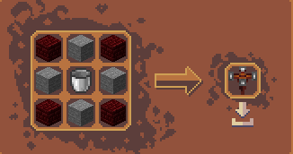</td></tr>
    <tr><td><strong>2단계 중급 스프링클러</strong></td><td align="center">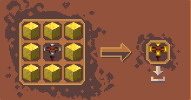</td></tr>
    <tr><td><strong>2.5단계 강화 중급</strong></td><td align="center">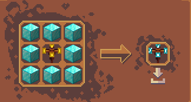</td></tr>
    <tr><td><strong>3단계 고급 스프링클러</strong></td><td align="center">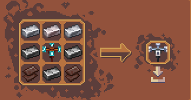</td></tr>
    <tr><td><strong>4단계 최고급 스프링클러</strong></td><td align="center">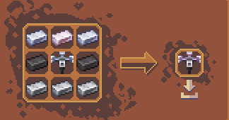</td></tr>
    <tr><td><strong>1단계 물뿌리개</strong></td><td align="center">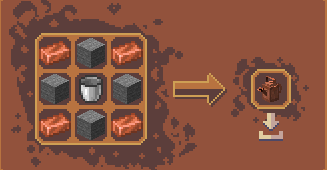</td></tr>
    <tr><td><strong>2단계 은 물뿌리개</strong></td><td align="center">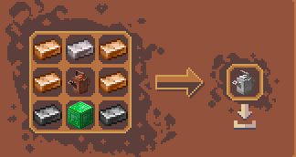</td></tr>
    <tr><td><strong>3단계 금 물뿌리개</strong></td><td align="center">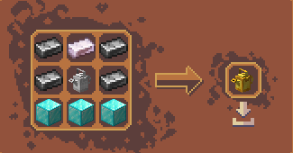</td></tr>
    <tr><td><strong>4단계 이리듐 물뿌리개</strong></td><td align="center">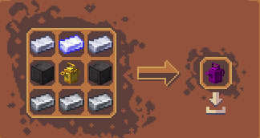</td></tr>
    <tr><td><strong>온실 유리</strong></td><td align="center">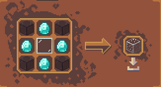</td></tr>
    <tr><td><strong>밭 블록 (원목 화분)</strong></td><td align="center">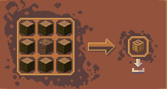</td></tr>
  </tbody>
</table>

---

## 4. 🐟 수중 통발 (물고기 덫 6단계)

* **공통 조합 공식 (3×3 형태 조합)**: **외곽 네 모서리 등급 블록 × 4** + **상하좌우 실 × 4** + **중앙 열대어 × 1**

| 통발 등급 | 네 모서리 재료 (×4) | 회수 시간 | 어부 EXP | 주요 어획물 & 추가 보상 |
| :--- | :--- | :---: | :---: | :--- |
| **1단계: 청동 통발** | 구리 블록 | 30분 | **150 EXP** | 브론즈 미끼(30%), 브론즈 물고기(70%) |
| **2단계: 은 통발** | 철 블록 | 1시간 | **250 EXP** | 실버 미끼(10%), 브론즈~실버 물고기 |
| **3단계: 금 통발** | 금 블록 | 1.5시간 | **400 EXP** | 골드 미끼(10%), 브론즈~골드 물고기, 1티어 합금 주괴 |
| **4단계: 다이아몬드 통발** | 다이아몬드 블록 | 2시간 | **650 EXP** | 다이아몬드 미끼(5%), 실버~다이아 물고기, 1티어 합금 주괴 |
| **5단계: 플래티넘(백금) 통발** | 백금 블록 | 8시간 | **950 EXP** | 플래티넘 미끼(2%), 실버~플래티넘 물고기, 2티어 합금 주괴 |
| **6단계: 신화 통발** | 자수정 꽃봉오리 | 12시간 | **1,500 EXP** | 신화 미끼(0.5%), 골드~신화 물고기, 3~4티어 합금 주괴 |

🖼️ 1~6단계 수중 통발 조합법 이미지 펼쳐보기

<table>
  <thead>
    <tr><th width="180">통발 단계</th><th align="center">3×3 작업대 조합법</th></tr>
  </thead>
  <tbody>
    <tr><td><strong>1단계 청동 통발</strong></td><td align="center">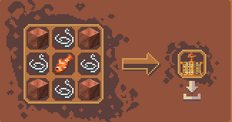</td></tr>
    <tr><td><strong>2단계 은 통발</strong></td><td align="center">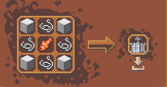</td></tr>
    <tr><td><strong>3단계 금 통발</strong></td><td align="center"></td></tr>
    <tr><td><strong>4단계 다이아몬드 통발</strong></td><td align="center"></td></tr>
    <tr><td><strong>5단계 플래티넘 통발</strong></td><td align="center"></td></tr>
    <tr><td><strong>6단계 신화 통발</strong></td><td align="center"></td></tr>
  </tbody>
</table>

---

## 5. 🪨 특수 작업대 및 핵심 설비 (3종)

| 설비명 | 형태 조합 배치 | 주요 기능 |
| :--- | :--- | :--- |
| **커스텀 양조기** | 중앙 `양조기` 1 + 상·하 `엔드 수정` 각 1 (총 2) | 연료 없이 **[연금술사](06-2-2.md)** 특수 포션 제조 |
| **커스텀 마법부여대** | 중앙 `마법부여대` 1 + 상·하 `네더라이트 주괴` 각 1 (총 2) | **[마법부여사](06-2-3.md)** 5×5 마법진 연성·도박 |
| **네더라이트 모루** | 중앙 `모루` 1 + 상하좌우 `네더라이트 주괴` 각 1 (총 4) | **[대장장이](06-2-1.md)** 수리·정동석 가공 & **[장비 강화](09-4.md)** |

🖼️ 특수 작업대 3종 조합법 · 외형 · GUI 이미지 펼쳐보기

<table>
  <thead>
    <tr><th width="140">설비</th><th align="center">제작 조합법</th><th align="center">설치 외형</th><th align="center">전용 GUI</th></tr>
  </thead>
  <tbody>
    <tr><td><strong>커스텀 양조기</strong></td><td align="center"></td><td align="center"></td><td align="center"></td></tr>
    <tr><td><strong>커스텀 마법부여대</strong></td><td align="center"></td><td align="center"></td><td align="center"></td></tr>
    <tr><td><strong>네더라이트 모루</strong></td><td align="center"></td><td align="center"></td><td align="center"></td></tr>
  </tbody>
</table>

