# ⚒️ 아이템 및 조합법

> **안내**: 서버 내 커스텀 아이템 및 CraftEngine 3×3 작업대, 용광로, 특수 설비의 제작 조합법 목록입니다.  
> 직업 활동과 야생에서 획득한 원자재로 특수 설비, 합금, 도구, 농경/수산업 시설을 제작할 수 있습니다.  
> 🔨 **대장장이 특수 망치 전용 주괴**: 5개 등급 수리 망치에 소모되는 **1~5티어 핵심 합금 주괴**는 **[2. 1~5티어 합금 혼합물 & 용광로 제련표](#2--15티어-합금-혼합물--용광로-제련표)** 최상단에 강조 정리되어 있습니다.

---

## 📑 목차 바로가기

1. [🧺 압축 보관 바구니 & 원석 블록](#1--압축-보관-바구니--원석-블록)
2. [🧪 1~5티어 합금 혼합물 & 용광로 제련표](#2--15티어-합금-혼합물--용광로-제련표)
3. [🌾 농경 설비 & 농사 도구](#3--농경-설비--농사-도구)
4. [🐟 수중 통발 (물고기 덫 6단계)](#4--수중-통발-물고기-덫-6단계)
5. [🪨 특수 작업대 및 핵심 설비](#5--특수-작업대-및-핵심-설비)

---

## 1. 🧺 압축 보관 바구니 & 원석 블록

인벤토리 공간을 절약하고 농작물 및 광물 자원을 9배 단위로 대량 운송·보관·제련합니다.



### 🧺 농작물/아이템 압축 바구니 & 묶음

재료 9개를 3×3 작업대에 가득 채워 1개의 바구니/묶음으로 압축하며, 제작대에 올리면 언제든지 9개로 다시 풀 수 있습니다.

<table>
  <thead>
    <tr>
      <th width="190">압축 아이템명</th>
      <th width="180">조합 재료 (3×3 가득 채움)</th>
      <th align="center">조합법</th>
    </tr>
  </thead>
  <tbody>
    <tr>
      <td><strong>순무 바구니</strong> (<code>beetroot_basket</code>)</td>
      <td>순무 (비트) × 9</td>
      <td align="center">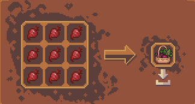</td>
    </tr>
    <tr>
      <td><strong>계란 바구니</strong> (<code>egg_basket</code>)</td>
      <td>달걀 × 9</td>
      <td align="center">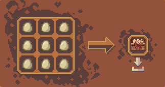</td>
    </tr>
    <tr>
      <td><strong>감자 바구니</strong> (<code>potato_basket</code>)</td>
      <td>감자 × 9</td>
      <td align="center">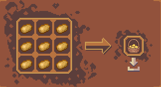</td>
    </tr>
    <tr>
      <td><strong>당근 바구니</strong> (<code>carrot_basket</code>)</td>
      <td>당근 × 9</td>
      <td align="center">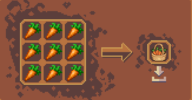</td>
    </tr>
    <tr>
      <td><strong>씨앗 묶음</strong> (<code>bundle_of_seeds</code>)</td>
      <td>밀 씨앗 × 9</td>
      <td align="center">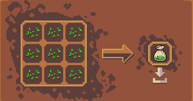</td>
    </tr>
    <tr>
      <td><strong>사탕수수 묶음</strong> (<code>bundle_of_sugarcane</code>)</td>
      <td>사탕수수 × 9</td>
      <td align="center"><em>(사탕수수 9개 3×3 채움)</em></td>
    </tr>
    <tr>
      <td><strong>석탄 블록</strong> (<code>coal_block</code>)</td>
      <td>숯 × 9</td>
      <td align="center">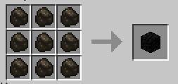</td>
    </tr>
  </tbody>
</table>



### ⛏️ 커스텀 신규 금속 블록 (원석 & 주괴 블록 6종)
신규 금속 원석과 주괴를 9개 단위로 압축하여 대량 보관하거나, 원석 블록을 통째로 화로/용광로에 구워 주괴 블록으로 대량 제련할 수 있습니다.

* **상호 변환**: 원석 9개 ↔ 원석 블록 1개 / 주괴 9개 ↔ 주괴 블록 1개 (제작대에 올려 9개로 언제든 복원 분해 가능)
* **대량 일괄 제련**: 화로(`smelting` 200틱 / 10초) 또는 용광로(`blasting` 100틱 / 5초)에 **원석 블록**을 넣으면 **주괴 블록 1개**로 즉시 제련됩니다.

<table>
  <thead>
    <tr>
      <th width="170">금속 종류</th>
      <th align="center" width="41%">원석 블록 조합법 (원석 × 9)</th>
      <th align="center" width="41%">주괴 블록 조합법 (주괴 × 9)</th>
    </tr>
  </thead>
  <tbody>
    <tr>
      <td>
        <strong>주석 (Tin)</strong> 
        • <code>raw_tin_block</code> 
        • <code>tin_block</code>  
        <em>💡 통째로 제련 시 주석 블록 1개 획득</em>
      </td>
      <td align="center">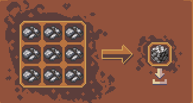</td>
      <td align="center">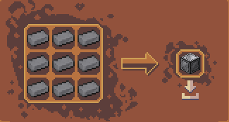</td>
    </tr>
    <tr>
      <td>
        <strong>은 (Silver)</strong> 
        • <code>raw_silver_block</code> 
        • <code>silver_block</code>  
        <em>💡 통째로 제련 시 은 블록 1개 획득</em>
      </td>
      <td align="center">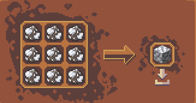</td>
      <td align="center">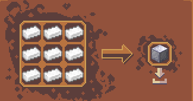</td>
    </tr>
    <tr>
      <td>
        <strong>니켈 (Nickel)</strong> 
        • <code>raw_nickel_block</code> 
        • <code>nickel_block</code>  
        <em>💡 통째로 제련 시 니켈 블록 1개 획득</em>
      </td>
      <td align="center">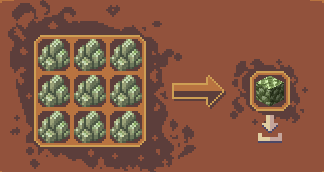</td>
      <td align="center">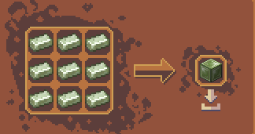</td>
    </tr>
    <tr>
      <td>
        <strong>텅스텐 (Tungsten)</strong> 
        • <code>raw_tungsten_block</code> 
        • <code>tungsten_block</code>  
        <em>💡 통째로 제련 시 텅스텐 블록 1개 획득</em>
      </td>
      <td align="center">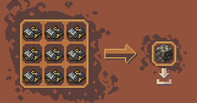</td>
      <td align="center">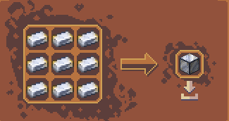</td>
    </tr>
    <tr>
      <td>
        <strong>백금 (Platinum)</strong> 
        • <code>raw_platinum_block</code> 
        • <code>platinum_block</code>  
        <em>💡 통째로 제련 시 백금 블록 1개 획득</em>
      </td>
      <td align="center">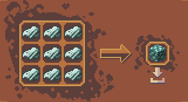</td>
      <td align="center">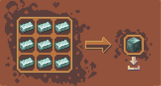</td>
    </tr>
    <tr>
      <td>
        <strong>티타늄 (Titanium)</strong> 
        • <code>raw_titanium_block</code> 
        • <code>titanium_block</code>  
        <em>💡 통째로 제련 시 티타늄 블록 1개 획득</em>
      </td>
      <td align="center">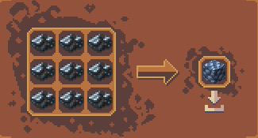</td>
      <td align="center">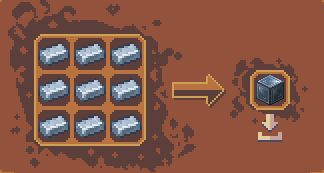</td>
    </tr>
  </tbody>
</table>

### 🌋 바닐라 원석 블록 용광로 대량 제련
* **용광로 대량 제련 (`blasting` 800틱 / 40초)**: 원석 블록을 화로/용광로에 넣고 통째로 구워 주괴 블록을 획득합니다.

<table>
  <thead>
    <tr>
      <th width="190">원석 블록명</th>
      <th width="180">제련 결과 (주괴 블록)</th>
      <th>제련 경험치</th>
    </tr>
  </thead>
  <tbody>
    <tr>
      <td><strong>철 원석 블록</strong> (<code>raw_iron_block</code>)</td>
      <td><strong>철 블록</strong> (<code>iron_block</code>) × 1</td>
      <td>제련 EXP 6.3 XP</td>
    </tr>
    <tr>
      <td><strong>금 원석 블록</strong> (<code>raw_gold_block</code>)</td>
      <td><strong>금 블록</strong> (<code>gold_block</code>) × 1</td>
      <td>제련 EXP 9.0 XP</td>
    </tr>
    <tr>
      <td><strong>구리 원석 블록</strong> (<code>raw_copper_block</code>)</td>
      <td><strong>구리 블록</strong> (<code>copper_block</code>) × 1</td>
      <td>제련 EXP 6.3 XP</td>
    </tr>
  </tbody>
</table>

### 💥 특수 자원 압축 블록
* **화약 블록** (<code>gunpowder_block</code>): 화약 9개 ➔ 화약 블록 1개 / 화약 블록 1개 ➔ 화약 9개 분해



---

## 2. 🧪 1~5티어 합금 혼합물 & 용광로 제련표

합금은 **[1단계: 작업대에서 주괴 금형 틀과 함께 원자재를 무정형 배합해 혼합물 제작]** ➔ **[2단계: 용광로(`blasting`)에 구워 주괴 완성]** 순서로 진행됩니다.  
*(※ 1~3티어 광물은 원석 또는 주괴 양방향 레시피가 모두 지원됩니다.)*



### 🔨 대장장이 특수 수리 망치 전용 핵심 주괴 (1~5티어)

<table>
  <thead>
    <tr>
      <th align="center" width="90">티어</th>
      <th width="220">망치 전용 주괴명</th>
      <th>조합법</th>
    </tr>
  </thead>
  <tbody>
    <tr>
      <td align="center"><strong>1티어</strong></td>
      <td>⭐ <strong>강철 주괴</strong> (Steel Ingot)</td>
      <td><strong>주괴 금형 틀</strong> + 원철 2개 + 석탄(또는 목탄) 2개</td>
    </tr>
    <tr>
      <td align="center"><strong>2티어</strong></td>
      <td>⭐ <strong>텅스텐 강철 주괴</strong> (Tungsten Steel)</td>
      <td><strong>주괴 금형 틀</strong> + 강철 주괴 4개 + 원시 텅스텐 3개</td>
    </tr>
    <tr>
      <td align="center"><strong>3티어</strong></td>
      <td>⭐ <strong>티타늄 합금 주괴</strong> (Titanium Alloy)</td>
      <td><strong>주괴 금형 틀</strong> + 텅스텐 강철 주괴 2개 + 원시 티타늄 6개</td>
    </tr>
    <tr>
      <td align="center"><strong>4티어</strong></td>
      <td>⭐ <strong>플라즈마 합금 주괴</strong> (Plasma Alloy)</td>
      <td><strong>주괴 금형 틀</strong> + 엔더리움 주괴 4개 + 서멀로이 주괴 4개</td>
    </tr>
    <tr>
      <td align="center"><strong>5티어</strong></td>
      <td>⭐ <strong>스텔라리움 주괴</strong> (Stellarium Ingot)</td>
      <td><strong>주괴 금형 틀</strong> + 오리하르콘 주괴 2개 + 플라즈마 합금 주괴 2개</td>
    </tr>
  </tbody>
</table>



### 1티어 기초 합금 (강철 · 청동 · 일렉트럼)

<table>
  <thead>
    <tr>
      <th width="200">합금 주괴명 & 제련 결과</th>
      <th align="center" width="40%">배합 레시피 ① (원석 배합)</th>
      <th align="center" width="40%">배합 레시피 ② (주괴 배합)</th>
    </tr>
  </thead>
  <tbody>
    <tr>
      <td>
        ⭐ <strong>강철 주괴</strong> (Steel Ingot) 
        <strong>[🔨 1단계 망치 재료]</strong>
        

        <strong>용광로 제련</strong>: 
        혼합물 ➔ <strong>강철 주괴</strong> 
        <em>⏱️ 60초 (1200틱) ✨ 40.0 XP</em>
      </td>
      <td align="center">
        <strong>석탄 배합</strong> 
        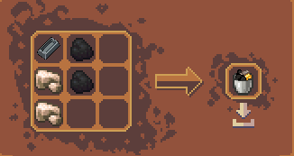 
        <em>금형 틀 + 원철 2 + 석탄 2</em>
      </td>
      <td align="center">
        <strong>목탄 배합</strong> 
        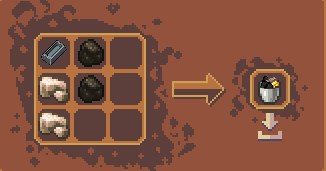 
        <em>금형 틀 + 원철 2 + 목탄 2</em>
      </td>
    </tr>
    <tr>
      <td>
        <strong>청동 주괴</strong> (Bronze Ingot)
        

        <strong>용광로 제련</strong>: 
        혼합물 ➔ <strong>청동 주괴</strong> 
        <em>⏱️ 60초 (1200틱) ✨ 40.0 XP</em>
      </td>
      <td align="center">
        <strong>원석 배합</strong> 
        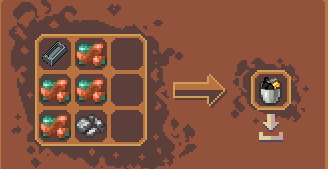 
        <em>금형 틀 + 원시 구리 4 + 원시 주석 1</em>
      </td>
      <td align="center">
        <strong>주괴 배합</strong> 
        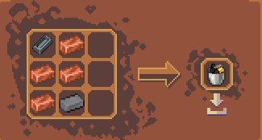 
        <em>금형 틀 + 구리 주괴 4 + 주석 주괴 1</em>
      </td>
    </tr>
    <tr>
      <td>
        <strong>일렉트럼 주괴</strong> (Electrum Ingot)
        

        <strong>용광로 제련</strong>: 
        혼합물 ➔ <strong>일렉트럼 주괴</strong> 
        <em>⏱️ 60초 (1200틱) ✨ 40.0 XP</em>
      </td>
      <td align="center">
        <strong>원석 배합</strong> 
        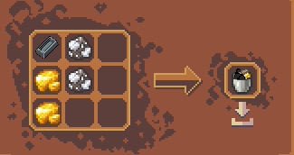 
        <em>금형 틀 + 원시 금 2 + 원시 은 2</em>
      </td>
      <td align="center">
        <strong>주괴 배합</strong> 
        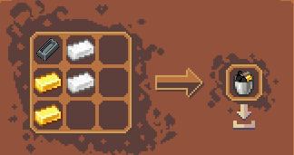 
        <em>금형 틀 + 금 주괴 2 + 은 주괴 2</em>
      </td>
    </tr>
  </tbody>
</table>



### 2티어 중급 합금 (텅스텐 강철 · 인바 · 백색금)

<table>
  <thead>
    <tr>
      <th width="200">합금 주괴명 & 제련 결과</th>
      <th align="center" width="40%">배합 레시피 ① (원석 배합)</th>
      <th align="center" width="40%">배합 레시피 ② (주괴 배합)</th>
    </tr>
  </thead>
  <tbody>
    <tr>
      <td>
        ⭐ <strong>텅스텐 강철 주괴</strong> (Tungsten Steel) 
        <strong>[🔨 2단계 망치 재료]</strong>
        

        <strong>용광로 제련</strong>: 
        혼합물 ➔ <strong>텅스텐 강철 주괴</strong> 
        <em>⏱️ 180초 (3600틱) ✨ 160.0 XP</em>
      </td>
      <td align="center">
        <strong>원석 배합</strong> 
        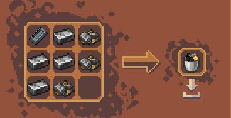 
        <em>금형 틀 + 강철 주괴 4 + 원시 텅스텐 3</em>
      </td>
      <td align="center">
        <strong>주괴 배합</strong> 
        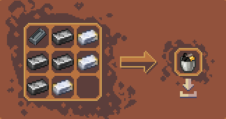 
        <em>금형 틀 + 강철 주괴 4 + 텅스텐 주괴 3</em>
      </td>
    </tr>
    <tr>
      <td>
        <strong>인바 주괴</strong> (Invar Ingot)
        

        <strong>용광로 제련</strong>: 
        혼합물 ➔ <strong>인바 주괴</strong> 
        <em>⏱️ 180초 (3600틱) ✨ 160.0 XP</em>
      </td>
      <td align="center">
        <strong>원석 배합</strong> 
        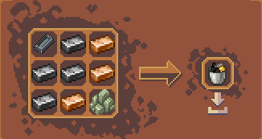 
        <em>금형 틀 + 강철 주괴 4 + 청동 주괴 3 + 원시 니켈 1</em>
      </td>
      <td align="center">
        <strong>주괴 배합</strong> 
        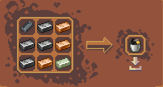 
        <em>금형 틀 + 강철 주괴 4 + 청동 주괴 3 + 니켈 주괴 1</em>
      </td>
    </tr>
    <tr>
      <td>
        <strong>백색금 주괴</strong> (White Gold)
        

        <strong>용광로 제련</strong>: 
        혼합물 ➔ <strong>백색금 주괴</strong> 
        <em>⏱️ 180초 (3600틱) ✨ 160.0 XP</em>
      </td>
      <td align="center">
        <strong>원석 배합</strong> 
        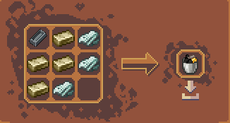 
        <em>금형 틀 + 일렉트럼 주괴 4 + 원시 백금 3</em>
      </td>
      <td align="center">
        <strong>주괴 배합</strong> 
        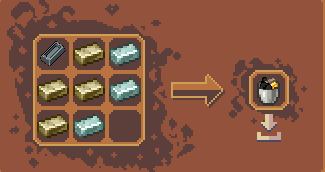 
        <em>금형 틀 + 일렉트럼 주괴 4 + 백금 주괴 3</em>
      </td>
    </tr>
  </tbody>
</table>



### 3티어 상급 합금 (티타늄 합금 · 서멀로이 · 엔더리움)

<table>
  <thead>
    <tr>
      <th width="200">합금 주괴명 & 제련 결과</th>
      <th align="center" width="40%">배합 레시피 ①</th>
      <th align="center" width="40%">배합 레시피 ②</th>
    </tr>
  </thead>
  <tbody>
    <tr>
      <td>
        ⭐ <strong>티타늄 합금 주괴</strong> (Titanium Alloy) 
        <strong>[🔨 3단계 망치 재료]</strong>
        

        <strong>용광로 제련</strong>: 
        혼합물 ➔ <strong>티타늄 합금 주괴</strong> 
        <em>⏱️ 600초 (12000틱) ✨ 400.0 XP</em>
      </td>
      <td align="center">
        <strong>원석 배합</strong> 
        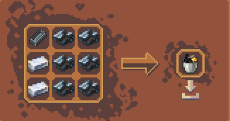 
        <em>금형 틀 + 텅스텐 강철 2 + 원시 티타늄 6</em>
      </td>
      <td align="center">
        <strong>주괴 배합</strong> 
        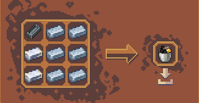 
        <em>금형 틀 + 텅스텐 강철 2 + 티타늄 주괴 6</em>
      </td>
    </tr>
    <tr>
      <td>
        <strong>서멀로이 주괴</strong> (Thermalloy Ingot)
        

        <strong>용광로 제련</strong>: 
        혼합물 ➔ <strong>서멀로이 주괴</strong> 
        <em>⏱️ 600초 (12000틱) ✨ 400.0 XP</em>
      </td>
      <td align="center" colspan="2">
        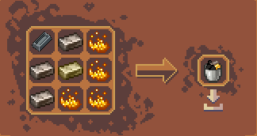 
        <em>금형 틀 + 인바 주괴 3 + 일렉트럼 주괴 1 + 블레이즈 가루 4</em>
      </td>
    </tr>
    <tr>
      <td>
        <strong>엔더리움 주괴</strong> (Enderium Ingot)
        

        <strong>용광로 제련</strong>: 
        혼합물 ➔ <strong>엔더리움 주괴</strong> 
        <em>⏱️ 600초 (12000틱) ✨ 400.0 XP</em>
      </td>
      <td align="center" colspan="2">
        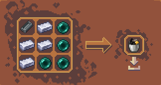 
        <em>금형 틀 + 백색금 주괴 4 + 엔더 진주 4</em>
      </td>
    </tr>
  </tbody>
</table>



### 4티어 최상급 합금 (플라즈마 합금 · 오리하르콘)

<table>
  <thead>
    <tr>
      <th width="240">합금 주괴명 & 제련 결과</th>
      <th align="center">작업대 배합 레시피 (무정형)</th>
    </tr>
  </thead>
  <tbody>
    <tr>
      <td>
        ⭐ <strong>플라즈마 합금 주괴</strong> (Plasma Alloy) 
        <strong>[🔨 4단계 망치 재료]</strong>
        

        <strong>용광로 제련</strong>: 
        혼합물 ➔ <strong>플라즈마 합금 주괴</strong> 
        <em>⏱️ 900초 (18000틱) ✨ 1500.0 XP</em>
      </td>
      <td align="center">
        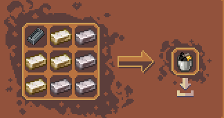 
        <em>금형 틀 + 엔더리움 주괴 4 + 서멀로이 주괴 4</em>
      </td>
    </tr>
    <tr>
      <td>
        <strong>오리하르콘 주괴</strong> (Orichalcum Ingot)
        

        <strong>용광로 제련</strong>: 
        혼합물 ➔ <strong>오리하르콘 주괴</strong> 
        <em>⏱️ 900초 (18000틱) ✨ 1500.0 XP</em>
      </td>
      <td align="center">
        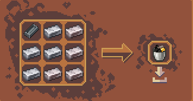 
        <em>금형 틀 + 티타늄 합금 주괴 4 + 서멀로이 주괴 4</em>
      </td>
    </tr>
  </tbody>
</table>



### 5티어 종결 합금 (스텔라리움)

<table>
  <thead>
    <tr>
      <th width="240">합금 주괴명 & 제련 결과</th>
      <th align="center">작업대 배합 레시피 (무정형)</th>
    </tr>
  </thead>
  <tbody>
    <tr>
      <td>
        ⭐ <strong>스텔라리움 주괴</strong> (Stellarium Ingot) 
        <strong>[🔨 5단계 망치 재료]</strong>
        

        <strong>용광로 제련</strong>: 
        혼합물 ➔ <strong>스텔라리움 주괴</strong> 
        <em>⏱️ 1500초 (30000틱) ✨ 11000.0 XP</em>
      </td>
      <td align="center">
        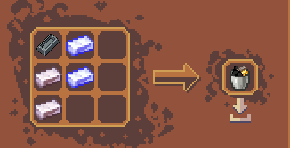 
        <em>금형 틀 + 오리하르콘 주괴 2 + 플라즈마 합금 주괴 2</em>
      </td>
    </tr>
  </tbody>
</table>



---

## 3. 🌾 농경 설비 & 농사 도구

대규모 자동 농업과 작물 성장을 극대화하는 설비 및 도구입니다.



### 💧 스프링클러 티어 업그레이드 체계 (총 5단계)
스프링클러는 설치 시 매 주기마다 주변 작물(밭 블록)에 자동으로 수분을 공급하여 성장을 대폭 촉진합니다.

> ⚠️ **제작 주의**: 1단계 스프링클러 제작 시 물이 든 양동이가 아닌 **일반 빈 양동이(`minecraft:bucket`)**가 사용됩니다.

<table>
  <thead>
    <tr>
      <th width="150">단계 및 아이템명</th>
      <th width="240">소모 재료 총합</th>
      <th width="250">3×3 작업대 배치</th>
      <th>설명 및 성능</th>
    </tr>
  </thead>
  <tbody>
    <tr>
      <td><strong>1단계 스프링클러</strong> (<code>sprinkler_1_item</code>)</td>
      <td>• 붉은 네더 벽돌 × 4 • 돌 × 4 • <strong>양동이</strong> × 1</td>
      <td>• <strong>상단</strong>: 붉은 네더 벽돌 / 돌 / 붉은 네더 벽돌 • <strong>중앙</strong>: 돌 / <strong>양동이</strong> / 돌 • <strong>하단</strong>: 붉은 네더 벽돌 / 돌 / 붉은 네더 벽돌</td>
      <td>가장 기초적인 자동 급수 스프링클러</td>
    </tr>
    <tr>
      <td><strong>2단계 중급 스프링클러</strong> (<code>sprinkler_2_item</code>)</td>
      <td>• 금 블록 × 8 • 1단계 스프링클러 × 1</td>
      <td>• <strong>외곽 8칸</strong>: 금 블록 × 8 • <strong>중앙 1칸</strong>: 1단계 스프링클러 × 1</td>
      <td>수분 공급 범위 및 효율 상승</td>
    </tr>
    <tr>
      <td><strong>2.5단계 강화 중급 스프링클러</strong> (<code>sprinkler_2_2_item</code>)</td>
      <td>• 다이아몬드 블록 × 8 • 2단계 스프링클러 × 1</td>
      <td>• <strong>외곽 8칸</strong>: 다이아몬드 블록 × 8 • <strong>중앙 1칸</strong>: 2단계 중급 스프링클러 × 1</td>
      <td>상위 티어 합금 스프링클러 제작을 위한 핵심 징검다리</td>
    </tr>
    <tr>
      <td><strong>3단계 고급 스프링클러</strong> (<code>sprinkler_3_item</code>)</td>
      <td>• 티타늄 합금 주괴 × 2 • 서멀로이 주괴 × 1 • 강철 주괴 × 3 • 2.5단계 스프링클러 × 1 • 네더라이트 파편 × 2</td>
      <td>• <strong>상단</strong>: 티타늄 합금 / 서멀로이 / 티타늄 합금 • <strong>중앙</strong>: 강철 / <strong>2.5단계 스프링클러</strong> / 강철 • <strong>하단</strong>: 네더라이트 파편 / 강철 / 네더라이트 파편</td>
      <td>고급 합금 배합으로 작물 급수 주기 대폭 단축</td>
    </tr>
    <tr>
      <td><strong>4단계 최고급 스프링클러</strong> (<code>sprinkler_4_item</code>)</td>
      <td>• 백색금 주괴 × 2 • 오리하르콘 주괴 × 1 • 네더라이트 주괴 × 2 • 3단계 스프링클러 × 1 • 티타늄 합금 주괴 × 3</td>
      <td>• <strong>상단</strong>: 백색금 / 오리하르콘 / 백색금 • <strong>중앙</strong>: 네더라이트 주괴 / <strong>3단계 스프링클러</strong> / 네더라이트 주괴 • <strong>하단</strong>: 티타늄 합금 × 3</td>
      <td>광범위 자동 급수를 지원하는 농경 종결 설비</td>
    </tr>
  </tbody>
</table>



### 🚿 물뿌리개 티어 업그레이드 체계 (총 4단계)
물 블록을 우클릭하여 물을 채운 뒤, 작물에 우클릭하면 전방 범위의 밭에 즉시 물을 뿌려 성장을 가속합니다.

> ⚠️ **제작 주의**: 1단계 물뿌리개 제작 시 물이 든 양동이가 아닌 **일반 빈 양동이(`minecraft:bucket`)**가 사용됩니다.

<table>
  <thead>
    <tr>
      <th width="150">단계 및 아이템명</th>
      <th width="240">소모 재료 총합</th>
      <th width="250">3×3 작업대 배치</th>
      <th>설명 및 성능</th>
    </tr>
  </thead>
  <tbody>
    <tr>
      <td><strong>1단계 물뿌리개</strong> (<code>watering_can_1</code>)</td>
      <td>• 구리 주괴 × 4 • 돌 × 4 • <strong>양동이</strong> × 1</td>
      <td>• <strong>상단</strong>: 구리 주괴 / 돌 / 구리 주괴 • <strong>중앙</strong>: 돌 / <strong>양동이</strong> / 돌 • <strong>하단</strong>: 구리 주괴 / 돌 / 구리 주괴</td>
      <td>기초 수동 급수 물뿌리개</td>
    </tr>
    <tr>
      <td><strong>2단계 은 물뿌리개</strong> (<code>watering_can_2</code>)</td>
      <td>• 청동 주괴 × 4 • 서멀로이 주괴 × 1 • 1단계 물뿌리개 × 1 • 강철 주괴 × 2 • 에메랄드 블록 × 1</td>
      <td>• <strong>상단</strong>: 청동 주괴 / 서멀로이 주괴 / 청동 주괴 • <strong>중앙</strong>: 청동 주괴 / <strong>1단계 물뿌리개</strong> / 청동 주괴 • <strong>하단</strong>: 강철 주괴 / 에메랄드 블록 / 강철 주괴</td>
      <td>물 용량 증가 및 살수 범위 확장</td>
    </tr>
    <tr>
      <td><strong>3단계 금 물뿌리개</strong> (<code>watering_can_3</code>)</td>
      <td>• 강철 주괴 × 4 • 오리하르콘 주괴 × 1 • 2단계 은 물뿌리개 × 1 • 다이아몬드 블록 × 3</td>
      <td>• <strong>상단</strong>: 강철 주괴 / 오리하르콘 주괴 / 강철 주괴 • <strong>중앙</strong>: 강철 주괴 / <strong>2단계 물뿌리개</strong> / 강철 주괴 • <strong>하단</strong>: 다이아몬드 블록 × 3</td>
      <td>대용량 수분 저장 및 넓은 살수 범위</td>
    </tr>
    <tr>
      <td><strong>4단계 이리듐 물뿌리개</strong> (<code>watering_can_4</code>)</td>
      <td>• 백색금 주괴 × 2 • 플라즈마 합금 주괴 × 1 • 네더라이트 블록 × 2 • 3단계 금 물뿌리개 × 1 • 티타늄 합금 주괴 × 3</td>
      <td>• <strong>상단</strong>: 백색금 / 플라즈마 합금 / 백색금 • <strong>중앙</strong>: 네더라이트 블록 / <strong>3단계 물뿌리개</strong> / 네더라이트 블록 • <strong>하단</strong>: 티타늄 합금 주괴 × 3</td>
      <td>초대형 밭을 한 번에 적시는 종결급 농사 도구</td>
    </tr>
  </tbody>
</table>



### 🌱 온실 설비 & 밭 블록 (원목 화분)
실내외 환경에서 계절과 날씨의 제약 없이 작물을 재배하기 위한 특수 구조물입니다.

<table>
  <thead>
    <tr>
      <th width="160">아이템명</th>
      <th width="240">소모 재료 총합</th>
      <th width="250">3×3 작업대 배치</th>
      <th>설명 및 활용</th>
    </tr>
  </thead>
  <tbody>
    <tr>
      <td><strong>온실 유리</strong> (<code>greenhouse_glass</code>)</td>
      <td>• 차광 유리 × 4 • 다이아몬드 × 4 • 유리판 × 1</td>
      <td>• <strong>상단</strong>: 차광 유리 / 다이아몬드 / 차광 유리 • <strong>중앙</strong>: 다이아몬드 / <strong>유리판</strong> / 다이아몬드 • <strong>하단</strong>: 차광 유리 / 다이아몬드 / 차광 유리</td>
      <td>천장에 설치하여 자연광을 공급하고 사계절 작물 성장을 보호하는 온실 전용 유리 블록</td>
    </tr>
    <tr>
      <td><strong>밭 블록 (원목 화분)</strong> (<code>dry_pot</code>)</td>
      <td>• 원목 × 8 • 흙 × 1</td>
      <td>• <strong>외곽 8칸</strong>: 원목 × 8 (동일 수종) • <strong>중앙 1칸</strong>: 흙 × 1</td>
      <td>작물을 심을 수 있는 특수 경작지 블록 (참나무, 가문비, 자작, 정글, 아카시아, 짙은 참나무, 맹그로브, 벚나무, 진홍빛, 뒤틀린 자루 등 10종 지원)</td>
    </tr>
  </tbody>
</table>



---

## 4. 🐟 수중 통발 (물고기 덫 6단계)

물속에 설치하면 시간에 따라 자동으로 물고기와 보물을 채집하는 자동 어획 설비입니다.  
* **조합 공식**: 네 모서리 등급별 블록 4개 + 상하좌우 실 4개 + 중앙 열대어 1개 (`shaped`)



### 1단계 청동 통발 (`bronze_fishtrap`)
* **외곽 네 모서리 (4개)**: **구리 블록** × 4
* **상하좌우 (4개)**: 실 × 4
* **중앙 (1개)**: 열대어 × 1



### 2단계 은 통발 (`silver_fishtrap`)
* **외곽 네 모서리 (4개)**: **철 블록** × 4
* **상하좌우 (4개)**: 실 × 4
* **중앙 (1개)**: 열대어 × 1



### 3단계 금 통발 (`gold_fishtrap`)
* **외곽 네 모서리 (4개)**: **금 블록** × 4
* **상하좌우 (4개)**: 실 × 4
* **중앙 (1개)**: 열대어 × 1



### 4단계 다이아몬드 통발 (`diamond_fishtrap`)
* **외곽 네 모서리 (4개)**: **다이아몬드 블록** × 4
* **상하좌우 (4개)**: 실 × 4
* **중앙 (1개)**: 열대어 × 1



### 5단계 백금 통발 (`platinum_fishtrap`)
* **외곽 네 모서리 (4개)**: **백금 블록** (`platinum_block`) × 4
* **상하좌우 (4개)**: 실 × 4
* **중앙 (1개)**: 열대어 × 1



### 6단계 신화 통발 (`mythic_fishtrap`)
* **외곽 네 모서리 (4개)**: **자수정 꽃봉오리** (`budding_amethyst`) × 4
* **상하좌우 (4개)**: 실 × 4
* **중앙 (1개)**: 열대어 × 1



---

## 5. 🪨 특수 작업대 및 핵심 설비

마을 또는 개인 거점에 설치하여 고급 전문직 활동 및 가공을 진행하는 설비 목록입니다.



### 커스텀 양조기 (`brewing_stand`)
* **제작 방식**: 형태 조합 (`shaped`)
* **필요 재료**: 바닐라 `양조기` 1개 + `엔드 수정` 2개
* **조합 배치**: 상단과 하단에 엔드 수정 각 1개, 정중앙에 바닐라 양조기 1개 배치
* **특징**: 연료 소모 없이 연금술사 전용 특수 포션을 제조하는 전문 작업대입니다.

<table>
  <thead>
    <tr>
      <th align="center" width="34%">제작 조합법</th>
      <th align="center" width="33%">설치 외형 블록</th>
      <th align="center" width="33%">전용 인터페이스</th>
    </tr>
  </thead>
  <tbody>
    <tr>
      <td align="center"></td>
      <td align="center"></td>
      <td align="center"></td>
    </tr>
  </tbody>
</table>



### 커스텀 마법부여대 (`enchanter_table`)
* **제작 방식**: 형태 조합 (`shaped`)
* **필요 재료**: 바닐라 `마법부여대` 1개 + `네더라이트 주괴` 2개
* **조합 배치**: 중앙에 바닐라 마법부여대 1개, 상단과 하단에 네더라이트 주괴 각 1개 배치
* **특징**: 마법부여사 전용 연성대 및 마나 과충전 미니게임을 진행하는 설비입니다.

<table>
  <thead>
    <tr>
      <th align="center" width="34%">제작 조합법</th>
      <th align="center" width="33%">설치 외형 블록</th>
      <th align="center" width="33%">전용 인터페이스</th>
    </tr>
  </thead>
  <tbody>
    <tr>
      <td align="center"></td>
      <td align="center"></td>
      <td align="center"></td>
    </tr>
  </tbody>
</table>



### 네더라이트 모루 (`netherite_anvil`)
* **제작 방식**: 형태 조합 (`shaped`)
* **필요 재료**: 바닐라 `모루` 1개 + `네더라이트 주괴` 4개
* **조합 배치**: 중앙에 바닐라 모루 1개, 상하좌우에 네더라이트 주괴 각 1개(총 4개) 배치
* **특징**: 기존 철 모루보다 내구도가 월등히 높고 견고하며, 대장장이 전용 수리 작업대로 활용되는 최상위 모루 설비입니다.

<table>
  <thead>
    <tr>
      <th align="center" width="34%">제작 조합법</th>
      <th align="center" width="33%">설치 외형 블록</th>
      <th align="center" width="33%">전용 인터페이스</th>
    </tr>
  </thead>
  <tbody>
    <tr>
      <td align="center"></td>
      <td align="center"></td>
      <td align="center"></td>
    </tr>
  </tbody>
</table>



---

<!--
[비활성화 항목: 만화경 요리 시스템]
요리사 직업과 연계된 대규모 요리 설비, 조리 도구 및 전용 가공 레시피입니다. (현재 문서 내 주석 처리)

- 조리 도구: 식칼 4종(철, 금, 다이아몬드, 네더라이트 식칼), 조리 주걱, 냄비, 국솥, 찜기, 맷돌, 찻주전자, 음식 바구니, 밀짚모자 등
- 주방 가구: 11종 목재별 조리용 의자 및 조리대(테이블)
- 7대 특수 조리 기구별 전용 기능:
  • 도마 (chopping_board): 육류/생선 손질, 사시미 제작, 면발 썰기
  • 맷돌 (millstone): 식용 기름 추출, 곡물 제분(밀가루), 광석/자수정/염료 가루 분쇄
  • 냄비 (pot): 볶음밥, 제육볶음, 탕수육, 마파 요리 등
  • 찜기 (steamer): 만두, 찐빵, 경단, 대나무 통밥
  • 국솥 (stockpot): 돈골 라멘, 된장국, 우동 등 육수 추출
  • 찻주전자 (teapot): 보리차, 우롱차, 꽃차 등 잎차 추출
  • 샤와르마 (shawarma): 회전 구이기 고기 바비큐
-->

<!--
[비활성화 항목: 미적용 조합법 안내]
- 토파즈 방어구 세트 (투구, 흉갑, 레깅스, 부츠)
- 토파즈 도구 및 무기 세트 (삽, 도끼, 곡괭이, 괭이, 검)
- 금고 블록 (safe_block)
- 테스트 광석 (test_ore) 제련법
- 토파즈 원석 직접 제련법
-->

<!--
[비활성화 항목: 이전 기재 항목 (패치노트 미언급 및 게임플레이 시스템)]
[항목 1] 🎯 대장간 타이밍 미니게임 & 최대 내구도 증가
[항목 2] ⚡ 인챈트 과부하 & 마법 가루 환급 규칙

[항목 4] 🪽 겉날개에 네더라이트 흉갑 능력치 이식하기
[항목 5] 📦 야외용 휴대 수리 키트 (수리팩)
[항목 6] 🔄 이전 버전 기재 조합법 및 설정 차이 대조
-->

---
