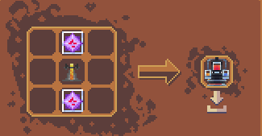
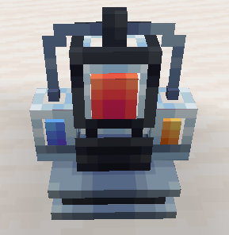
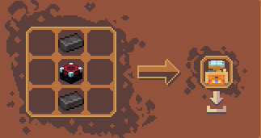
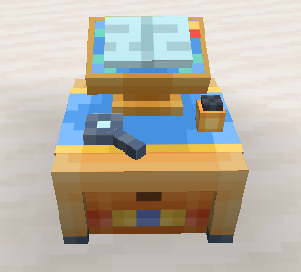
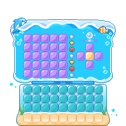
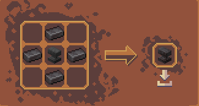
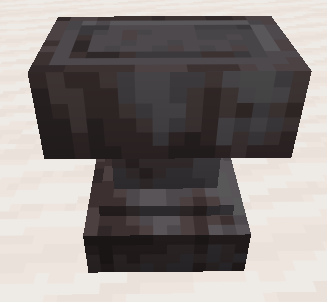

# ⚒️ 아이템 및 조합법

> **안내**: 서버 내 커스텀 아이템 및 CraftEngine 3×3 작업대, 용광로, 특수 설비의 제작 조합법 목록입니다.  
> 직업 활동과 야생에서 획득한 원자재로 특수 설비, 합금, 도구, 농경/수산업 시설을 제작할 수 있습니다.  
> 🔨 **대장장이 특수 망치 전용 주괴**: 5개 등급 수리 망치에 소모되는 **1~5티어 핵심 합금 주괴**는 **[3. 1~5티어 합금 혼합물 & 용광로 제련표](#3--15티어-합금-혼합물--용광로-제련표)** 최상단에 강조 정리되어 있습니다.

---

## 📑 목차 바로가기

1. [🧺 압축 보관 바구니 & 원석 블록](#1--압축-보관-바구니--원석-블록)
2. [⛏️ 신규 광물 제련 & 압축 블록 변환](#2--신규-광물-제련--압축-블록-변환)
3. [🧪 1~5티어 합금 혼합물 & 용광로 제련표](#3--15티어-합금-혼합물--용광로-제련표)
4. [🌾 농경 설비 & 농사 도구](#4--농경-설비--농사-도구)
5. [🐟 수중 통발 (물고기 덫 6단계)](#5--수중-통발-물고기-덫-6단계)
6. [🪨 특수 작업대 및 핵심 설비](#6--특수-작업대-및-핵심-설비)

---

## 1. 🧺 압축 보관 바구니 & 원석 블록

인벤토리 공간을 절약하고 농작물 및 광물 자원을 9배 단위로 대량 운송·보관·제련합니다.



### 🧺 농작물/아이템 압축 바구니 & 묶음

재료 9개를 3×3 작업대에 가득 채워 1개의 바구니/묶음으로 압축하며, 제작대에 올리면 언제든지 9개로 다시 풀 수 있습니다.

<table>
  <thead>
    <tr>
      <th width="190">압축 아이템명</th>
      <th width="200">조합 재료 (3×3 가득 채움)</th>
      <th>분해 (무정형 1개) 및 설명</th>
    </tr>
  </thead>
  <tbody>
    <tr>
      <td><strong>순무 바구니</strong> (<code>beetroot_basket</code>)</td>
      <td>순무 (비트) × 9</td>
      <td>제작대에 올리면 순무 9개로 즉시 복원</td>
    </tr>
    <tr>
      <td><strong>계란 바구니</strong> (<code>egg_basket</code>)</td>
      <td>달걀 × 9</td>
      <td>제작대에 올리면 달걀 9개로 즉시 복원</td>
    </tr>
    <tr>
      <td><strong>감자 바구니</strong> (<code>potato_basket</code>)</td>
      <td>감자 × 9</td>
      <td>제작대에 올리면 감자 9개로 즉시 복원</td>
    </tr>
    <tr>
      <td><strong>당근 바구니</strong> (<code>carrot_basket</code>)</td>
      <td>당근 × 9</td>
      <td>제작대에 올리면 당근 9개로 즉시 복원</td>
    </tr>
    <tr>
      <td><strong>씨앗 묶음</strong> (<code>bundle_of_seeds</code>)</td>
      <td>밀 씨앗 × 9</td>
      <td>제작대에 올리면 밀 씨앗 9개로 즉시 복원</td>
    </tr>
    <tr>
      <td><strong>사탕수수 묶음</strong> (<code>bundle_of_sugarcane</code>)</td>
      <td>사탕수수 × 9</td>
      <td>제작대에 올리면 사탕수수 9개로 즉시 복원</td>
    </tr>
    <tr>
      <td><strong>석탄 블록</strong> (<code>coal_block</code>)</td>
      <td>숯 × 9</td>
      <td>숯 9개로 석탄 블록 1개 조합 (대량 연료 압축 보관)</td>
    </tr>
  </tbody>
</table>



### ⛏️ 원석 압축 블록 & 대량 제련
원석 9개를 3×3으로 채워 **원석 블록**으로 압축할 수 있으며, 원석 블록 1개를 제작대에 올리면 원석 9개로 분해됩니다.  
특히 원석 블록을 통째로 화로/용광로에 넣으면 **주괴 블록 1개로 즉시 대량 제련**할 수 있습니다!

#### 1. 커스텀 신규 금속 원석 블록 (6종)
* **상호 변환**: 신규 원석 9개 ➔ 원석 블록 1개 / 원석 블록 1개 ➔ 원석 9개 분해
* **대량 제련**: 화로(`smelting` 200틱 / 10초) 또는 용광로(`blasting` 100틱 / 5초)에 원석 블록을 넣으면 **주괴 블록 1개**로 즉시 제련됩니다.

<table>
  <thead>
    <tr>
      <th width="190">원석 블록명</th>
      <th width="180">조합 원석 (9개)</th>
      <th>통째로 제련 시 결과 (주괴 블록)</th>
    </tr>
  </thead>
  <tbody>
    <tr>
      <td><strong>주석 원석 블록</strong> (<code>raw_tin_block</code>)</td>
      <td>주석 원석 × 9</td>
      <td><strong>주석 블록</strong> (<code>tin_block</code>) × 1</td>
    </tr>
    <tr>
      <td><strong>은 원석 블록</strong> (<code>raw_silver_block</code>)</td>
      <td>은 원석 × 9</td>
      <td><strong>은 블록</strong> (<code>silver_block</code>) × 1</td>
    </tr>
    <tr>
      <td><strong>니켈 원석 블록</strong> (<code>raw_nickel_block</code>)</td>
      <td>니켈 원석 × 9</td>
      <td><strong>니켈 블록</strong> (<code>nickel_block</code>) × 1</td>
    </tr>
    <tr>
      <td><strong>텅스텐 원석 블록</strong> (<code>raw_tungsten_block</code>)</td>
      <td>텅스텐 원석 × 9</td>
      <td><strong>텅스텐 블록</strong> (<code>tungsten_block</code>) × 1</td>
    </tr>
    <tr>
      <td><strong>백금 원석 블록</strong> (<code>raw_platinum_block</code>)</td>
      <td>백금 원석 × 9</td>
      <td><strong>백금 블록</strong> (<code>platinum_block</code>) × 1</td>
    </tr>
    <tr>
      <td><strong>티타늄 원석 블록</strong> (<code>raw_titanium_block</code>)</td>
      <td>티타늄 원석 × 9</td>
      <td><strong>티타늄 블록</strong> (<code>titanium_block</code>) × 1</td>
    </tr>
  </tbody>
</table>

#### 2. 바닐라 원석 블록 용광로 대량 제련
* **용광로 대량 제련 (`blasting` 800틱 / 40초)**: 원석 블록을 화로/용광로에 넣고 통째로 구워 주괴 블록을 획득합니다.

<table>
  <thead>
    <tr>
      <th width="190">원석 블록명</th>
      <th width="180">제련 결과 (주괴 블록)</th>
      <th>제련 경험치</th>
    </tr>
  </thead>
  <tbody>
    <tr>
      <td><strong>철 원석 블록</strong> (<code>raw_iron_block</code>)</td>
      <td><strong>철 블록</strong> (<code>iron_block</code>) × 1</td>
      <td>제련 EXP 6.3 XP</td>
    </tr>
    <tr>
      <td><strong>금 원석 블록</strong> (<code>raw_gold_block</code>)</td>
      <td><strong>금 블록</strong> (<code>gold_block</code>) × 1</td>
      <td>제련 EXP 9.0 XP</td>
    </tr>
    <tr>
      <td><strong>구리 원석 블록</strong> (<code>raw_copper_block</code>)</td>
      <td><strong>구리 블록</strong> (<code>copper_block</code>) × 1</td>
      <td>제련 EXP 6.3 XP</td>
    </tr>
  </tbody>
</table>

#### 3. 특수 자원 압축 블록
* **화약 블록** (<code>gunpowder_block</code>): 화약 9개 ➔ 화약 블록 1개 / 화약 블록 1개 ➔ 화약 9개 분해



---

## 2. ⛏️ 신규 광물 제련 & 압축 블록 변환

서버 고유의 6종 신규 금속 및 4종 특수 보석 광석입니다.



### 6종 신규 금속 원석 제련
* **제련 설비**: 일반 화로(`smelting` 200틱 / 10초) 또는 용광로(`blasting` 100틱 / 5초)

<table>
  <thead>
    <tr>
      <th width="220">원석 아이템</th>
      <th width="260">제련 결과 (주괴)</th>
      <th>설명</th>
    </tr>
  </thead>
  <tbody>
    <tr>
      <td><strong>주석 원석</strong> (Raw Tin)</td>
      <td><strong>주석 주괴</strong> (Tin Ingot)</td>
      <td>청동 합금의 필수 원자재</td>
    </tr>
    <tr>
      <td><strong>은 원석</strong> (Raw Silver)</td>
      <td><strong>은 주괴</strong> (Silver Ingot)</td>
      <td>일렉트럼 합금의 필수 원자재</td>
    </tr>
    <tr>
      <td><strong>니켈 원석</strong> (Raw Nickel)</td>
      <td><strong>니켈 주괴</strong> (Nickel Ingot)</td>
      <td>인바 합금 및 특수 금속 재료</td>
    </tr>
    <tr>
      <td><strong>텅스텐 원석</strong> (Raw Tungsten)</td>
      <td><strong>텅스텐 주괴</strong> (Tungsten Ingot)</td>
      <td>2티어 텅스텐 강철의 핵심 원자재</td>
    </tr>
    <tr>
      <td><strong>백금 원석</strong> (Raw Platinum)</td>
      <td><strong>백금 주괴</strong> (Platinum Ingot)</td>
      <td>백색금 및 고급 통발의 원자재</td>
    </tr>
    <tr>
      <td><strong>티타늄 원석</strong> (Raw Titanium)</td>
      <td><strong>티타늄 주괴</strong> (Titanium Ingot)</td>
      <td>3티어 티타늄 합금의 핵심 원자재</td>
    </tr>
  </tbody>
</table>



### 4종 신규 보석 광석 제련
원석을 채굴하여 화로에 제련하면 순수한 보석 완제품을 획득합니다.

<table>
  <thead>
    <tr>
      <th width="220">보석 원석</th>
      <th width="260">제련 결과</th>
      <th>활용처</th>
    </tr>
  </thead>
  <tbody>
    <tr>
      <td><strong>혈석 원석</strong> (Raw Bloodstone)</td>
      <td><strong>혈석</strong> (Bloodstone)</td>
      <td>특수 장비 및 마법 연성 재료</td>
    </tr>
    <tr>
      <td><strong>마나석 원석</strong> (Raw Manastone)</td>
      <td><strong>마나석</strong> (Manastone)</td>
      <td>마나 충전 및 인챈트 보조 재료</td>
    </tr>
    <tr>
      <td><strong>월장석 원석</strong> (Raw Moonstone)</td>
      <td><strong>월장석</strong> (Moonstone)</td>
      <td>고급 마법부여 및 특수 설비 재료</td>
    </tr>
    <tr>
      <td><strong>일장석 원석</strong> (Raw Sunstone)</td>
      <td><strong>일장석</strong> (Sunstone)</td>
      <td>고급 장비 제작 및 특수 제련 재료</td>
    </tr>
  </tbody>
</table>



### 압축 블록 상호 변환 및 대량 제련

* **주괴 ↔ 압축 블록**:
  * 신규 주괴 9개로 블록 1개 제작 / 블록 1개를 작업대에 올려 주괴 9개로 즉시 분해 (주석, 은, 니켈, 백금, 티타늄, 텅스텐 등)
* **원석 ↔ 원석 블록**:
  * 원석 9개로 원석 블록 1개 압축 / 원석 블록 1개를 원석 9개로 분해
* **원석 블록 통째로 굽기 (대량 제련)**:
  * 원석 블록을 화로/용광로에 통째로 넣으면 **주괴 블록 1개로 즉시 대량 제련**됩니다.
* **화약 블록 (`gunpowder_block`)**:
  * 화약 9개 ↔ 화약 블록 1개 상호 조합/분해



---

## 3. 🧪 1~5티어 합금 혼합물 & 용광로 제련표

합금은 **[1단계: 작업대에서 주괴 금형 틀과 함께 원자재를 무정형 배합해 혼합물 제작]** ➔ **[2단계: 용광로(`blasting`)에 구워 주괴 완성]** 순서로 진행됩니다.  
*(※ 1~3티어 광물은 원석 또는 주괴 양방향 레시피가 모두 지원됩니다.)*



### 🔨 대장장이 특수 수리 망치 전용 핵심 주괴 (1~5티어)

<table>
  <thead>
    <tr>
      <th align="center" width="90">티어</th>
      <th width="220">망치 전용 주괴명</th>
      <th>조합법</th>
    </tr>
  </thead>
  <tbody>
    <tr>
      <td align="center"><strong>1티어</strong></td>
      <td>⭐ <strong>강철 주괴</strong> (Steel Ingot)</td>
      <td><strong>주괴 금형 틀</strong> + 원철 2개 + 석탄(또는 목탄) 2개</td>
    </tr>
    <tr>
      <td align="center"><strong>2티어</strong></td>
      <td>⭐ <strong>텅스텐 강철 주괴</strong> (Tungsten Steel)</td>
      <td><strong>주괴 금형 틀</strong> + 강철 주괴 4개 + 원시 텅스텐 3개</td>
    </tr>
    <tr>
      <td align="center"><strong>3티어</strong></td>
      <td>⭐ <strong>티타늄 합금 주괴</strong> (Titanium Alloy)</td>
      <td><strong>주괴 금형 틀</strong> + 텅스텐 강철 주괴 2개 + 원시 티타늄 6개</td>
    </tr>
    <tr>
      <td align="center"><strong>4티어</strong></td>
      <td>⭐ <strong>플라즈마 합금 주괴</strong> (Plasma Alloy)</td>
      <td><strong>주괴 금형 틀</strong> + 엔더리움 주괴 4개 + 열합금 주괴 4개</td>
    </tr>
    <tr>
      <td align="center"><strong>5티어</strong></td>
      <td>⭐ <strong>스텔라리움 주괴</strong> (Stellarium Ingot)</td>
      <td><strong>주괴 금형 틀</strong> + 오리칼쿰 주괴 2개 + 플라즈마 합금 주괴 2개</td>
    </tr>
  </tbody>
</table>



### 1티어 기초 합금 (강철 · 청동 · 일렉트럼)

<table>
  <thead>
    <tr>
      <th width="220">합금 주괴명</th>
      <th width="300">작업대 배합 레시피 (무정형)</th>
      <th>용광로 제련 결과</th>
    </tr>
  </thead>
  <tbody>
    <tr>
      <td>⭐ <strong>강철 주괴</strong> (Steel Ingot) <strong>[🔨 1단계 강철 망치 핵심 재료]</strong></td>
      <td><strong>주괴 금형 틀</strong> + 원철 2개 + 석탄(또는 목탄) 2개</td>
      <td>강철 혼합물 양동이 ➔ <strong>강철 주괴</strong></td>
    </tr>
    <tr>
      <td><strong>청동 주괴</strong> (Bronze Ingot)</td>
      <td><strong>주괴 금형 틀</strong> + 원시 구리 4개 + 원시 주석 1개</td>
      <td>청동 혼합물 양동이 ➔ <strong>청동 주괴</strong></td>
    </tr>
    <tr>
      <td><strong>일렉트럼 주괴</strong> (Electrum Ingot)</td>
      <td><strong>주괴 금형 틀</strong> + 원시 금 2개 + 원시 은 2개</td>
      <td>일렉트럼 혼합물 양동이 ➔ <strong>일렉트럼 주괴</strong></td>
    </tr>
  </tbody>
</table>



### 2티어 중급 합금 (텅스텐 강철 · 인바 · 백색금)

<table>
  <thead>
    <tr>
      <th width="220">합금 주괴명</th>
      <th width="300">작업대 배합 레시피 (무정형)</th>
      <th>용광로 제련 결과</th>
    </tr>
  </thead>
  <tbody>
    <tr>
      <td>⭐ <strong>텅스텐 강철 주괴</strong> (Tungsten Steel) <strong>[🔨 2단계 텅스텐 망치 핵심 재료]</strong></td>
      <td><strong>주괴 금형 틀</strong> + 강철 주괴 4개 + 원시 텅스텐 3개</td>
      <td>텅스텐 강철 혼합물 양동이 ➔ <strong>텅스텐 강철 주괴</strong></td>
    </tr>
    <tr>
      <td><strong>인바 주괴</strong> (Invar Ingot)</td>
      <td><strong>주괴 금형 틀</strong> + 강철 주괴 4개 + 청동 주괴 3개 + 원시 니켈 1개</td>
      <td>인바 혼합물 양동이 ➔ <strong>인바 주괴</strong></td>
    </tr>
    <tr>
      <td><strong>백색금 주괴</strong> (White Gold)</td>
      <td><strong>주괴 금형 틀</strong> + 일렉트럼 주괴 4개 + 원시 백금 3개</td>
      <td>백색금 혼합물 양동이 ➔ <strong>백색금 주괴</strong></td>
    </tr>
  </tbody>
</table>



### 3티어 상급 합금 (티타늄 합금 · 열합금 · 엔더리움)

<table>
  <thead>
    <tr>
      <th width="220">합금 주괴명</th>
      <th width="300">작업대 배합 레시피 (무정형)</th>
      <th>용광로 제련 결과</th>
    </tr>
  </thead>
  <tbody>
    <tr>
      <td>⭐ <strong>티타늄 합금 주괴</strong> (Titanium Alloy) <strong>[🔨 3단계 티타늄 망치 핵심 재료]</strong></td>
      <td><strong>주괴 금형 틀</strong> + 텅스텐 강철 주괴 2개 + 원시 티타늄 6개</td>
      <td>티타늄 합금 혼합물 양동이 ➔ <strong>티타늄 합금 주괴</strong></td>
    </tr>
    <tr>
      <td><strong>열합금 주괴</strong> (Thermalloy Ingot)</td>
      <td><strong>주괴 금형 틀</strong> + 인바 주괴 3개 + 일렉트럼 주괴 1개 + 블레이즈 가루 4개</td>
      <td>열합금 혼합물 양동이 ➔ <strong>열합금 주괴</strong></td>
    </tr>
    <tr>
      <td><strong>엔더리움 주괴</strong> (Enderium Ingot)</td>
      <td><strong>주괴 금형 틀</strong> + 백색금 주괴 4개 + 엔더 진주 4개</td>
      <td>엔더리움 혼합물 양동이 ➔ <strong>엔더리움 주괴</strong></td>
    </tr>
  </tbody>
</table>



### 4티어 최상급 합금 (오리칼쿰 · 플라즈마 합금)

<table>
  <thead>
    <tr>
      <th width="220">합금 주괴명</th>
      <th width="300">작업대 배합 레시피 (무정형)</th>
      <th>용광로 제련 결과</th>
    </tr>
  </thead>
  <tbody>
    <tr>
      <td>⭐ <strong>플라즈마 합금 주괴</strong> (Plasma Alloy) <strong>[🔨 4단계 플라즈마 망치 핵심 재료]</strong></td>
      <td><strong>주괴 금형 틀</strong> + 엔더리움 주괴 4개 + 열합금 주괴 4개</td>
      <td>플라즈마 합금 혼합물 양동이 ➔ <strong>플라즈마 합금 주괴</strong></td>
    </tr>
    <tr>
      <td><strong>오리칼쿰 주괴</strong> (Orichalcum Ingot)</td>
      <td><strong>주괴 금형 틀</strong> + 티타늄 합금 주괴 4개 + 열합금 주괴 4개</td>
      <td>오리칼쿰 혼합물 양동이 ➔ <strong>오리칼쿰 주괴</strong></td>
    </tr>
  </tbody>
</table>



### 5티어 종결 합금 (스텔라리움)

<table>
  <thead>
    <tr>
      <th width="220">합금 주괴명</th>
      <th width="300">작업대 배합 레시피 (무정형)</th>
      <th>용광로 제련 결과</th>
    </tr>
  </thead>
  <tbody>
    <tr>
      <td>⭐ <strong>스텔라리움 주괴</strong> (Stellarium Ingot) <strong>[🔨 5단계 스텔라리움 망치 핵심 재료]</strong></td>
      <td><strong>주괴 금형 틀</strong> + 오리칼쿰 주괴 2개 + 플라즈마 합금 주괴 2개</td>
      <td>스텔라리움 혼합물 양동이 ➔ <strong>스텔라리움 주괴</strong></td>
    </tr>
  </tbody>
</table>



---

## 4. 🌾 농경 설비 & 농사 도구

대규모 자동 농업과 작물 성장을 극대화하는 설비 및 도구입니다.

### ① 온실 유리 & 밭 블록 (원목 화분)
* **온실 유리 (`greenhouse_glass`)**: 네 모서리 차광 유리 4개 + 십자 방향 다이아몬드 4개 + 중앙 유리판 1개
* **밭 블록 / 원목 화분 (`dry_pot`)**: 중앙 흙 1개 + 외곽 원목 8개 (참나무, 가문비, 자작, 정글, 아카시아, 짙은 참나무, 맹그로브, 벚나무, 진홍빛, 뒤틀린 자루 등 10종 원목별 지원)

### ② 스프링클러 티어 업그레이드 체계 (1 ~ 4단계)
스프링클러는 주변 작물에 자동으로 수분을 공급하여 성장을 돕습니다.



### 1단계 스프링클러 (`sprinkler_1_item`)
* **필요 재료**: 붉은 네더 벽돌 + 돌 + 물 양동이
* **특징**: 가장 기초적인 자동 수분 공급 스프링클러입니다.



### 2단계 스프링클러 (`sprinkler_2_item`)
* **필요 재료**: 1단계 스프링클러 + 금 블록 8개
* **특징**: 수분 공급 범위와 효율이 상승합니다.



### 2.5단계 스프링클러 (`sprinkler_2_2_item`)
* **필요 재료**: 2단계 스프링클러 + 다이아몬드 블록 8개
* **특징**: 상위 티어 합금 스프링클러로 넘어가기 위한 핵심 중간 단계입니다.



### 3단계 스프링클러 (`sprinkler_3_item`)
* **필요 재료**: 2.5단계 스프링클러 + 티타늄 합금 + 열합금 + 강철 + 네더라이트 파편
* **특징**: 고급 합금을 배합하여 작물의 성장 속도를 대폭 가속합니다.



### 4단계 스프링클러 (`sprinkler_4_item`)
* **필요 재료**: 3단계 스프링클러 + 백색금 + 오리칼쿰 + 네더라이트 주괴 + 티타늄 합금
* **특징**: 최고 효율의 농경 자동 수분 공급 종결 설비입니다.



### ③ 물뿌리개 티어 업그레이드 체계 (1 ~ 4단계)
우클릭으로 전방 넓은 범위의 작물에 물을 주어 수확 주기를 단축합니다.



### 1단계 물뿌리개 (`watering_can_1`)
* **필요 재료**: 구리 주괴 + 돌 + 물 양동이
* **특징**: 기초 수동 급수 물뿌리개입니다.



### 2단계 물뿌리개 (`watering_can_2`)
* **필요 재료**: 1단계 물뿌리개 + 청동 주괴 + 열합금 + 에메랄드 블록 + 강철
* **특징**: 살수 범위와 수분 지속 시간이 증가합니다.



### 3단계 물뿌리개 (`watering_can_3`)
* **필요 재료**: 2단계 물뿌리개 + 강철 주괴 + 오리칼쿰 + 다이아몬드 블록
* **특징**: 넓은 영역에 빠르게 물을 줄 수 있습니다.



### 4단계 물뿌리개 (`watering_can_4`)
* **필요 재료**: 3단계 물뿌리개 + 백색금 + 플라즈마 합금 + 네더라이트 블록 + 티타늄 합금
* **특징**: 초대형 밭을 한 번에 적시는 종결급 농사 도구입니다.



---

## 5. 🐟 수중 통발 (물고기 덫 6단계)

물속에 설치하면 시간에 따라 자동으로 물고기와 보물을 채집하는 자동 어획 설비입니다.  
* **조합 공식**: 네 모서리 등급별 블록 4개 + 상하좌우 실 4개 + 중앙 열대어 1개 (`shaped`)



### 1단계 청동 통발 (`bronze_fishtrap`)
* **외곽 네 모서리 (4개)**: **구리 블록** × 4
* **상하좌우 (4개)**: 실 × 4
* **중앙 (1개)**: 열대어 × 1



### 2단계 은 통발 (`silver_fishtrap`)
* **외곽 네 모서리 (4개)**: **철 블록** × 4
* **상하좌우 (4개)**: 실 × 4
* **중앙 (1개)**: 열대어 × 1



### 3단계 금 통발 (`gold_fishtrap`)
* **외곽 네 모서리 (4개)**: **금 블록** × 4
* **상하좌우 (4개)**: 실 × 4
* **중앙 (1개)**: 열대어 × 1



### 4단계 다이아몬드 통발 (`diamond_fishtrap`)
* **외곽 네 모서리 (4개)**: **다이아몬드 블록** × 4
* **상하좌우 (4개)**: 실 × 4
* **중앙 (1개)**: 열대어 × 1



### 5단계 백금 통발 (`platinum_fishtrap`)
* **외곽 네 모서리 (4개)**: **백금 블록** (`platinum_block`) × 4
* **상하좌우 (4개)**: 실 × 4
* **중앙 (1개)**: 열대어 × 1



### 6단계 신화 통발 (`mythic_fishtrap`)
* **외곽 네 모서리 (4개)**: **자수정 꽃봉오리** (`budding_amethyst`) × 4
* **상하좌우 (4개)**: 실 × 4
* **중앙 (1개)**: 열대어 × 1



---

## 6. 🪨 특수 작업대 및 핵심 설비

마을 또는 개인 거점에 설치하여 고급 전문직 활동 및 가공을 진행하는 설비 목록입니다.



### 커스텀 양조기 (`brewing_stand`)
* **제작 방식**: 형태 조합 (`shaped`)
* **필요 재료**: 바닐라 `양조기` 1개 + `엔드 수정` 2개
* **조합 배치**: 상단과 하단에 엔드 수정 각 1개, 정중앙에 바닐라 양조기 1개 배치
* **특징**: 연료 소모 없이 연금술사 전용 특수 포션을 제조하는 전문 작업대입니다.

<table>
  <thead>
    <tr>
      <th align="center" width="34%">제작 조합법</th>
      <th align="center" width="33%">설치 외형 블록</th>
      <th align="center" width="33%">전용 인터페이스</th>
    </tr>
  </thead>
  <tbody>
    <tr>
      <td align="center"></td>
      <td align="center"></td>
      <td align="center"></td>
    </tr>
  </tbody>
</table>



### 커스텀 마법부여대 (`enchanter_table`)
* **제작 방식**: 형태 조합 (`shaped`)
* **필요 재료**: 바닐라 `마법부여대` 1개 + `네더라이트 주괴` 2개
* **조합 배치**: 중앙에 바닐라 마법부여대 1개, 상단과 하단에 네더라이트 주괴 각 1개 배치
* **특징**: 마법부여사 전용 연성대 및 마나 과충전 미니게임을 진행하는 설비입니다.

<table>
  <thead>
    <tr>
      <th align="center" width="34%">제작 조합법</th>
      <th align="center" width="33%">설치 외형 블록</th>
      <th align="center" width="33%">전용 인터페이스</th>
    </tr>
  </thead>
  <tbody>
    <tr>
      <td align="center"></td>
      <td align="center"></td>
      <td align="center"></td>
    </tr>
  </tbody>
</table>



### 네더라이트 모루 (`netherite_anvil`)
* **제작 방식**: 형태 조합 (`shaped`)
* **필요 재료**: 바닐라 `모루` 1개 + `네더라이트 주괴` 4개
* **조합 배치**: 중앙에 바닐라 모루 1개, 상하좌우에 네더라이트 주괴 각 1개(총 4개) 배치
* **특징**: 기존 철 모루보다 내구도가 월등히 높고 견고하며, 대장장이 전용 수리 작업대로 활용되는 최상위 모루 설비입니다.

<table>
  <thead>
    <tr>
      <th align="center" width="34%">제작 조합법</th>
      <th align="center" width="33%">설치 외형 블록</th>
      <th align="center" width="33%">전용 인터페이스</th>
    </tr>
  </thead>
  <tbody>
    <tr>
      <td align="center"></td>
      <td align="center"></td>
      <td align="center"></td>
    </tr>
  </tbody>
</table>



---

<!--
[비활성화 항목: 만화경 요리 시스템]
요리사 직업과 연계된 대규모 요리 설비, 조리 도구 및 전용 가공 레시피입니다. (현재 문서 내 주석 처리)

- 조리 도구: 식칼 4종(철, 금, 다이아몬드, 네더라이트 식칼), 조리 주걱, 냄비, 국솥, 찜기, 맷돌, 찻주전자, 음식 바구니, 밀짚모자 등
- 주방 가구: 11종 목재별 조리용 의자 및 조리대(테이블)
- 7대 특수 조리 기구별 전용 기능:
  • 도마 (chopping_board): 육류/생선 손질, 사시미 제작, 면발 썰기
  • 맷돌 (millstone): 식용 기름 추출, 곡물 제분(밀가루), 광석/자수정/염료 가루 분쇄
  • 냄비 (pot): 볶음밥, 제육볶음, 탕수육, 마파 요리 등
  • 찜기 (steamer): 만두, 찐빵, 경단, 대나무 통밥
  • 국솥 (stockpot): 돈골 라멘, 된장국, 우동 등 육수 추출
  • 찻주전자 (teapot): 보리차, 우롱차, 꽃차 등 잎차 추출
  • 샤와르마 (shawarma): 회전 구이기 고기 바비큐
-->

<!--
[비활성화 항목: 미적용 조합법 안내]
- 토파즈 방어구 세트 (투구, 흉갑, 레깅스, 부츠)
- 토파즈 도구 및 무기 세트 (삽, 도끼, 곡괭이, 괭이, 검)
- 금고 블록 (safe_block)
- 테스트 광석 (test_ore) 제련법
- 토파즈 원석 직접 제련법
-->

<!--
[비활성화 항목: 이전 기재 항목 (패치노트 미언급 및 게임플레이 시스템)]
[항목 1] 🎯 대장간 타이밍 미니게임 & 최대 내구도 증가
[항목 2] ⚡ 인챈트 과부하 & 마법 가루 환급 규칙

[항목 4] 🪽 겉날개에 네더라이트 흉갑 능력치 이식하기
[항목 5] 📦 야외용 휴대 수리 키트 (수리팩)
[항목 6] 🔄 이전 버전 기재 조합법 및 설정 차이 대조
-->

---
