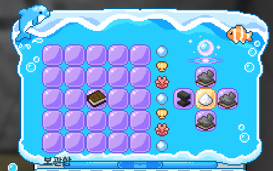
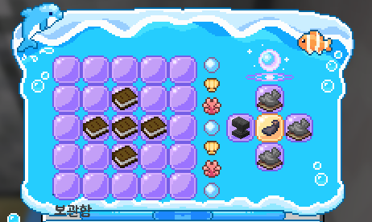
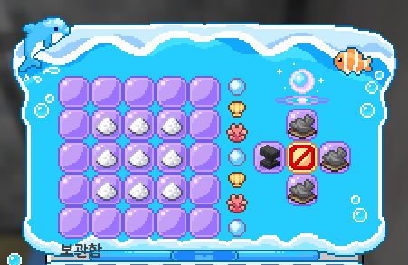
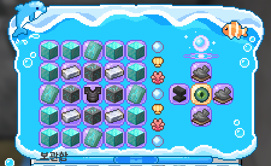
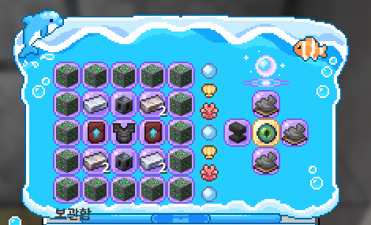
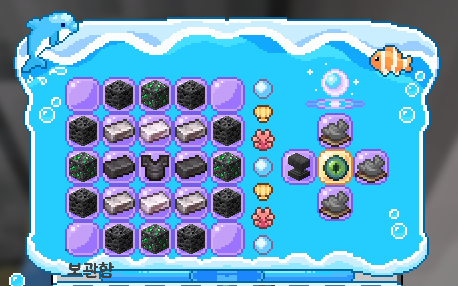
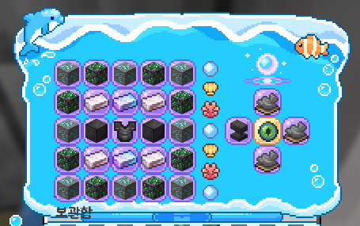
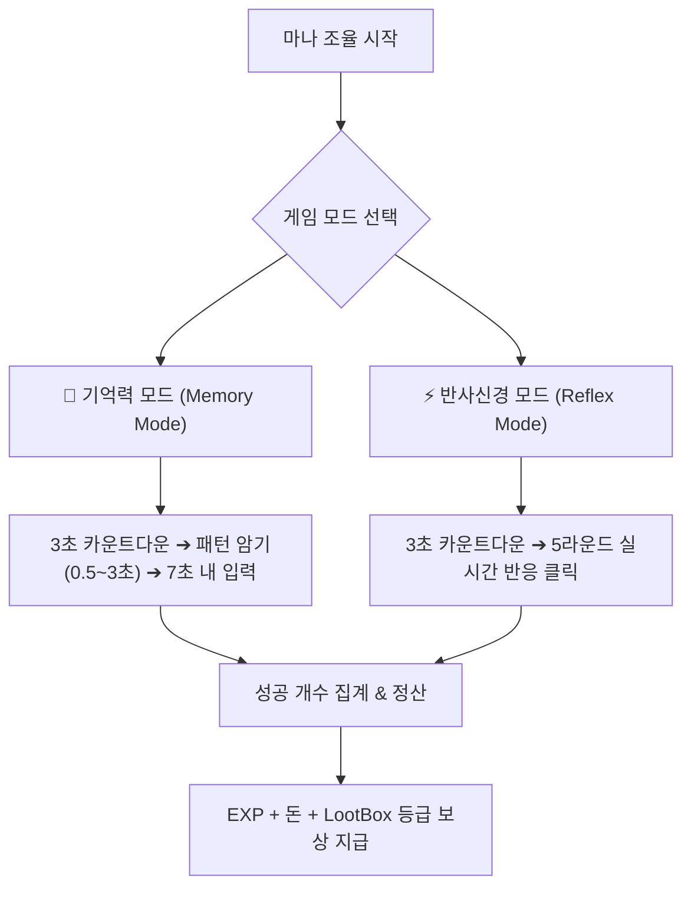

# 🔮 마법부여사

> **안내**: 5×5 대형 마법진 조합대(`xxxlpack:enchanter_table`)를 통해 인챈트 가루 연성, 마나 과충전(블랙잭 도박), 장비 인챈트 슬롯 확장 구슬(최대 7칸)을 제작하는 **마법부여사(Enchanter) 공식 전문 가이드**입니다.  
> 🔨 **전문 직업 통합 개요**: 전문직 공통 규칙(피로도, 수당, `/의뢰` 대리제작)은 **[🔨 전문 직업 및 제작](06-2.md)** 문서를 참고하시기 바랍니다.  
> 📜 **커스텀 인챈트 총람**: 장비에 부여되는 157종 커스텀 인챈트의 상세 효과는 **[📜 커스텀 인챈트 도감](08..md)**을 참고하시기 바랍니다.

---

## 📑 목차 바로가기

1. [🔮 마법부여사 직업 개요 및 마법부여대 구조](#1--마법부여사-직업-개요-및-마법부여대-구조)
2. [✨ 기초 연성: 인챈트 가루 & 인챈트 리무버](#2--기초-연성-인챈트-가루--인챈트-리무버)
   * 2.1 인챈트 가루 연성
   * 2.2 📜 인챈트 리무버 (블랙 스크롤) 연성
3. [🎲 마나 과충전 (인챈트 가루 블랙잭 도박) 시스템](#3--마나-과충전-인챈트-가루-블랙잭-도박-시스템)
   * 3.1 도박 진행 방식 및 인터페이스
   * 3.2 성공 확률 공식 및 레벨별 확률표
4. [🔮 장비 인챈트 슬롯 확장 구슬 제작 (4단계 ➔ 7단계)](#4--장비-인챈트-슬롯-확장-구슬-제작-4단계--7단계)
   * 4.1 슬롯 확장 구슬 12종 스펙 요약표
   * 4.2 5×5 마법진 단계별 재료 배치표 & 조합법
5. [🎮 마나 조율 미니게임 (기억력 & 반사신경)](#5--마나-조율-미니게임-기억력--반사신경)
   * 5.1 기억력 모드 (Memory Mode)
   * 5.2 반사신경 모드 (Reflex Mode)
   * 5.3 성과별 보상 체계 및 루트박스
6. [🤝 안전 대리 의뢰 (`/의뢰`)](#6--안전-대리-의뢰-의뢰)

---

## 1. 🔮 마법부여사 직업 개요 및 마법부여대 구조

마법부여사는 서버 내 마법 부여의 핵심 장인으로, 전용 **5×5 마법진 조합대**를 사용하여 인챈트 확률을 높이는 **인챈트 가루**, 가루의 가치를 극대화하는 **마나 과충전 도박**, 장비의 인챈트를 추출하는 **인챈트 리무버**, 그리고 장비의 커스텀 인챈트 슬롯을 최대 7칸까지 뚫어주는 **인챈트 확장 구슬**을 독점 제작합니다.

### 1.1 마법부여대 이용 방법
* **전용 블록 이용**: 필드나 마을에 설치된 **커스텀 마법부여대 블록(`xxxlpack:enchanter_table`)**을 우클릭하여 전용 GUI를 엽니다 (**마법부여사 Lv. 1 이상** 필요).
* **GUI 구조 (총 45칸)**:
  * **좌측 5×5 영역 (25칸)**: 연성 재료 투입구 (인덱스 `0 ~ 24`)
  * **중앙 구분선**: `5, 14, 23, 32, 41`번 슬롯
  * **24번 슬롯 (`ANVIL`)**: **`[ 연성 시작 ]`** 버튼 (재료 검증 후 연성 또는 도박 시작)
  * **25번 슬롯**: **결과물 슬롯** (즉시 연성 시 수령, 도박 진행 시 현재 상태 표시)
  * **16번 슬롯 (`EMERALD`)**: **`[ 등급 상승 시도 ]`** 버튼 (도박 전용)
  * **34번 슬롯 (`AMETHYST_SHARD`)**: **`[ 퍼센트 확률 상승 시도 ]`** 버튼 (도박 전용)
  * **26번 슬롯 (`GOLD_INGOT`)**: **`[ 현재 상태로 수령 ]`** 버튼 (도박 전용)

---

## 2. ✨ 기초 연성: 인챈트 가루 & 인챈트 리무버

### 2.1 인챈트 가루 연성

마법부여사가 다루는 모든 인챈트 가루의 기반이 되는 순수 마력 가루를 연성합니다.

* **제작 방식**: `INSTANT` (즉시 연성)
* **요구 직업 레벨**: **Lv. 0**
* **소모 피로도**: **1**
* **획득 경험치**: 마법부여사 직업 경험치 **+30 EXP** + AuraSkills 마법(`SORCERY`) 경험치 **+30 XP**

<figure><figcaption></figcaption></figure>

#### 5×5 재료 배치 방법
* 5×5 그리드의 **정중앙(12번 인덱스 / 3행 3열)**에 **`경험치 1,000이 저장된 경험치 책` 1개**만 단독으로 올립니다 (나머지 24칸은 모두 빈칸).
* `[ 연성 시작 ]`을 누르면 결과물 슬롯에 **`인챈트 가루` 1개**가 즉시 생성됩니다.

---

### 2.2 📜 인챈트 리무버 (블랙 스크롤) 연성

장비에 부여된 무작위 커스텀 인챈트를 안전하게 제거하고 인챈트 책으로 되돌려 추출하는 특수 두루마리입니다.

* **제작 방식**: `INSTANT` (즉시 연성)
* **요구 직업 레벨**: **Lv. 0**
* **소모 피로도**: **5**
* **획득 경험치**: 마법부여사 직업 경험치 **+200 EXP**
* **아이템 효과**: 장비에서 무작위 커스텀 인챈트 하나를 제거하고, **성공 확률 10%를 가진 인챈트 북으로 변환 추출** (인벤토리에서 장비 위로 드래그 앤 드롭하여 사용)

<figure><figcaption></figcaption></figure>

#### 5×5 재료 배치 방법 (십자 형태)
* **총 소모 재료**: **`경험치 1,000이 저장된 경험치 책` 5개**
* 중앙(12번)을 중심으로 상·하·좌·우 십자(+) 위치에 경험치 책을 1개씩 배치합니다:

| 1열 | 2열 | 3열 | 4열 | 5열 |
| :---: | :---: | :---: | :---: | :---: |
| 빈칸 | 빈칸 | 빈칸 | 빈칸 | 빈칸 |
| 빈칸 | 빈칸 | **경험치 책 (1,000)** | 빈칸 | 빈칸 |
| 빈칸 | **경험치 책 (1,000)** | **경험치 책 (1,000)** | **경험치 책 (1,000)** | 빈칸 |
| 빈칸 | 빈칸 | **경험치 책 (1,000)** | 빈칸 | 빈칸 |
| 빈칸 | 빈칸 | 빈칸 | 빈칸 | 빈칸 |

---

## 3. 🎲 마나 과충전 (인챈트 가루 블랙잭 도박) 시스템

인챈트 가루 9개를 결집하여 기본 가루를 연성한 후, 마나를 주입하여 가루의 등급과 성공 확률을 지속적으로 승급시키는 **블랙잭 스타일의 과충전 시스템**입니다.

* **제작 방식**: **`GAMBLE` (과충전 도박 모드)**
* **요구 직업 레벨**: **Lv. 0**
* **소모 피로도**: **5**
* **시작 경험치**: 마법부여사 직업 경험치 **+1,000 EXP** + AuraSkills 마법(`SORCERY`) **+1,000 XP**

### 3.1 도박 진행 방식 및 인터페이스

5×5 중앙 3×3 구역(인덱스 `6, 7, 8, 11, 12, 13, 16, 17, 18`)에 **`인챈트 가루` 9개**를 올리고 `[ 연성 시작 ]`을 누르면 도박 모드가 시작됩니다.

<figure><figcaption></figcaption></figure>

| 1열 | 2열 | 3열 | 4열 | 5열 |
| :---: | :---: | :---: | :---: | :---: |
| 빈칸 | 빈칸 | 빈칸 | 빈칸 | 빈칸 |
| 빈칸 | **인챈트 가루** | **인챈트 가루** | **인챈트 가루** | 빈칸 |
| 빈칸 | **인챈트 가루** | **인챈트 가루** | **인챈트 가루** | 빈칸 |
| 빈칸 | **인챈트 가루** | **인챈트 가루** | **인챈트 가루** | 빈칸 |
| 빈칸 | 빈칸 | 빈칸 | 빈칸 | 빈칸 |

* 시작 시 결과물 슬롯에 **`D등급 인챈트 가루 (성공 확률 10%)`**가 기본 배치되며 우측 버튼들이 활성화됩니다:

<figure><figcaption></figcaption></figure>

* 매 턴마다 플레이어는 3가지 선택지 중 하나를 결정할 수 있습니다:

<table>
  <thead>
    <tr>
      <th width="160">버튼 명칭</th>
      <th width="140">위치 (아이콘)</th>
      <th>성공 시 효과</th>
      <th>실패 시 페널티</th>
      <th width="150">시도 시 획득 경험치</th>
    </tr>
  </thead>
  <tbody>
    <tr>
      <td><strong>[ 등급 상승 시도 ]</strong></td>
      <td>16번 (에메랄드)</td>
      <td>가루 등급이 <strong>1단계 승급</strong>! (<code>D</code> ➔ <code>C</code> ➔ <code>B</code> ➔ <code>A</code> ➔ <code>S</code> ➔ <code>SS</code>) <em>(※ SS 도달 시 버튼 비활성화)</em></td>
      <td rowspan="2">가루의 성공 확률(%)이 <strong>절반(1/2)으로 깎이며</strong> 도박이 즉시 강제 종료되고 아이템 지급 (최소 1% 보장)</td>
      <td>• 직업 경험치 <strong>+150 EXP</strong> • AuraSkills 마법 <strong>+150 XP</strong></td>
    </tr>
    <tr>
      <td><strong>[ 확률 상승 시도 ]</strong></td>
      <td>34번 (자수정 조각)</td>
      <td>가루의 적용 성공 확률이 <strong>+5% 상승</strong>! <em>(최대 100%까지 상승 가능)</em></td>
      <td>• 직업 경험치 <strong>+150 EXP</strong> • AuraSkills 마법 <strong>+150 XP</strong></td>
    </tr>
    <tr>
      <td><strong>[ 현재 상태로 수령 ]</strong></td>
      <td>26번 (금괴)</td>
      <td>도박을 안전하게 멈추고 <strong>현재 가루를 인벤토리로 수령</strong></td>
      <td>페널티 없음 (안전 종료)</td>
      <td>추가 경험치 없음</td>
    </tr>
  </tbody>
</table>

> [!NOTE]
> **안전 이탈 시스템**: 도박 진행 도중 GUI 창을 닫더라도 아이템이 증발하지 않으며, 현재 상태의 결과물이 인벤토리(가득 찼을 경우 발밑 드롭)로 안전하게 자동 지급됩니다.

---

### 3.2 성공 확률 공식 및 레벨별 확률표

마나 과충전의 성공 확률은 **기본 90.0%**에서 시작하며, 플레이어의 **마법부여사 직업 레벨에 비례해 증가**하고 **연속 성공 횟수(`clicks`)**가 늘어날 때마다 **10%씩 차감**됩니다:

$$\text{성공 확률(\%)} = \text{Clamp}\Big(90.0 + (\text{마법부여사 레벨} \times 0.3) - (\text{연속 성공 횟수} \times 10.0),\; 1.0,\; 100.0\Big)$$

*(※ 최소 확률 1.0%, 최대 확률 100.0% 보장)*

#### 📊 연속 시도 차수 및 직업 레벨별 성공 확률표

| 연속 시도 차수 | 레벨 0 (+0.0%) | 레벨 10 (+3.0%) | 레벨 20 (+6.0%) | 레벨 30 (+9.0%) | 레벨 40 (+12.0%) | 레벨 50 (+15.0%) |
| :---: | :---: | :---: | :---: | :---: | :---: | :---: |
| **1차 시도** (0회 누적) | **90.0%** | **93.0%** | **96.0%** | **99.0%** | **100.0%** | **100.0%** |
| **2차 시도** (1회 누적) | **80.0%** | **83.0%** | **86.0%** | **89.0%** | **92.0%** | **95.0%** |
| **3차 시도** (2회 누적) | **70.0%** | **73.0%** | **76.0%** | **79.0%** | **82.0%** | **85.0%** |
| **4차 시도** (3회 누적) | **60.0%** | **63.0%** | **66.0%** | **69.0%** | **72.0%** | **75.0%** |
| **5차 시도** (4회 누적) | **50.0%** | **53.0%** | **56.0%** | **59.0%** | **62.0%** | **65.0%** |
| **6차 시도** (5회 누적) | **40.0%** | **43.0%** | **46.0%** | **49.0%** | **52.0%** | **55.0%** |
| **7차 시도** (6회 누적) | **30.0%** | **33.0%** | **36.0%** | **39.0%** | **42.0%** | **45.0%** |
| **8차 시도** (7회 누적) | **20.0%** | **23.0%** | **26.0%** | **29.0%** | **32.0%** | **35.0%** |
| **9차 시도** (8회 누적) | **10.0%** | **13.0%** | **16.0%** | **19.0%** | **22.0%** | **25.0%** |
| **10차 시도** (9회 누적) | **1.0%** | **3.0%** | **6.0%** | **9.0%** | **12.0%** | **15.0%** |

---

## 4. 🔮 장비 인챈트 슬롯 확장 구슬 제작 (4단계 ➔ 7단계)

모든 무기, 도구, 방어구는 기본적으로 커스텀 인챈트를 **최대 3개**까지만 적용할 수 있습니다. 마법부여사는 장비 부위별로 인챈트 한계를 돌파시키는 **인챈트 구슬(Orb)** 12종을 5×5 마법진에서 제작합니다.

* **적용 방식**: 완성된 인챈트 구슬을 인벤토리에서 대상 장비 위로 **드래그 앤 드롭**하면 100% 확률로 슬롯이 즉시 1칸 확장됩니다.
* **단계별 순차 확장**: 슬롯 확장은 3칸 ➔ 4칸 ➔ 5칸 ➔ 6칸 ➔ 7칸 순서대로만 진행할 수 있습니다.

### 4.1 슬롯 확장 구슬 12종 스펙 요약표

* **공통 조건**: 제작 방식 `INSTANT` (즉시 연성) / **소모 피로도 5**

| 확장 단계 | 결과물 명칭 | 부위별 레시피 ID | 요구 레벨 | 획득 경험치 (직업 & SORCERY) | 슬롯 효과 |
| :---: | :--- | :--- | :---: | :---: | :---: |
| **4단계 확장** | **무기/도구/방어구 인챈트 구슬 [4]** | `weapon/tool/armor_upgrade_level4` | **Lv. 5** | **2,000 EXP** | 3슬롯 ➔ **4슬롯** |
| **5단계 확장** | **무기/도구/방어구 인챈트 구슬 [5]** | `weapon/tool/armor_upgrade_level5` | **Lv. 10** | **2,500 EXP** | 4슬롯 ➔ **5슬롯** |
| **6단계 확장** | **무기/도구/방어구 인챈트 구슬 [6]** | `weapon/tool/armor_upgrade_level6` | **Lv. 20** | **3,000 EXP** | 5슬롯 ➔ **6슬롯** |
| **7단계 확장** | **무기/도구/방어구 인챈트 구슬 [7]** | `weapon/tool/armor_upgrade_level7` | **Lv. 40** | **3,500 EXP** | 6슬롯 ➔ **최종 7슬롯** |

---

### 4.2 5×5 마법진 단계별 재료 배치표 & 조합법

> [!IMPORTANT]
> 5×5 조합대는 **빈칸을 포함하여 모든 위치와 재료 개수**가 정확히 일치해야 연성이 시작됩니다.  
> 중앙(3행 3열)의 코어 장비는 제작하려는 부위에 맞춰 투입합니다:
> * **무기 구슬**: 네더라이트 검 (`NETHERITE_SWORD`)
> * **도구 구슬**: 네더라이트 곡괭이 (`NETHERITE_PICKAXE`)
> * **방어구 구슬**: 네더라이트 흉갑 (`NETHERITE_CHESTPLATE`)

#### 1) 🟢 Level 4: 인챈트 구슬 [4] (요구 레벨 5)
* **총 소모 재료**: 다이아몬드 블록 12개, 해안 갑옷 장식 형판 4개, **텅스텐 강철 주괴** 4개, 다이아몬드 광석 4개, **중앙 코어 장비 1개**

<figure><figcaption></figcaption></figure>

| 1열 | 2열 | 3열 | 4열 | 5열 |
| :---: | :---: | :---: | :---: | :---: |
| 다이아몬드 블록 | 다이아몬드 블록 | **해안 형판** | 다이아몬드 블록 | 다이아몬드 블록 |
| 다이아몬드 블록 | **텅스텐 강철 주괴** | 다이아몬드 광석 | **텅스텐 강철 주괴** | 다이아몬드 블록 |
| **해안 형판** | 다이아몬드 광석 | **중앙 코어 장비** | 다이아몬드 광석 | **해안 형판** |
| 다이아몬드 블록 | **텅스텐 강철 주괴** | 다이아몬드 광석 | **텅스텐 강철 주괴** | 다이아몬드 블록 |
| 다이아몬드 블록 | 다이아몬드 블록 | **해안 형판** | 다이아몬드 블록 | 다이아몬드 블록 |

#### 2) 🔵 Level 5: 인챈트 구슬 [5] (요구 레벨 10)
* **총 소모 재료**: 에메랄드 광석 16개, **백색금 주괴** 2개, **열합금 주괴** 2개, 무거운 코어(`HEAVY_CORE`) 2개, 네더라이트 강화 형판 2개, **중앙 코어 장비 1개**

<figure><figcaption></figcaption></figure>

| 1열 | 2열 | 3열 | 4열 | 5열 |
| :---: | :---: | :---: | :---: | :---: |
| 에메랄드 광석 | 에메랄드 광석 | 에메랄드 광석 | 에메랄드 광석 | 에메랄드 광석 |
| 에메랄드 광석 | **백색금 주괴** | **무거운 코어** | **열합금 주괴** | 에메랄드 광석 |
| 에메랄드 광석 | **네더라이트 강화 형판** | **중앙 코어 장비** | **네더라이트 강화 형판** | 에메랄드 광석 |
| 에메랄드 광석 | **열합금 주괴** | **무거운 코어** | **백색금 주괴** | 에메랄드 광석 |
| 에메랄드 광석 | 에메랄드 광석 | 에메랄드 광석 | 에메랄드 광석 | 에메랄드 광석 |

#### 3) 🟣 Level 6: 인챈트 구슬 [6] (요구 레벨 20)
* **총 소모 재료**: 심층암 석탄 광석 8개, 심층암 에메랄드 광석 4개, **열합금 주괴** 4개, **오리칼쿰 주괴** 2개, 네더라이트 주괴 2개, **중앙 코어 장비 1개**

<figure><figcaption></figcaption></figure>

| 1열 | 2열 | 3열 | 4열 | 5열 |
| :---: | :---: | :---: | :---: | :---: |
| 빈칸 | 심층암 석탄 광석 | 심층암 에메랄드 광석 | 심층암 석탄 광석 | 빈칸 |
| 심층암 석탄 광석 | **열합금 주괴** | **오리칼쿰 주괴** | **열합금 주괴** | 심층암 석탄 광석 |
| 심층암 에메랄드 광석 | **네더라이트 주괴** | **중앙 코어 장비** | **네더라이트 주괴** | 심층암 에메랄드 광석 |
| 심층암 석탄 광석 | **열합금 주괴** | **오리칼쿰 주괴** | **열합금 주괴** | 심층암 석탄 광석 |
| 빈칸 | 심층암 석탄 광석 | 심층암 에메랄드 광석 | 심층암 석탄 광석 | 빈칸 |

#### 4) 🟡 Level 7: 인챈트 구슬 [7] (요구 레벨 40)
* **총 소모 재료**: 다이아몬드 광석 8개, 심층암 에메랄드 광석 8개, **오리칼쿰 주괴** 4개, **스텔라리움 주괴** 2개, 네더라이트 블록 2개, **중앙 코어 장비 1개**

<figure><figcaption></figcaption></figure>

| 1열 | 2열 | 3열 | 4열 | 5열 |
| :---: | :---: | :---: | :---: | :---: |
| 다이아몬드 광석 | 심층암 에메랄드 광석 | 다이아몬드 광석 | 심층암 에메랄드 광석 | 다이아몬드 광석 |
| 심층암 에메랄드 광석 | **오리칼쿰 주괴** | **스텔라리움 주괴** | **오리칼쿰 주괴** | 심층암 에메랄드 광석 |
| 다이아몬드 광석 | **네더라이트 블록** | **중앙 코어 장비** | **네더라이트 블록** | 다이아몬드 광석 |
| 심층암 에메랄드 광석 | **오리칼쿰 주괴** | **스텔라리움 주괴** | **오리칼쿰 주괴** | 심층암 에메랄드 광석 |
| 다이아몬드 광석 | 심층암 에메랄드 광석 | 다이아몬드 광석 | 심층암 에메랄드 광석 | 다이아몬드 광석 |

---

## 5. 🎮 마나 조율 미니게임 (기억력 & 반사신경)

마법부여대에서 마나의 흐름을 조율하여 직업 경험치, 마법 경험치, 서버 재화 및 등급별 루트박스를 획득하는 수련 미니게임입니다.

### 5.1 🧠 기억력 모드 (Memory Mode)
1. **카운트다운 (3초)**: 5×5 슬롯 전체가 흰색 유리판으로 잠금 배치되며 카운트다운이 진행됩니다.
2. **패턴 암기 (0.5초 ~ 3.0초)**: 25칸 중 랜덤한 3~10칸이 **회색 유리판(`마나 공명`)**으로 변하며 차임벨이 울립니다 (클릭 불가 암기 시간).
3. **입력 판정 (7초 제한시간)**: 모든 칸이 흰색 유리판으로 덮이고 클릭이 활성화됩니다.
   * **정답 클릭**: 연두색 유리판으로 고정되며 점수 +1점 획득 (모두 찾으면 즉시 성공).
   * **오답 클릭 또는 시간 초과**: 빨간색 유리판으로 변하며 즉시 게임 종료.

### 5.2 ⚡ 반사신경 모드 (Reflex Mode)
1. 총 **5라운드** 동안 무작위 위치에 순간적으로 나타나는 빛나는 회색 유리판을 빠르게 클릭하는 스피드 반응 모드입니다.
2. 타겟 노출 시간(0.5초 ~ 3.0초) 내에 클릭하면 성공 카운트가 올라가며, 시간 내 클릭하지 못하면 기회가 사라지고 1초 후 다음 라운드로 진행됩니다.

### 5.3 🎁 성과별 보상 체계 및 루트박스

* **기본 스탯 보상**:
  * **마법부여사 직업 경험치**: `성공 개수 × 10 EXP`
  * **AuraSkills 마법(`SORCERY`) 경험치**: `성공 개수 × 10 EXP`
  * **서버 경제 재화**: `성공 개수 × 50원`
* **LootBox 등급별 보상 (`config.yml`)**:  
  맞춘 개수 조건을 달성한 가장 높은 등급 1개의 상자가 지급됩니다.

| 달성 등급 | 조건 (맞춘 개수) | 지급 보상 | 특징 |
| :---: | :---: | :--- | :--- |
| **SS** | **10개 이상** | **SS등급 루트박스** 1개 | 📢 **서버 전체 축하 공지** 브로드캐스트 |
| **S** | **7개 이상** | **S등급 루트박스** 1개 | 개인 축하 메시지 |
| **A** | **5개 이상** | **A등급 루트박스** 1개 | 개인 축하 메시지 |
| **B** | **3개 이상** | **B등급 루트박스** 1개 | 개인 축하 메시지 |
| **C** | **1개 이상** | **C등급 루트박스** 1개 | 개인 축하 메시지 |

---

## 6. 🤝 안전 대리 의뢰 (`/의뢰`)

마법부여사는 타 유저에게 인챈트 슬롯 확장(최대 7칸) 또는 고등급 커스텀 인챈트 가루 제작을 위탁받아 대행할 때 먹튀나 사기 위험 없는 **안전 대리 제작 시스템**을 이용할 수 있습니다.

* **명령어**: `/의뢰 <의뢰자 또는 제작자>` (단축어: `/commission`)
* **이용 절차**:
  1. 의뢰자가 `/의뢰 <마법부여사닉네임>`을 입력하여 전용 거래 GUI 창을 엽니다.
  2. 의뢰자는 작업 대상 장비 및 슬롯 확장 재료와 함께 작업 수수료(코인)를 올립니다.
  3. 마법부여사는 마법부여대에서 인챈트 구슬 또는 마법 가루 작업을 진행하고 완성품을 올립니다.
  4. 작업이 완료되면 양측 플레이어의 인벤토리로 슬롯이 확장된 장비와 수수료가 안전하게 자동 교환 지급됩니다.
