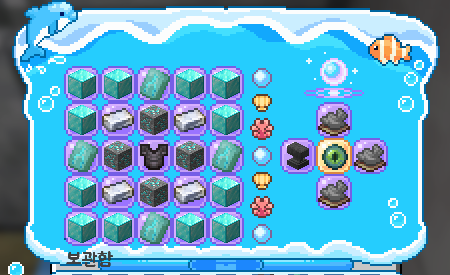
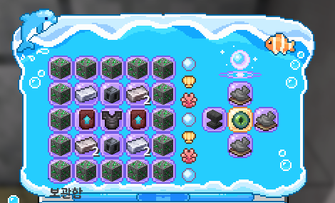
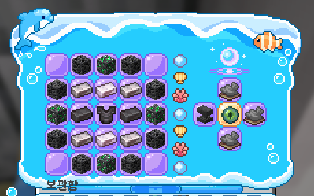
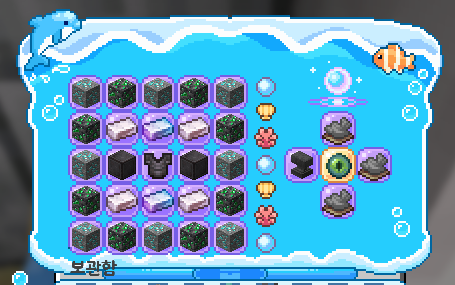

# 🔮 마법부여사

> **📌 30초 핵심 요약**
> * **이용 설비**: **커스텀 마법부여대** 우클릭 *(마법부여사 Lv. 1 이상 / 5×5 마법진 조합대)*
> * **주요 명령어**: `/마법부여대` (`/customenchanter`) · 특수 의뢰 열기 `/마법부여대 quest`
> * **공통 규칙**: 피로도·일일 수당은 **[🔨 전문 직업 및 제작](06-2.md)**, 153종 인챈트 효과는 **[📜 커스텀 인챈트](08..md)**를 참고하세요.


**💡 연성·과충전·구슬·양피지를 한 번에 다 하실 필요는 없습니다!**  
먼저 **기초 가루 연성**이나 **양피지 각인**부터 가볍게 한 번 체험해 보신 뒤, 나머지 시스템을 하나씩 살펴보세요.


<!-- [🎬 GIF 추천 #10] 커스텀 마법부여대 마나 과충전 도박 또는 양피지 각인 미니게임 4초 컷 -->

---

## 📑 목차 바로가기

1. [🔮 마법부여대 구조 및 명령어](#1--마법부여대-구조-및-명령어)
2. [✨ 기초 연성: 인챈트 가루 & 리무버](#2--기초-연성-인챈트-가루--리무버)
3. [🎲 마나 과충전 (인챈트 가루 블랙잭 도박)](#3--마나-과충전-인챈트-가루-블랙잭-도박)
4. [🔮 장비 인챈트 슬롯 확장 구슬 (4~7단계)](#4--장비-인챈트-슬롯-확장-구슬-47단계)
5. [🧪 마법부여사 특수 의뢰 (`/마법부여대 quest`) & 양피지 시스템](#5--마법부여사-특수-의뢰-마법부여대-quest--양피지-시스템)

---

## 1. 🔮 마법부여대 구조 및 명령어

* **명령어**: `/마법부여대` 또는 `/customenchanter` *(기존 `/enchanter` 별칭은 인챈트 충돌 방지를 위해 제거됨)*
* **GUI 슬롯 (45칸)**: 좌측 **5×5 마법진(`0~24`번)** 재료 투입 ➔ **`[ 연성 시작 ]`(24번)** ➔ **결과물 슬롯(25번)** · 도박 전용 버튼 `[등급 상승]`(16번) / `[확률 +5%]`(34번) / `[수령]`(26번) · 우측 상단 **`[ 마나 조율 의뢰 ]`(8번)**.

---

## 2. ✨ 기초 연성: 인챈트 가루 & 리무버

| 제작 품목 | 5×5 재료 배치 (경험치 1,000 책) | 소모 피로도 | 획득 경험치 | 효과 |
| :--- | :--- | :---: | :---: | :--- |
| **인챈트 가루** | 정중앙(3행 3열)에 **1개** 단독 배치 | 1 | 직업 +30 / 마법 +30 | 과충전 도박 및 인챈트 성공률 보정 기반 재료 |
| **인챈트 리무버** *(블랙 스크롤)* | 중앙 기준 십자(+) 형태로 **5개** 배치 | 5 | 직업 +200 | 장비의 무작위 인챈트 1개를 제거해 **10% 인챈트북**으로 추출 |

---

## 3. 🎲 마나 과충전 (인챈트 가루 블랙잭 도박)

5×5 중앙 **3×3 구역에 `인챈트 가루` 9개**를 올려 시작합니다 *(요구 Lv.0 / 피로도 5 / 시작 시 직업 +1,000 & 마법 +1,000 획득)*.
* **진행 규칙**: 시작 시 `D등급 (10%)`이 놓이며, 매 턴 **`[등급 상승 (D➔C➔B➔A➔S➔SS)]`** 또는 **`[확률 +5% 상승 (최대 100%)]`** 중 선택해 도전할 수 있습니다 *(매 시도 성공 시 직업 +150 & 마법 +150 추가 획득)*.
* **실패 & 안전 이탈**: 도전 실패 시 **현재 확률이 절반(1/2, 최소 1%)으로 깎이며 즉시 종료·수령**됩니다. 도중에 GUI를 닫아도 현재 상태 아이템이 인벤토리로 안전 지급됩니다.
* **성공 확률 공식**: $\text{성공 확률(\%)} = \text{Clamp}(90.0 + \text{레벨} \times 0.3 - \text{연속 성공 횟수} \times 10.0,\; 1.0,\; 100.0)$

📊 연속 시도 차수(1~10차) 및 레벨별 과충전 성공 확률표 펼쳐보기

| 시도 차수 | Lv.0 | Lv.10 (+3%) | Lv.20 (+6%) | Lv.30 (+9%) | Lv.40 (+12%) | Lv.50 (+15%) |
| :---: | :---: | :---: | :---: | :---: | :---: | :---: |
| **1차** (0회 성공) | 90.0% | 93.0% | 96.0% | 99.0% | 100.0% | 100.0% |
| **2차** (1회 성공) | 80.0% | 83.0% | 86.0% | 89.0% | 92.0% | 95.0% |
| **3차** (2회 성공) | 70.0% | 73.0% | 76.0% | 79.0% | 82.0% | 85.0% |
| **4차** (3회 성공) | 60.0% | 63.0% | 66.0% | 69.0% | 72.0% | 75.0% |
| **5차** (4회 성공) | 50.0% | 53.0% | 56.0% | 59.0% | 62.0% | 65.0% |
| **6차** (5회 성공) | 40.0% | 43.0% | 46.0% | 49.0% | 52.0% | 55.0% |
| **7차** (6회 성공) | 30.0% | 33.0% | 36.0% | 39.0% | 42.0% | 45.0% |
| **8차** (7회 성공) | 20.0% | 23.0% | 26.0% | 29.0% | 32.0% | 35.0% |
| **9차** (8회 성공) | 10.0% | 13.0% | 16.0% | 19.0% | 22.0% | 25.0% |
| **10차** (9회 성공) | 1.0% | 3.0% | 6.0% | 9.0% | 12.0% | 15.0% |

---

## 4. 🔮 장비 인챈트 슬롯 확장 구슬 (4~7단계)

기본 **3칸**인 장비의 커스텀 인챈트 슬롯을 **최대 7칸**까지 순차 확장(`3➔4➔5➔6➔7`)합니다. *(완성 후 장비에 드래그 앤 드롭 시 100% 확장 / 공통 소모 피로도 5)*

| 단계 | 결과물 (중앙 코어 장비) | 요구 Lv | 획득 EXP | 총 소모 재료 (빈칸 포함 5×5 정확 일치 필요) |
| :---: | :--- | :---: | :---: | :--- |
| **4단계** | **인챈트 구슬 [4]** *(3➔4칸)* | Lv. 5 | 2,000 | 다이아몬드 블록 12 + 물결 갑옷 장식 형판 4 + **텅스텐 강철 주괴 4** + 다이아 광석 4 + 코어 1 |
| **5단계** | **인챈트 구슬 [5]** *(4➔5칸)* | Lv. 10 | 2,500 | 에메랄드 광석 16 + **백색금 주괴 2** + **열합금 주괴 2** + 무거운 코어 2 + 네더 강화 형판 2 + 코어 1 |
| **6단계** | **인챈트 구슬 [6]** *(5➔6칸)* | Lv. 20 | 3,000 | 심층암 석탄 8 + 심층암 에메랄드 4 + **열합금 주괴 4** + **오리칼쿰 주괴 2** + 네더라이트 주괴 2 + 코어 1 |
| **7단계** | **인챈트 구슬 [7]** *(6➔7칸)* | Lv. 40 | 3,500 | 다이아 광석 8 + 심층암 에메랄드 8 + **오리칼쿰 주괴 4** + **스텔라리움 주괴 2** + 네더라이트 블록 2 + 코어 1 |

* **중앙 코어 장비**: 무기 구슬(`네더라이트 검`) · 도구 구슬(`네더라이트 곡괭이`) · 방어구 구슬(`네더라이트 흉갑`)

🖼️ 4~7단계 인챈트 구슬 5×5 마법진 조합법 이미지 & 격자 배치표 펼쳐보기

#### 🟢 Level 4: 인챈트 구슬 [4]
<figure><figcaption></figcaption></figure>

| 1열 | 2열 | 3열 | 4열 | 5열 |
| :---: | :---: | :---: | :---: | :---: |
| 다이아몬드 블록 | 다이아몬드 블록 | **물결 형판** | 다이아몬드 블록 | 다이아몬드 블록 |
| 다이아몬드 블록 | **텅스텐 강철 주괴** | 다이아몬드 광석 | **텅스텐 강철 주괴** | 다이아몬드 블록 |
| **물결 형판** | 다이아몬드 광석 | **중앙 코어 장비** | 다이아몬드 광석 | **물결 형판** |
| 다이아몬드 블록 | **텅스텐 강철 주괴** | 다이아몬드 광석 | **텅스텐 강철 주괴** | 다이아몬드 블록 |
| 다이아몬드 블록 | 다이아몬드 블록 | **물결 형판** | 다이아몬드 블록 | 다이아몬드 블록 |

#### 🔵 Level 5: 인챈트 구슬 [5]
<figure><figcaption></figcaption></figure>

| 1열 | 2열 | 3열 | 4열 | 5열 |
| :---: | :---: | :---: | :---: | :---: |
| 에메랄드 광석 | 에메랄드 광석 | 에메랄드 광석 | 에메랄드 광석 | 에메랄드 광석 |
| 에메랄드 광석 | **백색금 주괴** | **무거운 코어** | **열합금 주괴** | 에메랄드 광석 |
| 에메랄드 광석 | **네더라이트 강화 형판** | **중앙 코어 장비** | **네더라이트 강화 형판** | 에메랄드 광석 |
| 에메랄드 광석 | **열합금 주괴** | **무거운 코어** | **백색금 주괴** | 에메랄드 광석 |
| 에메랄드 광석 | 에메랄드 광석 | 에메랄드 광석 | 에메랄드 광석 | 에메랄드 광석 |

#### 🟣 Level 6: 인챈트 구슬 [6]
<figure><figcaption></figcaption></figure>

| 1열 | 2열 | 3열 | 4열 | 5열 |
| :---: | :---: | :---: | :---: | :---: |
| 빈칸 | 심층암 석탄 광석 | 심층암 에메랄드 광석 | 심층암 석탄 광석 | 빈칸 |
| 심층암 석탄 광석 | **열합금 주괴** | **오리칼쿰 주괴** | **열합금 주괴** | 심층암 석탄 광석 |
| 심층암 에메랄드 광석 | **네더라이트 주괴** | **중앙 코어 장비** | **네더라이트 주괴** | 심층암 에메랄드 광석 |
| 심층암 석탄 광석 | **열합금 주괴** | **오리칼쿰 주괴** | **열합금 주괴** | 심층암 석탄 광석 |
| 빈칸 | 심층암 석탄 광석 | 심층암 에메랄드 광석 | 심층암 석탄 광석 | 빈칸 |

#### 🟡 Level 7: 인챈트 구슬 [7]
<figure><figcaption></figcaption></figure>

| 1열 | 2열 | 3열 | 4열 | 5열 |
| :---: | :---: | :---: | :---: | :---: |
| 다이아몬드 광석 | 심층암 에메랄드 광석 | 다이아몬드 광석 | 심층암 에메랄드 광석 | 다이아몬드 광석 |
| 심층암 에메랄드 광석 | **오리칼쿰 주괴** | **스텔라리움 주괴** | **오리칼쿰 주괴** | 심층암 에메랄드 광석 |
| 다이아몬드 광석 | **네더라이트 블록** | **중앙 코어 장비** | **네더라이트 블록** | 다이아몬드 광석 |
| 심층암 에메랄드 광석 | **오리칼쿰 주괴** | **스텔라리움 주괴** | **오리칼쿰 주괴** | 심층암 에메랄드 광석 |
| 다이아몬드 광석 | 심층암 에메랄드 광석 | 다이아몬드 광석 | 심층암 에메랄드 광석 | 다이아몬드 광석 |

---

## 5. 🧪 마법부여사 특수 의뢰 (`/마법부여대 quest`) & 양피지 시스템

### ① 🔮 마법부여사 학회 특수 의뢰 (4단계 마나 조율 미니게임)
마법부여대 우측 상단 **8번 슬롯(`[ 마나 조율 의뢰 ]`)** 또는 **`/마법부여대 quest`**(`/customenchanter quest`)로 도전할 수 있습니다.
* **보상 체계**: 각 라운드 정확도에 따라 **SSS / SS / S / A / B** 등급이 매겨지며, 등급 배율에 맞춰 **직업 경험치, 마법 스킬 경험치(4배), 의뢰 보수금**을 지급합니다. **S랭크 이상** 달성 시 고급 마법부여 재료 및 희귀 보상을 추가로 얻습니다.
* **안전장치 & 퀘스트 연동**: 미니게임 진행 중 창을 닫거나 접속이 끊기면 **소모된 피로도가 100% 자동 환불**되며, 직업 의뢰(`[초/중/고급] 마나 조율 미니게임 진행`) 목표와 함께 완료됩니다.

| 단계 | 의뢰명 | 모드 유형 | 요구 Lv | 소모 피로도 |
| :---: | :--- | :--- | :---: | :---: |
| **1단계** | **[견습 마법사의 시련] 기초 마나 조율** | 공간 기억력 모드 | Lv. 0+ | 5 |
| **2단계** | **[숙련 마법사의 의뢰] 마나 궤적 추적** | 마나 궤적 모드 | Lv. 10+ | 10 |
| **3단계** | **[고위 마법사의 공정] 사이먼 마나 공명** | 순서 암기 모드 | Lv. 20+ | 15 |
| **4단계** | **[대마법사의 시련] 심연의 마나 과충전** | 무작위 돌발 모드 | Lv. 30+ | 20 |

### ② 📜 양피지 실력 배팅 시스템
* **진행 방법**: 4단계 등급(`견습생` / `숙련자` / `전문가` / `대마법사`)의 **빈 양피지**를 손에 들고 우클릭하면 마나 조율 미니게임이 시작됩니다.
* **보상 및 거래**: 미니게임 종료 시 최종 등급(`SSS` ~ `F`), 점수, 판매 가치가 각인된 **완성 양피지**로 변환되며, 상점 판매 시 본인의 조율 실력에 따라 수익 또는 손실이 정산됩니다.
