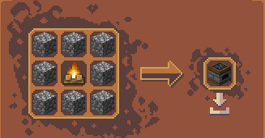

# 🍳 요리사

> **안내**: 전문 수제 주방 조리 시스템과 3D 전통 요리 솥 시스템의 조리기구 사용법, 가열 열원 규칙, 상점 판매 공식 등록 기준 전체 61종 요리 스펙(수제 35종 + 전통 솥 26종), 품질 등급 및 안전 대리 제작(`/의뢰`)을 총망라한 **요리사 공식 총가이드**입니다.  
> 🔨 **전문 직업 통합 개요**: 전문직 공통 규칙(피로도, 수당, `/의뢰` 대리제작)은 **[🔨 전문 직업 및 제작](06-2.md)** 문서를 참고하시기 바랍니다.  
> 🌾 **농작물 수급처**: 요리에 필요한 29종 커스텀 작물 및 보라별 작물은 **[🌲 생활 직업 및 특성 - 농부](06-1.md#2--농부-farmer)**를 참고하시기 바랍니다.

---

## 📑 목차 바로가기

1. [🍳 요리사 개요 및 2대 조리 체계 비교](#1--요리사-개요-및-2대-조리-체계-비교)
   * 체계 A: 🔪 전문 수제 주방 조리 (35종)
   * 체계 B: 🍲 전통 3D 요리 솥 조리 (26종)
2. [🔥 가열 열원 설치 및 점화 / 소화 메커니즘](#2--가열-열원-설치-및-점화--소화-메커니즘)
   * 전용 주방 스토브 (라이터 점화 / 삽 소화)
   * 모닥불 / 마그마 블록 열원
3. [⚡ 조리 행동별 피로도·경험치 및 레벨 할인 시스템](#3--조리-행동별-피로도경험치-및-레벨-할인-시스템)
   * 과정별 실시간 피로도 (칼질 +1, 웍질 +1, 맷돌 +2)
   * 요리사 레벨별 피로도 할인 및 영끌(대출) 규칙
4. [⭐ 요리 품질(1★~5★ 별 등급) 추첨 확률 및 판매 배율](#4-️-요리-품질15-별-등급-추첨-확률-및-판매-배율)
   * 기본 가중치 및 레벨별 고등급 보너스
   * 상점 매입 배율 (1.0배 ~ 3.0배)
5. [🛠️ 주방 설비 및 요리 도구 제작 레시피 (16종)](#5-️-주방-설비-및-요리-도구-제작-레시피-16종)
   * 5.1 🍳 핵심 주방 조리 설비 & 기구 (8종)
   * 5.2 🥄 보조 조리기구 & 보관 용기 (4종)
   * 5.3 🔪 요리용 식칼 (중식도 4종)
6. [🔪 [체계 A] 수제 주방 기구 사용법](#6--체계-a-수제-주방-기구-사용법)
   * 6.1 🔪 도마 (Chopping Board) - 식칼 손질
   * 6.2 🍳 프라이팬 / 웍 (Pot/Wok) - 볶음 및 튀김
   * 6.3 🍲 곰솥 - 탕, 국물 및 쌀밥
   * 6.4 🥟 찜기 & 🌯 샤와르마
   * 6.5 ⚙️ 맷돌 - 제분 및 도정
7. [📋 [체계 A] 수제 요리 레시피 총람 (35종)](#7--체계-a-수제-요리-레시피-총람-35종)
   * 7.1 프라이팬 / 웍 볶음 요리 (17종)
   * 7.2 곰솥 / 국물 & 면 요리 (16종)
   * 7.3 찜기 & 샤와르마 회전구이 (2종)
8. [🍲 [체계 B] 전통 요리 솥 조리 매뉴얼 & 레시피 (26종)](#8--체계-b-전통-요리-솥-조리-매뉴얼--레시피-26종)
   * 8.1 솥 설치, 가열 및 재료 투입 상호작용
   * 8.2 전통 솥 요리 전체 목록 (26종 - 피로도 12, 경험치 120 EXP)
9. [🤝 안전 대리 의뢰 (`/의뢰`)](#9--안전-대리-의뢰-의뢰)

---

## 1. 🍳 요리사 개요 및 2대 조리 체계 비교

서버의 요리 시스템은 상호 보완적인 **2가지 독립 조리 체계**로 운영됩니다.

<table>
  <thead>
    <tr>
      <th width="160">구분</th>
      <th width="260">🔪 체계 A: 전문 수제 주방 조리</th>
      <th width="260">🍲 체계 B: 전통 요리 솥 조리</th>
    </tr>
  </thead>
  <tbody>
    <tr>
      <td><strong>주요 설비</strong></td>
      <td>도마, 프라이팬(웍), 곰솥, 찜기, 맷돌, 샤와르마 머신, 주방 스토브</td>
      <td>전통 요리 솥 (ModelEngine 3D 솥)</td>
    </tr>
    <tr>
      <td><strong>조리 방식</strong></td>
      <td>식칼 손질, 웍질, 제분, 찌기 등 단계별 손동작 직접 수행</td>
      <td>재료 투입 후 솥을 저어 끓여내는 전통 솥 조리</td>
    </tr>
    <tr>
      <td><strong>피로도 규칙</strong></td>
      <td><strong>과정별 실시간 누적</strong> (칼질 +1, 웍질 +1, 맷돌 +2, 완성 수령)</td>
      <td><strong>1회 완성 시 일괄 차감</strong> (피로도 12 소모)</td>
    </tr>
    <tr>
      <td><strong>피로도당 가치</strong></td>
      <td><strong>피로도당 750원 기준</strong> (고부가가치 수제 요리, 최대 18,000원)</td>
      <td><strong>5,000원 정산가</strong> (피로도당 약 416원)</td>
    </tr>
    <tr>
      <td><strong>품질 등급</strong></td>
      <td><strong>1★ ~ 5★ 별 등급</strong> 추첨 (1.0배 ~ 3.0배 차등 판매가)</td>
      <td><strong>1★ ~ 5★ 별 등급</strong> 추첨 (기본가 5,000원 기준 1.0~3.0배)</td>
    </tr>
    <tr>
      <td><strong>등록 메뉴</strong></td>
      <td>동파육, 우육면, 불도장, 고추완자튀김 등 <strong>35종</strong></td>
      <td>초밥, 샌드위치, 햄버거, 케밥 등 <strong>26종</strong></td>
    </tr>
  </tbody>
</table>

* **요리사 자격 제한**: 두 시스템의 모든 조리기구는 **요리사 직업을 보유한 유저만 조작 및 철거**할 수 있습니다.
* **내용물 보호 (안티 글리치)**: 조리기구 내부에 식재료나 조리 중인 음식이 남아있는 경우 블록 파괴가 불가능하여 재료 분실을 원천 방지합니다.

---

## 2. 🔥 가열 열원 설치 및 점화 / 소화 메커니즘

프라이팬, 곰솥, 찜기, 전통 요리 솥 등 열을 사용하는 조리기구는 **조리기구 바로 아래(1칸 밑)에 가열 열원(Heat Source)이 활성화되어 있어야만 조리가 진행**됩니다.

```
[ 조리 기구 ]  (프라이팬, 곰솥, 찜기, 전통 요리 솥 등)
      │
[ 가열 열원 ]  (주방 스토브, 모닥불, 마그마 블록 등)
```

### 1. 전용 주방 난로 (스토브)
* **점화 (불 지피기)**:
  * **부싯돌과 부싯쇠(라이터)** 또는 **화염구(Fire Charge)**를 손에 들고 스토브를 우클릭하면 불이 켜지며 (`lit: true`), 타닥타닥 소리와 함께 가열이 시작됩니다.
* **소화 (불 끄기)**:
  * **삽(모든 재질의 Shovel)**을 든 채 켜진 스토브를 우클릭하거나 물을 뿌리면 안전하게 불이 꺼집니다.

### 2. 모닥불 / 영혼 모닥불 (`Campfire` / `Soul Campfire`)
* 모닥불 바로 위에 조리기구를 올릴 수 있으며, 꺼져 있을 경우 **부싯돌과 부싯쇠**로 우클릭하여 점화합니다. (삽으로 소화)

### 3. 마그마 블록 (`Magma Block`)
* 마그마 블록은 별도의 점화나 소화 작업 없이 **24시간 항시 무한 가열 상태**를 유지하는 자동 열원입니다.

---

## 3. ⚡ 조리 행동별 피로도·경험치 및 레벨 할인 시스템

요리 피로도 시스템에 의해 행동별 실시간 피로도 누적과 요리사 레벨별 혜택이 적용됩니다.

### 3.1 조리 행동별 실시간 피로도 & 경험치 (`process-fatigue`)
수제 조리 진행 시 단계별 행동마다 피로도와 직업 경험치가 실시간으로 차감/누적됩니다.

| 조리 기구 | 조리 행동 | 1회 피로도 | 1회 획득 경험치 | 상세 설명 |
| :--- | :--- | :---: | :---: | :--- |
| **🔪 도마 (Chopping Board)** | 식칼 손질 (칼질) | **`+1`** | **`+5 EXP`** | 고기 및 생선 슬라이스 손질, 면 반죽 썰기 (레시피당 5회) |
| **🍳 프라이팬 (Pot/Wok)** | 주걱 볶기 (웍질) | **`+1`** | **`+5 EXP`** | 화력 조절 및 볶음 작업 (레시피당 3~5회) |
| **⚙️ 맷돌** | 밀 제분 / 곡물 가공 | **`+2`** | **`+10 EXP`** | 1회 회전 완료 시 밀가루 제분 및 곡물 도정 |

### 3.2 요리사 레벨 할인 (`level-discount`)
* **피로도 할인 규칙**: 요리사 전문직 레벨 **15레벨마다 1회 제작 피로도 1 감소**
* **최대 할인 수치**: **최대 -3 피로도 할인** (`max-discount: 3`, Lv.45 도달 시 최대치 달성)
* **최소 피로도 하한선**: 어떤 할인이 들어가더라도 1회 제작당 최소 **1 피로도**는 소모됩니다.

### 3.3 피로도 상한 및 영끌(대출) 모드 (`allow-overwork`)
* 현재 피로도가 한계치에 도달하더라도, 기구 내에 이미 완성된 요리가 있는 경우 **초과 수령(영끌 대출)이 허용**되어 음식 소실 없이 안전하게 회수할 수 있습니다.

---

## 4. ⭐ 요리 품질(1★~5★ 별 등급) 추첨 확률 및 판매 배율

수제 요리는 완성 시 숙련도에 따라 **1★부터 5★까지의 품질 등급**이 추첨되며, 상점(`/상점`) 판매 시 기본 판매가에 등급별 배율이 곱해져 정산됩니다.

### 4.1 기본 가중치 및 레벨별 고등급 보너스
* **기본 추첨 가중치**:
  * **1★ (일반)**: 가중치 `50.0` (기본 약 50.0%)
  * **2★ (고급)**: 가중치 `30.0` (기본 약 30.0%)
  * **3★ (희귀)**: 가중치 `14.0` (기본 약 14.0%)
  * **4★ (영웅)**: 가중치 `5.0` (기본 약 5.0%)
  * **5★ (전설)**: 가중치 `1.0` (기본 약 1.0%)
* **요리사 레벨 보너스 (`chef-level-bonus`)**:
  * 요리사 직업 레벨 **1당 4성(영웅)과 5성(전설) 가중치 각각 +0.15씩 증가**
  * **Lv. 50 만렙 기준**: 4성과 5성에 **각각 +7.5의 추가 가중치**가 부여되어 고품질 요리 획득 확률이 대폭 상승합니다.

### 4.2 등급별 상점 판매 배율표

$$\text{최종 판매 가격} = \text{1★ 기본 시세} \times \text{품질 배율}$$

<table>
  <thead>
    <tr>
      <th align="center" width="90">등급</th>
      <th width="130">품질 명칭</th>
      <th align="center" width="130">상점 매입 배율</th>
      <th>설명</th>
    </tr>
  </thead>
  <tbody>
    <tr>
      <td align="center"><strong>1★</strong></td>
      <td>일반</td>
      <td align="center"><strong>1.0배</strong></td>
      <td>기본 정산 가격으로 판매됩니다.</td>
    </tr>
    <tr>
      <td align="center"><strong>2★</strong></td>
      <td>고급</td>
      <td align="center"><strong>1.4배</strong></td>
      <td>기본가 대비 40% 추가 수익을 얻습니다.</td>
    </tr>
    <tr>
      <td align="center"><strong>3★</strong></td>
      <td>희귀</td>
      <td align="center"><strong>1.8배</strong></td>
      <td>기본가 대비 80% 추가 수익을 얻습니다.</td>
    </tr>
    <tr>
      <td align="center"><strong>4★</strong></td>
      <td>영웅</td>
      <td align="center"><strong>2.4배</strong></td>
      <td>기본가 대비 140% 추가 수익을 얻습니다.</td>
    </tr>
    <tr>
      <td align="center"><strong>5★</strong></td>
      <td>전설</td>
      <td align="center"><strong>3.0배</strong></td>
      <td>기본가의 무려 <strong>3배</strong>로 판매되는 최고 품질 요리입니다.</td>
    </tr>
  </tbody>
</table>

---

## 5. 🛠️ 주방 설비 및 요리 도구 제작 레시피 (16종)

전문 수제 주방 조리 시스템(**Kaleidoscope Cookery**)에서 사용되는 핵심 조리 설비, 보조 기구, 보관 용기 및 요리용 중식도 16종의 공식 조합법입니다.

### 5.1 🍳 핵심 주방 조리 설비 & 기구 (8종)

가열, 볶기, 끓이기, 찌기, 제분 등 전문 수제 요리 조리의 필수 설비 및 기구입니다.

<table>
  <thead>
    <tr>
      <th width="140">설비 / 기구명</th>
      <th width="200">조합 재료</th>
      <th align="center" width="220">조합법</th>
      <th>설명 및 주요 기능</th>
    </tr>
  </thead>
  <tbody>
    <tr>
      <td><strong>난로</strong></td>
      <td>조약돌 × 8<br>모닥불 × 1<br><em>(영혼 모닥불 가능)</em></td>
      <td align="center"></td>
      <td>프라이팬, 냄비, 찜기를 올려 가열 조리하는 주방 핵심 열원 설비 (라이터 점화 / 삽 소화)</td>
    </tr>
    <tr>
      <td><strong>프라이팬 (웍)</strong></td>
      <td>철괴 × 7</td>
      <td align="center"></td>
      <td>난로 위에 올려 기름을 두르고 볶음 및 튀김 요리를 조리하는 조리 기구</td>
    </tr>
    <tr>
      <td><strong>냄비 (곰솥)</strong></td>
      <td>벽돌 × 2<br>철괴 × 5</td>
      <td align="center"></td>
      <td>탕, 찌개, 국물 요리 및 밥을 짓기 위한 대형 곰솥 설비</td>
    </tr>
    <tr>
      <td><strong>냄비 뚜껑</strong></td>
      <td>벽돌 × 1<br>철괴 × 3</td>
      <td align="center"></td>
      <td>냄비 조리 시 덮어서 증기를 가두고 푹 끓여내는 데 필수적인 전용 뚜껑</td>
    </tr>
    <tr>
      <td><strong>도마</strong></td>
      <td>참나무 압력판 × 6</td>
      <td align="center"></td>
      <td>고기, 생선, 채소 식재료를 식칼로 썰어 요리용 밑재료를 준비하는 전용 손질대</td>
    </tr>
    <tr>
      <td><strong>맷돌</strong></td>
      <td>매끄러운 돌 × 3<br>참나무 울타리 × 1<br>막대기 × 1<br>숫돌 × 1</td>
      <td align="center"></td>
      <td>밀을 제분하여 밀가루를 만들거나 곡물을 도정하는 회전식 제분 기구</td>
    </tr>
    <tr>
      <td><strong>찜기</strong></td>
      <td>대나무 다락문 × 3<br>대나무 블록 × 3</td>
      <td align="center"></td>
      <td>냄비 위에 올려 증기로 만두, 딤섬, 찐빵 등을 조리하는 다단 찜기</td>
    </tr>
    <tr>
      <td><strong>샤와르마 꼬챙이</strong></td>
      <td>사슬 × 4<br>모닥불 × 2</td>
      <td align="center"></td>
      <td>고기 반죽을 꽂아 회전구이로 겉바속촉 바베큐를 조리하는 특수 조리 설비</td>
    </tr>
  </tbody>
</table>

### 5.2 🥄 보조 조리기구 & 보관 용기 (4종)

<table>
  <thead>
    <tr>
      <th width="140">도구 / 용기명</th>
      <th width="200">조합 재료</th>
      <th align="center" width="220">조합법</th>
      <th>설명 및 주요 기능</th>
    </tr>
  </thead>
  <tbody>
    <tr>
      <td><strong>뒤집개</strong></td>
      <td>철괴 × 1<br>철 조각 × 1<br>막대기 × 1</td>
      <td align="center"></td>
      <td>프라이팬에서 재료를 뒤집고 볶는 웍질 조리에 필수적인 조리 주걱</td>
    </tr>
    <tr>
      <td><strong>법랑 대야</strong></td>
      <td>돌 버튼 × 1<br>중량형 압력판(철) × 1<br>양동이 × 1</td>
      <td align="center"></td>
      <td>주방 인테리어 및 식재료 세척/보관용 다용도 세라믹 대야</td>
    </tr>
    <tr>
      <td><strong>빈 기름 항아리</strong></td>
      <td>벽돌 × 5</td>
      <td align="center"></td>
      <td>식용 기름을 담아 보관하기 위한 빈 세라믹 항아리</td>
    </tr>
    <tr>
      <td><strong>기름 항아리</strong></td>
      <td>빈 기름 항아리 × 1<br>식용유(기름) × 8<br><em>(무정형 조합)</em></td>
      <td align="center"></td>
      <td>프라이팬 볶음 요리에 식용유를 공급하는 대용량 조리용 기름 항아리</td>
    </tr>
  </tbody>
</table>

### 5.3 🔪 요리용 식칼 (중식도 4종)

도마에서 식재료를 썰어 손질할 때 사용되는 중식 식칼 4종입니다.

<table>
  <thead>
    <tr>
      <th width="140">식칼명</th>
      <th width="200">조합 재료</th>
      <th align="center" width="220">조합법</th>
      <th>설명 및 주요 기능</th>
    </tr>
  </thead>
  <tbody>
    <tr>
      <td><strong>철 중식도</strong></td>
      <td>철괴 × 3<br>막대기 × 1</td>
      <td align="center"></td>
      <td>도마에서 재료를 손질할 때 사용하는 가장 기본적인 주방 식칼</td>
    </tr>
    <tr>
      <td><strong>금 중식도</strong></td>
      <td>금괴 × 3<br>막대기 × 1</td>
      <td align="center"></td>
      <td>금 재질로 제작된 중식 식칼</td>
    </tr>
    <tr>
      <td><strong>다이아몬드 중식도</strong></td>
      <td>다이아몬드 × 3<br>막대기 × 1</td>
      <td align="center"></td>
      <td>높은 내구도를 지닌 고급 중식 식칼</td>
    </tr>
    <tr>
      <td><strong>네더라이트 중식도</strong></td>
      <td>다이아몬드 중식도 × 1<br>네더라이트 주괴 × 1<br><em>(무정형 조합)</em></td>
      <td align="center"></td>
      <td>최상위 내구도를 자랑하는 종결 주방 식칼</td>
    </tr>
  </tbody>
</table>

---

## 6. 🔪 [체계 A] Kaleidoscope Cookery 주방 기구 사용법

### 6.1 🔪 도마 (Chopping Board) - 식칼 손질
고기, 생선, 채소를 썰어 요리의 밑재료를 준비하는 조리대입니다.
```
[재료 들고 도마 우클릭] ➔ [식칼 들고 우클릭하여 썰기] ➔ [손질된 재료 수령]
```
* **식칼 사용**: **식칼(Kitchen Knife)**을 손에 들고 도마를 우클릭하여 썹니다.
* **소모 피로도**: 칼질 1회당 피로도 1 소모 / 경험치 5 EXP (레시피당 총 5회 칼질, 누적 +5 피로도 소모).

### 6.2 🍳 프라이팬 / 웍 (Pot/Wok) - 볶음 및 튀김
센 불에 기름을 두르고 재료를 빠르게 볶아내는 대표 조리기구입니다.
```
[식용유 투입] ➔ [레시피 재료 투입] ➔ [주걱으로 볶기] ➔ [그릇으로 요리 퍼내기]
```
* **식용유 투입**: 프라이팬에 식용유를 우클릭하여 두릅니다.
* **주걱 웍질**: **조리 주걱**을 들고 우클릭하여 볶습니다 (회당 피로도 1 소모 / 경험치 5 EXP).
* **완성 수령**: 조리가 끝나면 **빈 그릇**을 들고 우클릭하여 요리를 담아냅니다. (이때 요리별 완성 피로도 차감 및 별 등급 추첨)

### 6.3 🍲 곰솥 - 탕, 국물 및 쌀밥
오랜 시간 은근한 불로 육수와 재료를 우려내는 대형 국물 조리기구입니다.
```
[육수 베이스 투입] ➔ [식재료 투입] ➔ [뚜껑 덮고 끓이기] ➔ [뚜껑 열고 그릇으로 수령]
```
* **육수 베이스**: 물 또는 정해진 육수 베이스를 붓습니다. *(마라 닭요리, 열건면은 용암 육수 사용)*
* **뚜껑 여닫기**: 재료를 넣은 뒤 뚜껑을 닫아 끓이고, 조리가 끝나면 뚜껑을 열고 빈 그릇으로 퍼냅니다.

### 6.4 🥟 찜기 & 🌯 샤와르마
* **찜기**: 곰솥 위에 찜기 단을 올리고 만두나 찐빵 반죽을 넣어 증기로 찌기 조리를 진행합니다.
* **샤와르마 머신**: 회전구이 기둥에 고기 반죽을 꽂아 겉면을 바삭하게 익혀냅니다.

### 6.5 ⚙️ 맷돌 - 제분 및 도정
* 밀을 넣어 밀가루로 제분하거나, 곡물을 가공하여 면 반죽의 기초 재료를 만듭니다 (1회 회전당 피로도 2 소모 / 경험치 10 EXP).

---

## 7. 📋 [체계 A] 수제 요리 레시피 총람 (35종)

상점 판매가 활성화된 전문 수제 요리 35종의 세부 과정, 완성 피로도, 직업 경험치 및 상점 가격표입니다.  
*(※ 총 피로도 = 사전 가공 피로도 + 웍질/칼질 피로도 + 완성 수령 피로도)*

### 7.1 프라이팬 / 웍 볶음 요리 (17종)

<table>
  <thead>
    <tr>
      <th width="160">요리명</th>
      <th width="240">제작 세부 과정</th>
      <th align="center" width="80">완성 피로도</th>
      <th align="center" width="80">총 피로도</th>
      <th align="center" width="90">직업 경험치</th>
      <th align="right" width="95">1★ 기본가</th>
      <th align="right" width="95">5★ 최고가</th>
    </tr>
  </thead>
  <tbody>
    <tr>
      <td><strong>계란 후라이</strong></td>
      <td>달걀 1 ➔ 볶기 3회 ➔ 맨손 수령</td>
      <td align="center">3</td>
      <td align="center"><strong>6</strong></td>
      <td align="center">50 EXP</td>
      <td align="right">4,500원</td>
      <td align="right">13,500원</td>
    </tr>
    <tr>
      <td><strong>토마토 달걀 볶음</strong></td>
      <td>달걀 3 + 토마토 3 ➔ 볶기 3회 ➔ 수령</td>
      <td align="center">8</td>
      <td align="center"><strong>11</strong></td>
      <td align="center">110 EXP</td>
      <td align="right">8,300원</td>
      <td align="right">24,900원</td>
    </tr>
    <tr>
      <td><strong>야키토리</strong></td>
      <td>생 닭고기 4 + 고추 2 ➔ 볶기 4회 ➔ 수령</td>
      <td align="center">8</td>
      <td align="center"><strong>12</strong></td>
      <td align="center">110 EXP</td>
      <td align="right">9,000원</td>
      <td align="right">27,000원</td>
    </tr>
    <tr>
      <td><strong>튀긴 춘권</strong></td>
      <td>돼지고기 4 + 팬텀막 2 + 버섯 2 ➔ 볶기 4회 ➔ 수령</td>
      <td align="center">8</td>
      <td align="center"><strong>12</strong></td>
      <td align="center">120 EXP</td>
      <td align="right">9,000원</td>
      <td align="right">27,000원</td>
    </tr>
    <tr>
      <td><strong>돼지고기 피망 볶음</strong></td>
      <td>돼지고기 3 + 고추 3 ➔ 볶기 3회 ➔ 수령</td>
      <td align="center">10</td>
      <td align="center"><strong>13</strong></td>
      <td align="center">140 EXP</td>
      <td align="right">9,800원</td>
      <td align="right">29,400원</td>
    </tr>
    <tr>
      <td><strong>생선 조림</strong></td>
      <td>생 대구 6 + 고추 1 ➔ 볶기 3회 ➔ 수령</td>
      <td align="center">10</td>
      <td align="center"><strong>13</strong></td>
      <td align="center">140 EXP</td>
      <td align="right">9,800원</td>
      <td align="right">29,400원</td>
    </tr>
    <tr>
      <td><strong>계란 볶음밥</strong></td>
      <td>곰솥 쌀밥(+4) + 달걀 2 + 볶기 3회 ➔ 수령</td>
      <td align="center">7</td>
      <td align="center"><strong>14</strong></td>
      <td align="center">100 EXP</td>
      <td align="right">10,500원</td>
      <td align="right">31,500원</td>
    </tr>
    <tr>
      <td><strong>어향육사</strong></td>
      <td>돼지고기 2 + 버섯 2 + 고추 2 ➔ 볶기 4회 ➔ 수령</td>
      <td align="center">10</td>
      <td align="center"><strong>14</strong></td>
      <td align="center">140 EXP</td>
      <td align="right">10,500원</td>
      <td align="right">31,500원</td>
    </tr>
    <tr>
      <td><strong>홍소우육</strong></td>
      <td>생 소고기 3 + 고추 3 ➔ 볶기 4회 ➔ 수령</td>
      <td align="center">10</td>
      <td align="center"><strong>14</strong></td>
      <td align="center">150 EXP</td>
      <td align="right">10,500원</td>
      <td align="right">31,500원</td>
    </tr>
    <tr>
      <td><strong>찹쌀떡</strong></td>
      <td>곰솥 쌀밥(+4) + 볶기 4회 ➔ 맨손 수령</td>
      <td align="center">6</td>
      <td align="center"><strong>14</strong></td>
      <td align="center">90 EXP</td>
      <td align="right">10,500원</td>
      <td align="right">31,500원</td>
    </tr>
    <tr>
      <td><strong>전병</strong></td>
      <td>맷돌 밀가루(+2) + 고기 반죽 ➔ 볶기 4회 ➔ 수령</td>
      <td align="center">8</td>
      <td align="center"><strong>14</strong></td>
      <td align="center">120 EXP</td>
      <td align="right">10,500원</td>
      <td align="right">31,500원</td>
    </tr>
    <tr>
      <td><strong>매운 양념치킨</strong></td>
      <td>생 닭고기 4 + 고추 4 ➔ 볶기 4회 ➔ 그릇 수령</td>
      <td align="center">11</td>
      <td align="center"><strong>15</strong></td>
      <td align="center">160 EXP</td>
      <td align="right">11,300원</td>
      <td align="right">33,900원</td>
    </tr>
    <tr>
      <td><strong>유포어</strong></td>
      <td>생 대구 6 + 고추 2 ➔ 볶기 5회 ➔ 그릇 수령</td>
      <td align="center">11</td>
      <td align="center"><strong>16</strong></td>
      <td align="center">160 EXP</td>
      <td align="right">12,000원</td>
      <td align="right">36,000원</td>
    </tr>
    <tr>
      <td><strong>돼지갈비찜</strong></td>
      <td>돼지고기 4 + 뼈 4 ➔ 볶기 5회 ➔ 그릇 수령</td>
      <td align="center">11</td>
      <td align="center"><strong>16</strong></td>
      <td align="center">160 EXP</td>
      <td align="right">12,000원</td>
      <td align="right">36,000원</td>
    </tr>
    <tr>
      <td><strong>맛있는 계란 볶음밥</strong></td>
      <td>곰솥 쌀밥(+4) + 달걀/상추/당근 ➔ 볶기 4회 ➔ 수령</td>
      <td align="center">9</td>
      <td align="center"><strong>17</strong></td>
      <td align="center">130 EXP</td>
      <td align="right">12,800원</td>
      <td align="right">38,400원</td>
    </tr>
    <tr>
      <td><strong>동파육</strong></td>
      <td>생 돼지고기 6 + 대나무 2 ➔ 볶기 5회 ➔ 그릇 수령</td>
      <td align="center">12</td>
      <td align="center"><strong>17</strong></td>
      <td align="center">180 EXP</td>
      <td align="right">12,800원</td>
      <td align="right">38,400원</td>
    </tr>
    <tr>
      <td><strong>고추완자튀김</strong><br><small style="color: #888;">(속 채운 호피고추)</small></td>
      <td>도마에서 생닭고기 2개 손질(생고기 조각 4개) + 고추 4개 ➔ 프라이팬 볶기 5회 ➔ 그릇 수령</td>
      <td align="center">9</td>
      <td align="center"><strong>24</strong></td>
      <td align="center">130 EXP</td>
      <td align="right">18,000원</td>
      <td align="right">54,000원</td>
    </tr>
  </tbody>
</table>

---

### 7.2 곰솥 / 국물 & 면 요리 (16종)

<table>
  <thead>
    <tr>
      <th width="160">요리명</th>
      <th width="240">제작 세부 과정</th>
      <th align="center" width="80">완성 피로도</th>
      <th align="center" width="80">총 피로도</th>
      <th align="center" width="90">직업 경험치</th>
      <th align="right" width="95">1★ 기본가</th>
      <th align="right" width="95">5★ 최고가</th>
    </tr>
  </thead>
  <tbody>
    <tr>
      <td><strong>쌀밥</strong></td>
      <td>물 + 쌀 1~9개 ➔ 곰솥 끓이기 ➔ 수령</td>
      <td align="center">4</td>
      <td align="center"><strong>4</strong></td>
      <td align="center">60 EXP</td>
      <td align="right">3,000원</td>
      <td align="right">9,000원</td>
    </tr>
    <tr>
      <td><strong>익힌 쭝쯔</strong></td>
      <td>쌀 + 수련잎 ➔ 곰솥 끓이기 ➔ 맨손 수령</td>
      <td align="center">8</td>
      <td align="center"><strong>8</strong></td>
      <td align="center">120 EXP</td>
      <td align="right">6,000원</td>
      <td align="right">18,000원</td>
    </tr>
    <tr>
      <td><strong>사골국</strong></td>
      <td>물 + 뼈 7개 ➔ 곰솥 끓이기 ➔ 그릇 수령</td>
      <td align="center">9</td>
      <td align="center"><strong>9</strong></td>
      <td align="center">130 EXP</td>
      <td align="right">6,800원</td>
      <td align="right">20,400원</td>
    </tr>
    <tr>
      <td><strong>쇠고기완자탕</strong></td>
      <td>고기완자 1 + 양상추 3 ➔ 곰솥 끓이기 ➔ 수령</td>
      <td align="center">9</td>
      <td align="center"><strong>9</strong></td>
      <td align="center">130 EXP</td>
      <td align="right">6,800원</td>
      <td align="right">20,400원</td>
    </tr>
    <tr>
      <td><strong>소고기감자조림</strong></td>
      <td>감자 3 + 소고기 2 ➔ 곰솥 끓이기 ➔ 수령</td>
      <td align="center">10</td>
      <td align="center"><strong>10</strong></td>
      <td align="center">140 EXP</td>
      <td align="right">7,500원</td>
      <td align="right">22,500원</td>
    </tr>
    <tr>
      <td><strong>토마토 소고기 양지 수프</strong></td>
      <td>소고기 3 + 토마토 4 ➔ 곰솥 끓이기 ➔ 수령</td>
      <td align="center">10</td>
      <td align="center"><strong>10</strong></td>
      <td align="center">150 EXP</td>
      <td align="right">7,500원</td>
      <td align="right">22,500원</td>
    </tr>
    <tr>
      <td><strong>사희완자탕</strong></td>
      <td>생고기 완자 4 ➔ 곰솥 끓이기 ➔ 그릇 수령</td>
      <td align="center">10</td>
      <td align="center"><strong>10</strong></td>
      <td align="center">150 EXP</td>
      <td align="right">7,500원</td>
      <td align="right">22,500원</td>
    </tr>
    <tr>
      <td><strong>교자</strong></td>
      <td>맷돌 밀가루(+2) + 만두 반죽 ➔ 곰솥 끓이기 ➔ 수령</td>
      <td align="center">8</td>
      <td align="center"><strong>10</strong></td>
      <td align="center">120 EXP</td>
      <td align="right">7,500원</td>
      <td align="right">22,500원</td>
    </tr>
    <tr>
      <td><strong>물만두</strong></td>
      <td>맷돌 밀가루(+2) + 만두 반죽 ➔ 곰솥 끓이기 ➔ 수령</td>
      <td align="center">8</td>
      <td align="center"><strong>10</strong></td>
      <td align="center">120 EXP</td>
      <td align="right">7,500원</td>
      <td align="right">22,500원</td>
    </tr>
    <tr>
      <td><strong>마라 닭요리</strong></td>
      <td><strong>용암 육수</strong> + 닭고기 3 + 고추 2 ➔ 수령</td>
      <td align="center">11</td>
      <td align="center"><strong>11</strong></td>
      <td align="center">160 EXP</td>
      <td align="right">8,300원</td>
      <td align="right">24,900원</td>
    </tr>
    <tr>
      <td><strong>수제비탕</strong></td>
      <td>맷돌 제분 2회(+4) + 양상추 4 + 밀가루 2 ➔ 수령</td>
      <td align="center">8</td>
      <td align="center"><strong>12</strong></td>
      <td align="center">110 EXP</td>
      <td align="right">9,000원</td>
      <td align="right">27,000원</td>
    </tr>
    <tr>
      <td><strong>우동</strong></td>
      <td>맷돌(+2) + 도마 칼질(+5) + 양상추/달걀 ➔ 끓이기</td>
      <td align="center">9</td>
      <td align="center"><strong>16</strong></td>
      <td align="center">140 EXP</td>
      <td align="right">12,000원</td>
      <td align="right">36,000원</td>
    </tr>
    <tr>
      <td><strong>열건면</strong></td>
      <td>맷돌(+2) + 도마 칼질(+5) + <strong>용암 육수</strong> + 고추 3</td>
      <td align="center">9</td>
      <td align="center"><strong>16</strong></td>
      <td align="center">140 EXP</td>
      <td align="right">12,000원</td>
      <td align="right">36,000원</td>
    </tr>
    <tr>
      <td><strong>우육면</strong></td>
      <td>맷돌(+2) + 도마 칼질(+5) + 소고기 4 ➔ 끓이기</td>
      <td align="center">10</td>
      <td align="center"><strong>17</strong></td>
      <td align="center">150 EXP</td>
      <td align="right">12,800원</td>
      <td align="right">38,400원</td>
    </tr>
    <tr>
      <td><strong>양고기 후이몐</strong></td>
      <td>맷돌(+2) + 도마 칼질(+5) + 양고기 4 ➔ 끓이기</td>
      <td align="center">10</td>
      <td align="center"><strong>17</strong></td>
      <td align="center">150 EXP</td>
      <td align="right">12,800원</td>
      <td align="right">38,400원</td>
    </tr>
    <tr>
      <td><strong>불도장</strong></td>
      <td>달걀 2 + 팬텀막 2 + 양상추 4 ➔ <strong>화분으로 수령</strong></td>
      <td align="center">18</td>
      <td align="center"><strong>18</strong></td>
      <td align="center">250 EXP</td>
      <td align="right">13,500원</td>
      <td align="right">40,500원</td>
    </tr>
  </tbody>
</table>

---

### 7.3 찜기 & 샤와르마 회전구이 요리 (2종)

<table>
  <thead>
    <tr>
      <th width="160">요리명</th>
      <th width="240">제작 세부 과정</th>
      <th align="center" width="80">완성 피로도</th>
      <th align="center" width="80">총 피로도</th>
      <th align="center" width="90">직업 경험치</th>
      <th align="right" width="95">1★ 기본가</th>
      <th align="right" width="95">5★ 최고가</th>
    </tr>
  </thead>
  <tbody>
    <tr>
      <td><strong>찐빵</strong></td>
      <td>맷돌 제분(+2) + 반죽 ➔ 찜기 50초 찌기 ➔ 수령</td>
      <td align="center">6</td>
      <td align="center"><strong>8</strong></td>
      <td align="center">90 EXP</td>
      <td align="right">6,000원</td>
      <td align="right">18,000원</td>
    </tr>
    <tr>
      <td><strong>구운 만두</strong></td>
      <td>맷돌(+2) + 채워진 반죽 ➔ 샤와르마 회전구이 ➔ 수령</td>
      <td align="center">8</td>
      <td align="center"><strong>8</strong></td>
      <td align="center">120 EXP</td>
      <td align="right">6,000원</td>
      <td align="right">18,000원</td>
    </tr>
  </tbody>
</table>

---

## 8. 🍲 [체계 B] 전통 요리 솥 조리 매뉴얼 & 레시피 (26종)

대형 3D 요리 솥에 식재료를 직접 투입하여 간편하게 대량 생산하는 전통 솥 요리 체계입니다.

```
[ 전통 요리 솥(Cooking Pot) ]
             │
      [ 모닥불 / 열원 ]
```

### 8.1 솥 설치, 가열 및 재료 투입 상호작용
1. **솥 설치 및 열원 확인**:
   * 바닥에 모닥불 또는 활성화된 열원을 설치하고 그 위에 전통 요리 솥을 배치합니다.
   * 불이 켜지면 솥 내부의 국물이 보글보글 끓어오르는 수증기 파티클과 사운드가 재생됩니다.
2. **식재료 투입**:
   * 레시피에 필요한 식재료들을 손에 들고 솥을 **우클릭**하여 차례대로 솥 안에 던져 넣습니다.
   * 투입된 식재료들이 솥 안에서 회전하며 조리 상태로 전환됩니다.
3. **요리 완성 및 수령**:
   * 정해진 레시피 재료가 모두 올바르게 투입되면 국물이 저어지며 조리가 완료됩니다.
   * 솥을 우클릭하여 완성된 요리를 수령합니다.

---

### 8.2 전통 솥 요리 전체 목록 (26종)

상점 판매가 활성화된 전통 솥 요리 26종의 상세 목록입니다.  
모든 솥 요리는 1회 조리 시 **피로도 12 일괄 소모 / 직업 경험치 120 EXP** 획득, 상점 기본 매입가 **5,000원**으로 책정되어 있습니다.

* **공통 밸런스**: 1회 조리 시 **피로도 12 소모 / 직업 경험치 120 EXP** 획득 / **상점 1★ 기본가 5,000원 (5★ 최고가 15,000원)**

| 요리명 | 투입 레시피 재료 | 소모 피로도 | 획득 경험치 | 1★ 기본가 | 특징 및 설명 |
| :--- | :--- | :---: | :---: | :---: | :--- |
| **글레이즈드 햄** | 돼지고기 + 꿀 | **12** | **120 EXP** | 5,000원 | 달콤하고 부드러운 돼지고기 요리 |
| **과일 샐러드** | 수박 + 사과 | **12** | **120 EXP** | 5,000원 | 상큼한 과일 샐러드 (발광 버프 부여) |
| **연어 초밥** | 연어 + 다시마 | **12** | **120 EXP** | 5,000원 | 고소한 연어 초밥 요리 |
| **대구 초밥** | 대구 + 다시마 | **12** | **120 EXP** | 5,000원 | 담백한 대구 초밥 요리 |
| **소고기 케밥** | 소고기 + 막대기 | **12** | **120 EXP** | 5,000원 | 꼬치에 꽂은 든든한 소고기 케밥 |
| **애플 턴오버** | 빵 + 사과 | **12** | **120 EXP** | 5,000원 | 달콤한 사과 파이 디저트 |
| **애플소스 돼지고기** | 돼지고기 + 사과 | **12** | **120 EXP** | 5,000원 | 사과소스를 곁들인 전통 돼지고기 요리 |
| **링고아메 (탕후루)** | 설탕 + 사과 | **12** | **120 EXP** | 5,000원 | 바삭하고 달콤하게 코팅된 사과 사탕 |
| **브라우니** | 빵 + 코코아 콩 | **12** | **120 EXP** | 5,000원 | 진하고 부드러운 초콜릿 브라우니 |
| **대구 샌드위치** | 빵 + 대구 | **12** | **120 EXP** | 5,000원 | 바삭하고 담백한 생선 샌드위치 |
| **연어 샌드위치** | 빵 + 연어 | **12** | **120 EXP** | 5,000원 | 신선한 연어가 들어간 고급 샌드위치 |
| **햄버거 (비프버거)** | 빵 + 소고기 | **12** | **120 EXP** | 5,000원 | 육즙이 가득한 클래식 비프 버거 |
| **치킨 샌드위치** | 빵 + 닭고기 | **12** | **120 EXP** | 5,000원 | 담백하고 영양 만점인 치킨 샌드위치 |
| **에그 인 홀 (계란빵)** | 빵 + 계란 | **12** | **120 EXP** | 5,000원 | 부드러운 계란이 얹어진 계란빵 |
| **햄 샌드위치** | 빵 + 돼지고기 | **12** | **120 EXP** | 5,000원 | 짭짤하고 고소한 햄 샌드위치 |
| **도넛** | 빵 + 설탕 | **12** | **120 EXP** | 5,000원 | 달콤한 슈가 도넛 간식 |
| **팬케이크** | 빵 + 꿀 | **12** | **120 EXP** | 5,000원 | 꿀을 듬뿍 올린 달콤한 팬케이크 |
| **초콜릿 바** | 설탕 + 코코아 콩 | **12** | **120 EXP** | 5,000원 | 진한 카카오 초콜릿 간식 |
| **초코 우유** | 우유 + 코코아 콩 | **12** | **120 EXP** | 5,000원 | 달콤하고 진한 초코 우유 |
| **피시 앤 칩스** | 대구 + 감자 | **12** | **120 EXP** | 5,000원 | 영국 전통 생선튀김과 감자튀김 |
| **밀크 스테이크** | 소고기 + 우유 | **12** | **120 EXP** | 5,000원 | 우유에 푹 끓여낸 부드러운 스테이크 |
| **스테이크와 달걀** | 소고기 + 계란 | **12** | **120 EXP** | 5,000원 | 스테이크와 계란 후라이 조합 |
| **막대 사탕 (롤리팝)** | 설탕 + 막대기 | **12** | **120 EXP** | 5,000원 | 알록달록 달콤한 막대사탕 |
| **솜사탕** | 설탕 + 실 | **12** | **120 EXP** | 5,000원 | 입에서 사르르 녹는 달콤한 솜사탕 |
| **베이컨과 달걀** | 돼지고기 + 계란 | **12** | **120 EXP** | 5,000원 | 아침 식사용 베이컨 에그 |
| **딸기 우유 (베리밀크)** | 우유 + 달콤한 열매 | **12** | **120 EXP** | 5,000원 | 상큼하고 달콤한 베리 생과일 우유 |

---

## 9. 🤝 안전 대리 의뢰 (`/의뢰`)

요리사는 타 유저에게 고급 수제 요리, 프리미엄 덮밥, 대량 솥 요리를 위탁받아 조리해 줄 때 먹튀나 사기 위험 없는 **안전 대리 제작 시스템**을 이용할 수 있습니다.

* **명령어**: `/의뢰 <의뢰자 또는 제작자>` (단축어: `/commission`)
* **이용 절차**:
  1. 의뢰자가 `/의뢰 <요리사닉네임>`을 입력하여 전용 거래 GUI 창을 엽니다.
  2. 의뢰자는 조리에 필요한 식재료 및 작물과 함께 조리 수수료(코인)를 올립니다.
  3. 요리사는 조리 기구(도마, 웍, 곰솥, 전통 요리 솥 등)에서 요리를 진행하고 완성품을 올립니다.
  4. 조리가 완료되면 양측 플레이어의 인벤토리로 완성된 고품질 요리와 수수료가 안전하게 자동 교환 지급됩니다.
