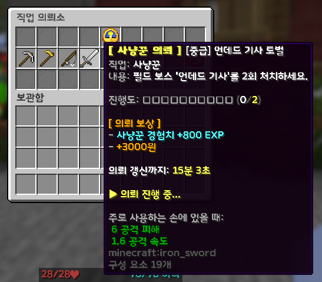

# 💼 직업 시스템

<table>
  <tr>
    <td align="center"></td>
    <td align="center"></td>
  </tr>
</table>

> **📌 30초 핵심 요약**
> * **기본 메뉴**: `/직업` (`/job`) — 내 레벨·일일 의뢰 확인 · 생활직 아이콘 우클릭 시 특성 선택
> * **전문직 가입**: `/직업 가입` — 3단계 안내 화면을 통해 전문 직업 선택 *(스킬 총합 300 달성 시 2차 전직 해금)*
> * **보상 확인**: `/직업경험치 <직업명>` — 활동별 획득 경험치 및 추가 드롭 확률 실시간 조회

---

## 📑 직업 상세 가이드 바로가기

| 문서 | 가이드 명칭 | 주요 수록 내용 |
| :---: | :--- | :--- |
| **06-1** | **[🌲 생활 직업 및 특성](06-1.md)** | 4대 생활직(광부·농부·어부·사냥꾼) 기본 보유 · Lv. 5~80 5단계 특성 트리 · 커스텀 광물 13종·정동석 드롭 · 작물 29종 · 통발 6단계 · 5대 필드보스 |
| **06-2** | **[🔨 전문 직업 및 제작](06-2.md)** | 전문직 가입 3단계 UX & 2차 전직(총합 300) · 피로도(6시간 주기 회복) & 자정 수당 · 4대 전문직 바로가기: • **[⚒️ 대장장이](06-2-1.md)**: 합금, 수리 망치·키트, 정동석 가공, 길드 의뢰(`/smith quest`), +20강 강화 • **[🍳 요리사](06-3.md)**: 수제 요리 35종 + 전통 솥 26종, 1~5★ 등급, 식도락 도감(`/식도락`) • **[🧪 연금술사](06-2-2.md)**: 특수 포션 21종, 발광석 농축 / 레드스톤 연장, 3병 동시 양조 • **[🔮 마법부여사](06-2-3.md)**: 가루 과충전 도박, 슬롯 구슬(4~7칸), 마나 조율 의뢰(`/마법부여대 quest`), 양피지 |
| **05** | **[⚒️ 아이템 및 조합법](05..md)** | 1~5티어 합금 배합식, 스프링클러·물뿌리개·통발·특수 설비 조합법 이미지 |
