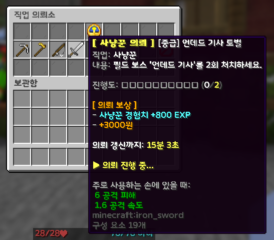

# 💼 직업 시스템

<table>
  <tr>
    <td align="center"></td>
    <td align="center"></td>
  </tr>
</table>

서버의 직업 시스템은 **모든 유저가 기본으로 보유하는 4대 생활직**과 **경제와 장비 생산을 주도하는 4대 전문직**으로 구성되어 있습니다.

상세 내용은 아래 세부 가이드 문서를 참고하시기 바랍니다.

---

## 📑 직업 상세 가이드 바로가기

<table>
  <thead>
    <tr>
      <th align="center" width="100">문서 번호</th>
      <th width="200">가이드 명칭</th>
      <th>주요 수록 내용</th>
    </tr>
  </thead>
  <tbody>
    <tr>
      <td align="center"><strong>06-1</strong></td>
      <td><a href="06-1.md"><strong>🌲 생활 직업 및 특성 가이드</strong></a></td>
      <td>
        • 4대 생활 직업 (광부, 농부, 어부, 사냥꾼) 
        • 5단계 직업 특성 트리 요약표 및 세부 설명 (Lv. 5 ~ 80, 2중 택 1) 
        • 커스텀 광물(11종), 커스텀 농작물(29종) 및 온실, 수중 통발(6단계), 필드보스 사냥 
        • 실시간 보상 확률 확인 (<code>/직업경험치</code>)
      </td>
    </tr>
    <tr>
      <td align="center"><strong>06-2</strong></td>
      <td><a href="06-2.md"><strong>🔨 전문 직업 및 제작 가이드</strong></a></td>
      <td>
        • 4대 전문 직업 (대장장이, 요리사, 연금술사, 마법부여사) 
        • 피로도 시스템 및 일일 직업 수당 
        • 사기 방지 안전 대리 제작 (<code>/의뢰</code>)
      </td>
    </tr>
  </tbody>
</table>

---

> **조합법 안내**: 직업 활동으로 수급한 재료를 활용하는 3×3 작업대, 합금 제련, 스프링클러, 통발 등의 조합법은 **[⚒️ 아이템 및 조합법](05..md)**을 참고하시기 바랍니다.