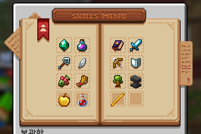
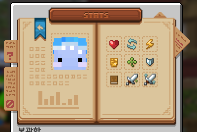

# 🔮 스킬 및 스탯

> **안내**: 채광, 벌목, 농사, 사냥, 낚시 등 활동에 따라 스킬 경험치를 획득하고 캐릭터 기본 능력치를 강화하는 스킬 및 스탯 가이드입니다.  
> 🥇 **랭크 가이드**: 7단계 랭크 승급 심사 및 해금 혜택은 **[🥇 랭크](07-1.md)** 문서를 참고하시기 바랍니다.  
> 📜 **커스텀 인챈트 가이드**: 도구 및 무기 커스텀 인챈트 관련 내용은 **[📜 커스텀 인챈트](08..md)**를 참고하시기 바랍니다.

---

## 📑 목차 바로가기

1. [🔮 AuraSkills 시스템 개요 및 명령어 (`/skills`)](#1--auraskills-시스템-개요-및-명령어-skills)
2. [⛏️ 10대 핵심 스킬 종류 & 경험치 획득처](#2-️-10대-핵심-스킬-종류--경험치-획득처)
3. [💪 영구 스탯(Stats) 보너스](#3--영구-스탯stats-보너스)
4. [🏆 총합 레벨(Power Level) 활용처](#4--총합-레벨power-level-활용처)
5. [🌙 경험치 핫타임 및 주말 버프 안내](#5--경험치-핫타임-및-주말-버프-안내)

---

## 1. 🔮 AuraSkills 시스템 개요 및 명령어 (`/skills`)

서버에서 채광, 벌목, 농사, 사냥, 마법부여 등 일상적인 파밍 및 모험 활동을 할 때마다 **AuraSkills** 스킬 경험치가 누적되어 캐릭터의 기본 능력치(스탯)가 영구적으로 강화됩니다.

<table>
  <thead>
    <tr>
      <th width="150">명령어</th>
      <th width="150">alias</th>
      <th width="150">기능</th>
      <th>설명</th>
    </tr>
  </thead>
  <tbody>
    <tr>
      <td><strong>/skills</strong></td>
      <td><code>/스킬</code>, <code>/tmzlf</code></td>
      <td>AuraSkills 메뉴</td>
      <td>채광, 벌목, 농사, 마법부여 등 오라스킬 레벨 및 누적 스탯 확인 창을 엽니다.</td>
    </tr>
  </tbody>
</table>

<figure><figcaption></figcaption></figure>

---

## 2. ⛏️ 10대 핵심 스킬 종류 & 경험치 획득처

채집 및 제작 활동 시 **직업 경험치(Job EXP)**와 함께 **AuraSkills 경험치**가 동시에 오릅니다:

<table>
  <thead>
    <tr>
      <th align="center" width="160">스킬 종류</th>
      <th width="260">주요 경험치 획득 활동</th>
      <th>핵심 연계 인챈트 및 시스템</th>
    </tr>
  </thead>
  <tbody>
    <tr>
      <td align="center"><strong>⛏️ 채광 (Mining)</strong></td>
      <td>야생 및 광산에서 일반 광석 및 커스텀 광석 채굴</td>
      <td><code>초보 광부</code>, <code>연쇄채광</code>, <code>제련</code> 인챈트 연계 권장</td>
    </tr>
    <tr>
      <td align="center"><strong>🪓 벌목 (Foraging)</strong></td>
      <td>나무 원목 벌목</td>
      <td><code>초보 나무꾼</code>, <code>벌목(한방 벌목)</code> 인챈트와 연동</td>
    </tr>
    <tr>
      <td align="center"><strong>🌾 농사 (Farming)</strong></td>
      <td>일반 농작물 수확 및 <strong>특수 거대 작물</strong> 파괴</td>
      <td><code>초보 농부</code>, <code>수확(3×3/5×5)</code> 인챈트와 연동 • 대왕 양배추 수확: <strong>+200 XP</strong> • 대왕 토마토 수확: <strong>+400 XP</strong> • 대왕 파인애플 수확: <strong>+600 XP</strong></td>
    </tr>
    <tr>
      <td align="center"><strong>🎣 낚시 (Fishing)</strong></td>
      <td>커스텀 낚시 성공 및 수중 통발(어망) 수확</td>
      <td>커스텀 낚싯대 및 6단계 통발 자동 파밍</td>
    </tr>
    <tr>
      <td align="center"><strong>⚔️ 전투 (Fighting)</strong></td>
      <td>검을 들고 몬스터 사냥</td>
      <td>근접 공격력 및 체력 스탯 상승</td>
    </tr>
    <tr>
      <td align="center"><strong>🏹 사격 (Archery)</strong></td>
      <td>활 및 쇠뇌로 몬스터 저격</td>
      <td>원거리 피해량 및 치명타 확률 상승</td>
    </tr>
    <tr>
      <td align="center"><strong>🛡️ 방어 (Defense)</strong></td>
      <td>몬스터에게 피격당할 때 방어</td>
      <td>강인함(Toughness) 및 받는 피해 감소</td>
    </tr>
    <tr>
      <td align="center"><strong>📜 마법부여 (Enchanting)</strong></td>
      <td>커스텀 인챈트북을 장비에 성공적으로 부여 시 대량 획득!</td>
      <td><strong>책 등급별 AuraSkills 마법부여 경험치 지급</strong>: • D등급: <strong>+400 XP</strong> / C등급: <strong>+600 XP</strong> • B등급: <strong>+800 XP</strong> / A등급: <strong>+1,000 XP</strong> • S등급: <strong>+1,500 XP</strong> / SS등급: <strong>+2,000 XP</strong></td>
    </tr>
    <tr>
      <td align="center"><strong>🔮 마법 (Sorcery)</strong></td>
      <td>커스텀 마법부여대에서 연성 및 과충전 도박 진행</td>
      <td>마법부여사 전문직 활동 시 동시 획득</td>
    </tr>
    <tr>
      <td align="center"><strong>💖 치유 (Healing)</strong></td>
      <td>커스텀 요리 섭취 시 재생 경험치 획득</td>
      <td>요리사 제작 고급 요리 섭취 시 획득</td>
    </tr>
  </tbody>
</table>

---

## 3. 💪 영구 스탯(Stats) 보너스

스킬 레벨이 오를 때마다 내 캐릭터에 다음과 같은 기본 스탯 보너스가 **영구적으로 누적**됩니다:
* **체력 (Health)**: 최대 생명력 하트가 영구적으로 증가합니다.
* **힘 (Strength)**: 몬스터에게 입히는 근접 공격 피해량이 상승합니다.
* **강인함 (Toughness)**: 피격 시 받는 피해량을 감소시킵니다.
* **재생 (Regeneration)**: 자연 체력 회복 속도가 빨라집니다.
* **행운 (Luck)**: 전리품 및 낚시 희귀 보상 확률이 증가합니다.
* **지식 (Wisdom)**: 바닐라 경험치(EXP) 구슬 및 스킬 경험치 획득량이 증가합니다.
* **치명타 확률 & 치명타 피해 (Crit Chance / Crit Damage)**: 몬스터에게 강력한 치명타 공격이 터질 확률과 피해량이 상승합니다.

<figure><figcaption></figcaption></figure>

---

## 4. 🏆 총합 레벨(Power Level) 활용처

개별 스킬 레벨의 총합인 **총합 레벨(Power Level)**은 서버 주요 콘텐츠 해금의 핵심 척도입니다:
1. **2번째 전문직 해금**: AuraSkills 총합 레벨 **300** 달성 시 2번째 전문직(대장장이, 요리사, 연금술사, 마법부여사 중 택1)을 추가로 습득할 수 있습니다.
2. **7단계 랭크 승급**: 루비, 산호, 골드, 에메랄드, 사파이어, 자수정, 무지개 등 상위 랭크 승급 조건에 스킬 총합 레벨 및 상위 4대 주력 스킬 레벨이 필수적으로 요구됩니다 ([🥇 랭크](07-1.md) 가이드 참고).
3. **길라잡이 퀘스트**: 29단계 퀘스트(`AuraSkills 총합 100 달성`) 완료 시 귀중한 **에픽 열쇠**를 지급받습니다.

---

## 5. 🌙 경험치 핫타임 및 주말 버프 안내

* **🌙 심야 핫타임 (매일 밤 00:00 ~ 06:00)**:  
  매일 00:00 ~ 06:00 동안 전 서버에 **AuraSkills 경험치 +50% (1.5배)** 핫타임이 적용됩니다.
* **🎉 주말 상시 버프 (토요일 00:00 ~ 일요일 23:59)**:  
  주말 동안 전 서버에 **AuraSkills 경험치 +50% (1.5배)** 보너스가 유지됩니다.
* **📈 개인 스킬 배수 쿠폰**:  
  스킬 배수 쿠폰 사용 시 상단 보스바에 잔여 시간이 표시되며, 심야 및 주말 버프와 중첩 적용됩니다.
