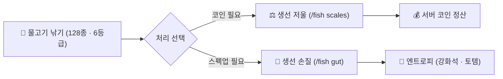

# 🎣 커스텀 낚시

> **📌 30초 핵심 요약**
> * **핵심 메뉴**: `/fish` (`/fish menu`) — 도감·가방·저울·손질대·강화석·스킬 통합 GUI
> * **물고기 처리**: **코인 벌기** ➔ `생선 저울(/fish scales)` / **스펙업 재화** ➔ `생선 손질(/fish gut)`로 **엔트로피** 획득
> * **연계 가이드**: **[🔖 물고기 도감](09-1.md)** · **[🧺 통발 조합법](05..md#4--수중-통발-물고기-덫-6단계)** · **[🌲 어부 직업](06-1.md)**

<!-- [🎬 GIF 추천 #13] 커스텀 물고기 낚기 & 전용 가방/엔트로피 확인 3초 컷 -->

---

## 📑 목차 바로가기

1. [📋 필수 낚시 명령어 (10종)](#1--필수-낚시-명령어-10종)
2. [🐟 6대 물고기 등급 (128종) & 엔트로피 · 전용 가방](#2--6대-물고기-등급-128종--엔트로피--전용-가방)
3. [✨ 낚싯대 12대 강화석 (가마솥 제작)](#3--낚싯대-12대-강화석-가마솥-제작)
4. [🪱 2중 미끼 체계 · 스킬 · 배달 · 토너먼트](#4--2중-미끼-체계--스킬--배달--토너먼트)

---

## 1. 📋 필수 낚시 명령어 (10종)

| 명령어 (단축) | 기능 | 설명 |
| :--- | :--- | :--- |
| **`/fish menu`** (`/fish`) | 낚시 통합 메뉴 | 도감·가방·상점·강화석·스킬 통합 GUI 열기 |
| **`/fish bag`** | 물고기 전용 가방 | 자동 적립·보관 · 원클릭 일괄 판매/손질 · **신화/플래티넘 등 등급 필터 보존** |
| **`/fish scales`** (`/fish shop`) | 생선 저울 (판매) | 길이(cm)·무게(lbs) 기반 코인 즉시 정산 *(태양의 분노 장착 시 최대 +25%)* |
| **`/fish gut`** | 생선 손질대 (분해) | 물고기를 엔트로피로 변환 *(정밀 손질 + 더 나은 손질 스킬로 보너스)* |
| **`/fish augment`** | 강화석 관리 / 크리스탈 | 강화석 장착 & 엔트로피 10,000을 거래 가능한 `엔트로피 크리스탈`로 변환 |
| **`/fish augments`** | 강화석 도감 & 레시피 | 모든 강화석 효과 및 가마솥 조합 재료 확인 |
| **`/fish skills`** | 낚시 스킬 트리 | 포인트로 패시브 강화 *(더 나은 손질 · 포획의 행운 · 마스터 강화술사 · 증폭기 주입 · 토템 리더)* |
| **`/fish deliveries`** | 일일 배달 퀘스트 | 지정 어종·크기 납품 시 대량 엔트로피·부스터·코인·희귀 미끼 상자 획득 |
| **`/fish codex`** (`/도감 물고기`) | 물고기 도감 | 서식 바이옴·날씨·시간대 조건 및 최대 크기 기록 확인 |
| **`/fish boosters`** | 부스터 확인 | 활성 경험치/엔트로피 배율 부스터 잔여 시간 조회 |

---

## 2. 🐟 6대 물고기 등급 (128종) & 엔트로피 · 전용 가방

* **물고기 6단계**: **1. 브론즈** *(입문)* ➔ **2. 실버** *(중급)* ➔ **3. 골드** *(고급·바이옴/수심)* ➔ **4. 다이아몬드** *(희귀 상급)* ➔ **5. 플래티넘** *(초희귀·도감/배달 핵심)* ➔ **6. 신화** *(종결 전설)*
* **엔트로피**: 낚시·손질대·통찰력 강화석·`엔트로피 크리스탈` 우클릭으로 획득하며, **강화석 제작·장착**, **토템 충전·업그레이드**, **크리스탈 변환 거래**에 사용합니다.

---

## 3. ✨ 낚싯대 12대 강화석 (가마솥 제작)

1. 물이 채워진 **가마솥**에 `/fish augments` 레시피 재료와 몬스터 전리품을 던져 넣고 엔트로피를 지불해 제작합니다.
2. **`/fish augment`** 창에서 강화석을 낚싯대 위로 드래그 앤 드롭해 장착합니다.

✨ 낚싯대 12대 강화석 상세 효과 · 최대 레벨 · 재료 전체표 펼쳐보기

| 강화석 명칭 | 최대 Lv | 요구 몬스터 재료 | 상세 성능 및 효과 |
| :--- | :---: | :--- | :--- |
| **핫스팟** | 10Lv | 돌고래 꼬리, 게 집게발 | 일정 확률(최대 **22%**)로 물고기 **2마리(2배)** 동시 포획 |
| **숙련된 어부** | 5Lv | 돌고래 꼬리, 게 껍질 | 플래티넘·신화 등 **상위 희귀 어종 출현 확률** 대폭 상승 |
| **바이옴 왜곡** | 3Lv | 돌고래 꼬리, 게 껍질 | 현재 바이옴 무관 **모든 바이옴 물고기** 일정 확률(최대 65%) 포획 |
| **태양의 분노** | 5Lv | 게 집게발, 게 껍질, 오징어 촉수 | 생선 저울 판매 시 **코인 정산금 최대 +25% 추가 지급** |
| **통찰력** | 5Lv | 오징어 촉수, 게 집게발 | 낚시 성공 시 낮은 확률로 **수천~수만 단위 대박 엔트로피** 획득 |
| **정밀 손질** | 5Lv | 게 껍질, 오징어 촉수 | 생선 손질대 분해 시 획득하는 **기본 엔트로피 대폭 증가** |
| **폭풍의 부름** | 3Lv | 돌고래 꼬리, 오징어 촉수 | 비·뇌우 시 입질 속도 및 희귀 어종 포획 확률 극대화 |
| **트로피** | 3Lv | 게 집게발, 돌고래 꼬리 | 물고기 **길이와 무게(대물) 최대치 확률** 상승 |
| **현자** | 5Lv | 오징어 촉수, 게 껍질 | 낚시 성공 시 획득 **낚시 고유 경험치** 증가 |
| **지성** | 5Lv | 게 집게발, 오징어 촉수 | 낚시 시 **바닐라 경험치 구슬** 추가 생성 |
| **게 미끼** | 3Lv | 게 집게발, 게 껍질 | 낚시 중 특수 몬스터 **'게'** 출현 확률 증가 *(재료 수급용)* |
| **포화** | 3Lv | 오징어 촉수, 게 집게발 | 낚시 성공 시마다 **배고픔 게이지 자동 회복** |

---

## 4. 🪱 2중 미끼 체계 · 스킬 · 배달 · 토너먼트

* **① 본가 낚시 미끼** (`/fish` 상점): 코인·엔트로피로 구매해 정해진 횟수만큼 해당 등급 물고기 출현 풀 개방
* **② Dolphin 전용 '추가 미끼'** (수중 통발 회수 시 확률 획득):
  * 인벤토리에서 추가 미끼를 **낚싯대 위에 드래그 앤 드롭**하여 횟수를 충전합니다 *(기존 횟수 소진 전까지 덮어쓰기 불가)*.
  * 입질 성공 시 **원래 물고기 외에 해당 등급(브론즈~신화) 커스텀 물고기 1마리를 100% 확정 추가 지급**합니다!
* **🏆 토너먼트 & 파티 보너스**: 정기 낚시 대회(`/fish tournaments` — 최대 크기/최다 어획/특정 등급) 입상 시 캐시·마일리지·칭호 지급 · 반경 50블록 내 최대 5인까지 파티 낚시 속도·엔트로피 보너스 적용!
