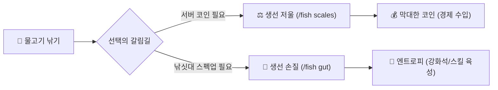

# 🎣 커스텀 낚시

> **안내**: 단순한 바닐라 낚시를 넘어 **128종 커스텀 물고기, 핵심 재화 엔트로피, 12대 낚싯대 강화석, 전용 스킬 트리, 6단계 수중 통발 및 추가 미끼**로 이어지는 서버 고유의 **성장형 커스텀 낚시 종합 가이드**입니다.  
> 🐟 **물고기 도감**: 128종 커스텀 어종의 수집 및 납품 보상은 **[🔖 도감](09-1.md)**을 참고하시기 바랍니다.  
> 🧺 **수중 통발**: 자동 어획 설비 및 추가 미끼 획득 조합법은 **[⚒️ 아이템 및 조합법](05..md#4--6)**을 참고하시기 바랍니다.  
> 💼 **어부 직업**: 낚시를 통한 직업 경험치 및 특성 트리는 **[🌲 생활 직업 & 특성](06-1.md)**을 참고하시기 바랍니다.

---

## 📑 목차 바로가기

1. [🎣 커스텀 낚시 개요 & 필수 명령어](#1--커스텀-낚시-개요--필수-명령어)
2. [🐟 6대 물고기 등급 체계 (총 128종)](#2--6대-물고기-등급-체계-총-128종)
3. [🔮 핵심 재화 '엔트로피' 시스템](#3--핵심-재화-엔트로피-시스템)
4. [⚖️ 생선 저울(판매) & 손질대(엔트로피 변환)](#4-️-생선-저울판매--손질대엔트로피-변환)
5. [🎒 전용 물고기 가방 (`/fish bag`)](#5--전용-물고기-가방-fish-bag)
6. [✨ 낚싯대 12대 강화석 상세표](#6--낚싯대-12대-강화석-상세표)
7. [🪱 2중 미끼 체계 (본가 미끼 & Dolphin 추가 미끼)](#7--2중-미끼-체계-본가-미끼--dolphin-추가-미끼)
8. [📜 낚시 스킬 트리 & 배달 & 토너먼트](#8--낚시-스킬-트리--배달--토너먼트)

---

## 1. 🎣 커스텀 낚시 개요 & 필수 명령어

서버의 낚시 시스템은 일반적인 마인크래프트 바닐라 낚시와 완전히 다릅니다.  
야생의 물가에 낚싯대를 드리우면 **다양한 바이옴, 시간, 날씨 조건**에 따라 특별한 비주얼과 크기(길이/무게)를 지닌 커스텀 물고기가 낚이며, 물고기를 판매하여 대량의 코인을 벌거나 분해하여 낚시 전용 화폐인 **엔트로피**를 모아 낚싯대를 끝없이 강화할 수 있습니다.

### 📋 주요 낚시 명령어 총정리

<table>
  <thead>
    <tr>
      <th width="190">명령어</th>
      <th width="150">단축 명령어</th>
      <th width="160">기능</th>
      <th>상세 설명</th>
    </tr>
  </thead>
  <tbody>
    <tr>
      <td><strong>/fish menu</strong></td>
      <td><code>/fish</code></td>
      <td>낚시 메인 메뉴</td>
      <td>도감, 가방, 상점, 강화석, 스킬 등 모든 낚시 기능을 한눈에 보는 통합 GUI를 엽니다.</td>
    </tr>
    <tr>
      <td><strong>/fish bag</strong></td>
      <td>-</td>
      <td>물고기 전용 가방</td>
      <td>인벤토리 공간 걱정 없이 낚은 물고기들을 안전하게 자동 적립·보관하는 가상 창고입니다.</td>
    </tr>
    <tr>
      <td><strong>/fish scales</strong></td>
      <td><code>/fish shop</code></td>
      <td>생선 저울 (코인 판매)</td>
      <td>낚은 물고기를 올려놓고 크기와 무게에 따라 서버 코인으로 즉시 정산·판매합니다.</td>
    </tr>
    <tr>
      <td><strong>/fish gut</strong></td>
      <td>-</td>
      <td>생선 손질대 (엔트로피)</td>
      <td>물고기를 손질(분해)하여 낚싯대 강화에 필수적인 핵심 재화 <strong>엔트로피</strong>를 획득합니다.</td>
    </tr>
    <tr>
      <td><strong>/fish augment</strong></td>
      <td>-</td>
      <td>강화석 장착/관리</td>
      <td>낚싯대에 특수 강화석을 장착하거나 현재 적용된 효과를 관리합니다.</td>
    </tr>
    <tr>
      <td><strong>/fish augments</strong></td>
      <td>-</td>
      <td>강화석 도감 및 레시피</td>
      <td>서버에 존재하는 모든 강화석의 효과와 가마솥 제작 조합법을 확인합니다.</td>
    </tr>
    <tr>
      <td><strong>/fish skills</strong></td>
      <td>-</td>
      <td>낚시 스킬 트리</td>
      <td>낚시 레벨업으로 획득한 포인트로 손질 효율 증가, 대물 포획률 상승 등 고유 스킬을 찍습니다.</td>
    </tr>
    <tr>
      <td><strong>/fish deliveries</strong></td>
      <td>-</td>
      <td>물고기 배달 퀘스트</td>
      <td>지정된 어종과 품질을 납품하고 고액 코인, 희귀 미끼, 부스터 보상을 수령합니다.</td>
    </tr>
    <tr>
      <td><strong>/fish codex</strong></td>
      <td><code>/도감 물고기</code></td>
      <td>물고기 도감</td>
      <td>자신이 낚은 물고기 종류와 최고 기록(최대 크기)을 확인하고 도감 등록 보상을 받습니다.</td>
    </tr>
    <tr>
      <td><strong>/fish boosters</strong></td>
      <td>-</td>
      <td>부스터 확인</td>
      <td>현재 활성화된 경험치/엔트로피 배율 부스터의 남은 시간을 확인합니다.</td>
    </tr>
  </tbody>
</table>

---

## 2. 🐟 6대 물고기 등급 체계 (총 128종)

낚시로 낚을 수 있는 물고기는 총 **128종**이며, 희귀도와 가치에 따라 **6단계 등급**으로 나뉩니다.  
물고기는 같은 종류라도 **길이(cm)와 무게(lbs)**가 무작위로 결정되며, 크기가 클수록 판매 코인과 손질 엔트로피 가치가 기하급수적으로 높아집니다.

<table>
  <thead>
    <tr>
      <th width="140">등급</th>
      <th width="100">대표 색상</th>
      <th width="160">주요 특징</th>
      <th>설명 및 주요 가치</th>
    </tr>
  </thead>
  <tbody>
    <tr>
      <td><strong>1. 브론즈</strong></td>
      <td><span style="color: #cd7f32;">■ 주황/갈색</span></td>
      <td>입문용 기초 어종</td>
      <td>입문 단계에서 낚을 수 있는 기초 어종입니다.</td>
    </tr>
    <tr>
      <td><strong>2. 실버</strong></td>
      <td><span style="color: #a8a8a8;">■ 은백색</span></td>
      <td>중급 어종</td>
      <td>기본적인 낚시 스킬과 미끼를 갖추면 자주 등장하며, 적절한 판매 대금과 준수한 경험치를 줍니다.</td>
    </tr>
    <tr>
      <td><strong>3. 골드</strong></td>
      <td><span style="color: #ffd700;">■ 황금색</span></td>
      <td>고급 어종</td>
      <td>특정 바이옴이나 수심 조건에서 주로 출현하는 고급 어종입니다.</td>
    </tr>
    <tr>
      <td><strong>4. 다이아몬드</strong></td>
      <td><span style="color: #00bfff;">■ 하늘색</span></td>
      <td>희귀 상급 어종</td>
      <td>높은 가치를 지닌 희귀 어종으로, 어부 레벨과 강화석 보너스가 갖춰져야 본격적으로 낚이기 시작합니다.</td>
    </tr>
    <tr>
      <td><strong>5. 플래티넘</strong></td>
      <td><span style="color: #55ffff;">■ 청록/백금</span></td>
      <td>초희귀 최고급 어종</td>
      <td>극도로 희귀하며, 높은 엔트로피와 코인 가치를 지닙니다. 배달 퀘스트와 도감의 핵심 납품 어종입니다.</td>
    </tr>
    <tr>
      <td><strong>6. 신화</strong></td>
      <td><span style="color: #aa00aa;">■ 보라색</span></td>
      <td>종결급 전설 어종</td>
      <td>고티어 미끼와 최고급 세팅 조건에서 낚을 수 있는 전설 어종입니다.</td>
    </tr>
  </tbody>
</table>

* **서식 조건 안내**: 특정 물고기는 날씨(비/눈)나 시간대(야간)에 따라 출현 여부가 결정되며, 상세 서식 조건은 도감(`/fish codex`)에서 확인할 수 있습니다.

---

## 3. 🔮 핵심 재화 '엔트로피' 시스템

**엔트로피**는 일반 서버 화폐(코인)와 완전히 분리된 **낚시 생태계 전용 핵심 육성 화폐**입니다.

### ① 엔트로피의 주요 획득 방법
* **물고기 낚기**: 물고기를 낚아 올릴 때마다 기본적으로 일정량의 엔트로피가 자동 누적됩니다.
* **생선 손질 (`/fish gut`)**: 낚은 물고기를 손질대에 넣어 분해하면 가장 많은 양의 엔트로피를 얻을 수 있습니다.
* **통찰력 강화석**: 낚시 성공 시 일정 확률로 대박 보너스 엔트로피가 한 번에 들어옵니다.
* **엔트로피 크리스탈 거래**: 다른 유저가 제작한 `엔트로피 크리스탈`을 구매하여 우클릭하면 즉시 대량의 엔트로피가 충전됩니다.

### ② 엔트로피의 핵심 활용처
* **낚싯대 강화석 제작 및 적용**: 특수 능력을 부여하는 강화석을 가마솥에서 빚어내고 낚싯대에 장착할 때 소모됩니다.
* **토템 충전 및 업그레이드**: 주변 범위에 낚시 버프를 주는 설치형 토템을 가동하는 데 쓰입니다.
* **엔트로피 크리스탈 제작 (`/fish augment` 내)**: 자신의 10,000 엔트로피를 물리적 크리스탈 아이템으로 변환하여 다른 유저와 자유롭게 거래할 수 있습니다.

---

## 4. ⚖️ 생선 저울(판매) & 손질대(엔트로피 변환)

낚은 물고기는 크게 **두 가지 방법**으로 처리하여 성장 동력으로 삼습니다:



### ① ⚖️ 생선 저울 (`/fish scales` 또는 `/fish shop`)
* 낚은 물고기를 GUI 창에 넣고 클릭하면 무게와 등급에 맞춰 **서버 코인**으로 즉시 환전해 줍니다.
* **태양의 분노(Solar Rage)** 강화석이 장착되어 있다면 판매 시 최대 **+25%의 추가 코인 보너스**를 영구적으로 누릴 수 있습니다!

### ② 🔪 생선 손질대 (`/fish gut`)
* 물고기를 칼로 갈아 분해하여 순수한 **엔트로피**로 환원하는 시스템입니다.
* **정밀 손질(Precision Cutting)** 강화석과 낚시 스킬 트리의 **더 나은 손질(Better Gutting)**을 배우면 손질할 때마다 보너스 엔트로피를 추가로 획득합니다.

---

## 5. 🎒 전용 물고기 가방 (`/fish bag`)

물고기를 낚다 보면 36칸의 기본 인벤토리가 금세 가득 차 버립니다. 이를 완벽하게 해결해 주는 전용 편의 기능입니다.

* **자동 보관 기능**: 인벤토리에 여유가 없어도 낚은 물고기가 증발하지 않고 **물고기 가방 GUI 창**으로 즉시 자동 적립됩니다.
* **일괄 판매 및 손질 연동**: 가방 메뉴 내부에서 버튼 한 번으로 보관 중인 물고기를 전량 판매하거나 일괄 손질할 수 있습니다.
* **등급별 필터**: 특정 등급(예: 신화/플래티넘)의 희귀 물고기만 보존하고 나머지만 골라 처분할 수 있습니다.

---

## 6. ✨ 낚싯대 12대 강화석 상세표

강화석은 일반 마인크래프트 인챈트와 완전히 별개로, **낚싯대에 영구적인 특수 패시브 능력을 주입하는 낚시 전용 마법 보석**입니다.

### ⚗️ 강화석 제작 방식 (가마솥 연금술)
1. 바닥에 **가마솥**을 설치하고 물을 채웁니다.
2. `/fish augments` 메뉴에서 확인한 제작 레시피에 맞춰 **요구 재료**와 특수 전리품(게 껍질, 집게발, 오징어 촉수, 돌고래 꼬리 등)을 가마솥 안에 던져 넣습니다.
3. 소모 엔트로피를 지불하면 가마솥에서 신비로운 마법 효과음과 함께 완제품 **강화석 아이템**이 생성됩니다!
4. **`/fish augment`** GUI 창을 열고 강화석을 낚싯대에 드래그 앤 드롭하여 장착합니다.

### 📋 12대 핵심 낚싯대 강화석 종합 안내표

<table>
  <thead>
    <tr>
      <th width="150">강화석 명칭</th>
      <th width="80">최대 Lv</th>
      <th width="160">요구 몬스터 재료</th>
      <th>상세 성능 및 효과</th>
    </tr>
  </thead>
  <tbody>
    <tr>
      <td><strong>핫스팟</strong></td>
      <td>Lv. 10</td>
      <td>돌고래 꼬리, 게 집게발</td>
      <td>물고기를 낚았을 때 일정 확률(최대 <strong>22%</strong>)로 동일한 물고기를 <strong>2마리(2배)</strong> 동시에 낚아 올립니다.</td>
    </tr>
    <tr>
      <td><strong>숙련된 어부</strong></td>
      <td>Lv. 5</td>
      <td>돌고래 꼬리, 게 껍질</td>
      <td>플래티넘, 신화 등 **상위 티어 희귀 물고기가 출현할 확률**을 대폭 끌어올립니다.</td>
    </tr>
    <tr>
      <td><strong>바이옴 왜곡</strong></td>
      <td>Lv. 3</td>
      <td>돌고래 꼬리, 게 껍질</td>
      <td>현재 자신이 서 있는 바이옴에 구애받지 않고, **모든 바이옴의 특수 물고기를 일정 확률(최대 65%)로 어디서든 포획**합니다.</td>
    </tr>
    <tr>
      <td><strong>태양의 분노</strong></td>
      <td>Lv. 5</td>
      <td>게 집게발, 게 껍질, 오징어 촉수</td>
      <td>생선 저울(`/fish scales`)에 물고기를 판매할 때 얻는 **코인 정산금을 최대 +25% 추가 지급**합니다.</td>
    </tr>
    <tr>
      <td><strong>통찰력</strong></td>
      <td>Lv. 5</td>
      <td>오징어 촉수, 게 집게발</td>
      <td>물고기 낚시 성공 시 낮은 확률로 **수천~수만 단위의 대박 보너스 엔트로피**를 일시 획득합니다.</td>
    </tr>
    <tr>
      <td><strong>정밀 손질</strong></td>
      <td>Lv. 5</td>
      <td>게 껍질, 오징어 촉수</td>
      <td>생선 손질대(`/fish gut`)에서 물고기를 분해할 때 얻는 **기본 엔트로피 양을 대폭 증가**시킵니다.</td>
    </tr>
    <tr>
      <td><strong>폭풍의 부름</strong></td>
      <td>Lv. 3</td>
      <td>돌고래 꼬리, 오징어 촉수</td>
      <td>비나 천둥번개가 칠 때 낚시 입질 속도와 희귀 어종 포획 확률을 극대화합니다.</td>
    </tr>
    <tr>
      <td><strong>트로피</strong></td>
      <td>Lv. 3</td>
      <td>게 집게발, 돌고래 꼬리</td>
      <td>물고기의 **길이와 무게가 최대치(대물)로 결정될 확률**을 높여 판매 가치를 뻥튀기합니다.</td>
    </tr>
    <tr>
      <td><strong>현자</strong></td>
      <td>Lv. 5</td>
      <td>오징어 촉수, 게 껍질</td>
      <td>물고기를 낚을 때 획득하는 **낚시 고유 경험치 획득량**을 증가시킵니다.</td>
    </tr>
    <tr>
      <td><strong>지성</strong></td>
      <td>Lv. 5</td>
      <td>게 집게발, 오징어 촉수</td>
      <td>낚시를 할 때 마인크래프트 **바닐라 경험치 구슬**을 추가로 생성하여 빠른 인챈트 레벨업을 돕습니다.</td>
    </tr>
    <tr>
      <td><strong>게 미끼</strong></td>
      <td>Lv. 3</td>
      <td>게 집게발, 게 껍질</td>
      <td>낚시 중 특수 몬스터 **'게'**가 수면 위로 낚여 올라올 확률을 높입니다. (강화 재료 수급용)</td>
    </tr>
    <tr>
      <td><strong>포화</strong></td>
      <td>Lv. 3</td>
      <td>오징어 촉수, 게 집게발</td>
      <td>낚시에 성공할 때마다 플레이어의 **배고픔(허기) 게이지를 자동으로 채워주어** 음식 소비를 줄입니다.</td>
    </tr>
  </tbody>
</table>

---

## 7. 🪱 2중 미끼 체계 (본가 미끼 & Dolphin 추가 미끼)

Dolphin 서버에서는 두 가지 미끼 시스템이 유기적으로 공존합니다.

### ① 🐟 본가 낚시 미끼 (`/fish` 상점 구매)
* 상점에서 코인 또는 엔트로피로 구매 가능한 소모품 미끼입니다.
* 낚싯대에 장착하면 정해진 횟수 동안 브론즈, 실버, 골드, 다이아몬드, 플래티넘, 신화 등급 물고기가 낚일 수 있는 최소 출현 풀을 열어줍니다.

### ② 🌟 Dolphin 서버 전용 '추가 미끼' (통발 연계 확정 보너스!)
서버 고유의 특수 미끼로, 수중 통발(Fish Trap)을 회수할 때 일정 확률로 획득할 수 있습니다.

```
[인벤토리 장착 화면 예시]
┌──────────────────────────────────────────────┐
│  ⚓ 낚싯대 (Diamond Fishing Rod)             │
│  ...                                         │
│  §6[추가 미끼] §6브론즈 미끼                  │
│  §8▶ 남은 횟수: §a5§7회                     │
└──────────────────────────────────────────────┘
```

* **장착 방법**: 인벤토리에서 통발로 얻은 **추가 미끼 아이템**을 마우스로 집어, **낚싯대 위에 클릭(드래그 앤 드롭)**하면 경쾌한 모루 소리와 함께 즉시 횟수(5회 등)가 부여됩니다.
* **추가 획득 효과**:
  * 추가 미끼가 발린 낚싯대로 입질을 낚아채면, **원래 낚이는 일반 수확물 외에 해당 등급(브론즈~신화)의 커스텀 물고기 1마리를 100% 확정으로 추가 지급**합니다!
  * 낚을 때마다 액션바에 `[§6브론즈§f 추가 미끼로 §a참치§f을(를) 보너스로 획득했습니다!]` 메시지가 뜨며 횟수가 1회씩 안전하게 차감됩니다.
* **규칙**: 이미 추가 미끼가 발려 있는 상태에서는 횟수를 모두 소모하기 전까지 다른 추가 미끼를 덮어쓸 수 없습니다.

---

## 8. 📜 낚시 스킬 트리 & 배달 & 토너먼트

### ① 🎓 낚시 고유 스킬 트리 (`/fish skills`)
낚시를 통해 낚시 레벨이 오르면 주어지는 스킬 포인트로 다양한 패시브 능력을 영구 습득할 수 있습니다:
* **더 나은 손질 (Better Gutting)**: 물고기 손질 시 보너스 엔트로피를 대량 추가 획득
* **포획의 행운 (Luck of the Catch)**: 물고기를 낚을 때마다 보너스 엔트로피 누적
* **마스터 강화술사 (Master Augmenter)**: 강화석 제작 시 소모되는 엔트로피 비용 할인
* **증폭기 주입 (Augment Infusion)**: 강화석 제작 실패나 분해 시 원재료의 일부를 환급
* **토템 리더 (Totem Leader)**: 설치형 토템의 쿨타임을 대폭 감소

### ② 📦 일일 배달 퀘스트 (`/fish deliveries`)
* 매일 서버에서 지정하는 특별한 어종과 크기를 요구하는 3~4개의 배달 주문서가 주어집니다.
* 조건을 만족하는 물고기를 인벤토리에 지닌 채 납품하면 **수십만 단위의 엔트로피, 엔트로피 부스터, 대량의 코인, 그리고 희귀 미끼 상자**를 보상으로 지급합니다.

### ③ 🏆 낚시 토너먼트 대회 (`/fish tournaments`)
* 정기적으로 서버 전체 유저를 대상으로 열리는 낚시 경쟁 이벤트입니다.
* **대회 유형**: 가장 큰 물고기 잡기(최대 크기), 가장 많은 물고기 낚기(최다 어획), 특정 희귀 등급 물고기 먼저 낚기 등
* 상위권 입상자에게는 서버 방송 알림과 함께 캐시/마일리지, 고티어 전리품 상자, 전용 칭호가 수여됩니다!

### ④ 👥 파티 낚시 보너스 (Party Fishing)
* 다른 플레이어와 인접하여 낚시할 경우 **반경 50블록 내 최대 5인까지 낚시 속도 및 엔트로피 획득량 보너스**가 추가로 적용됩니다.
