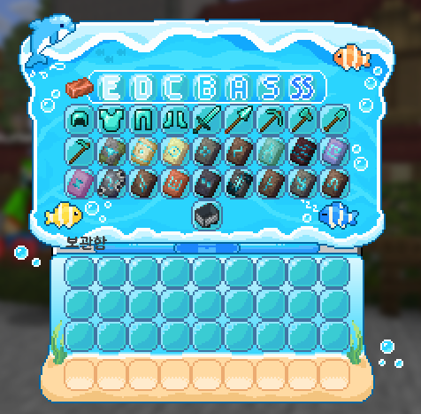
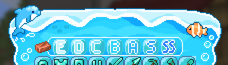

# 🔖 도감

<figure><figcaption></figcaption></figure>

> **📌 30초 핵심 요약**
> * **명령어**: 아이템 도감 `/도감` (`/col`) · 물고기 도감 `/물고기도감` (`/fishcol`) · 펫 도감 `/펫도감` (`/펫`)
> * **와일드카드**: 까다로운 아이템 대신 빈 슬롯에 클릭해 재료 소모 없이 즉시 완료할 수 있는 조커 아이템

---

## 📑 목차 바로가기

1. [📦 아이템 도감 (`/도감`) & 염소 뿔 검증](#1--아이템-도감-도감--염소-뿔-검증)
2. [🎣 커스텀 물고기 도감 (`/물고기도감`)](#2--커스텀-물고기-도감-물고기도감)
3. [🐾 펫 도감 & 수집 마일스톤 (`/펫도감`)](#3--펫-도감--수집-마일스톤-펫도감)

---

## 1. 📦 아이템 도감 (`/도감`) & 염소 뿔 검증

<figure><figcaption></figcaption></figure>

1. `/도감` 카테고리 진입 ➔ 슬롯 호버로 요구 수량 확인 ➔ 아이템 소지 후 클릭 납품 ➔ 슬롯/카테고리 완성 보상(코인·EXP·특수 아이템·칭호북) 수령.
2. **⚠️ A등급 염소 뿔 7종 소리 속성 검증**: A등급 도감의 염소 뿔 7종은 각각 지정된 고유 소리(**추앙, 갈망, 탐구, 감각, 노래, 부름, 꿈**)와 정확히 일치하는 정품 염소 뿔만 납품되며, 도감 화면에서도 각 슬롯에 실제 소리 속성과 툴팁이 표시됩니다.
3. **🃏 와일드카드**: 등급에 맞는 와일드카드를 빈 슬롯에 올려 클릭하면 재료 소모 없이 즉시 완료 처리됩니다 *(획득처: 이벤트·퀘스트·특별 상점)*.

---

## 2. 🎣 커스텀 물고기 도감 (`/물고기도감`)

2줄 **18칸 고정 그리드**로 개편되어 빠르게 완주하고 보상을 순환할 수 있습니다 *(단축: `/물고기도감`, `/도감 물고기`, `/fishcol`, 오타 방어 `/anfrhrlehrka`)*.
* **18칸 등급 비율 (신화 등급 완전 제외)**: 브론즈 6종(각 5마리) · 실버 5종(각 4마리) · 골드 4종(각 3마리) · 다이아몬드 2종(각 2마리) · 플래티넘 1종(1마리)
* **보상**: 개별 칸 완료 시 **50% 확률로 돌고래 꼬리 또는 오징어 촉수** 지급 · 18종 완주 후 `[보상 수령]` 클릭 시 **`[낚시 랜덤 보상 상자]` 지급 및 새 목록 자동 리필**!

---

## 3. 🐾 펫 도감 & 수집 마일스톤 (`/펫도감`)

이벤트·상자에서 얻은 **펫 소환 티켓**을 우클릭하면 영구 소환 권한과 함께 도감에 자동 등록됩니다 *(중복 사용 자동 방지)*.
* **4개 테마 총 84종**: 판타지(21종) · 사바나 & 밀림(21종) · 초원 & 숲속(21종) · 해양 생태계(21종)

| 수집률 (보유 수) | 20% (17마리) | 40% (34마리) | 60% (51마리) | 80% (68마리) |
| :---: | :---: | :---: | :---: | :---: |
| **마일스톤 보상** | **페넥 여우** | **도토리 펫** | **루디 더 순록** | **전설의 날탈 펫** *(비행 탑승 가능)* |
