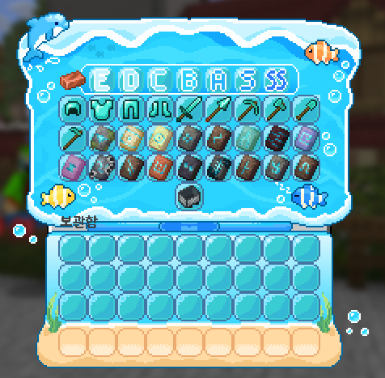

# 🔖 도감

<figure><figcaption></figcaption></figure>

> **안내**: 야생 및 직업 활동 중 획득한 다양한 바닐라/커스텀 아이템과 물고기를 납품하여 보상을 획득하는 **도감(Collections) 수집 콘텐츠 가이드**입니다.  
> 🌟 **기타 컨텐츠 목록**: 칭호는 **[🏷️ 칭호](09-2.md)**, 도전과제는 **[🏆 업적](09-3.md)**, 장비 강화는 **[💎 강화](09-4.md)**를 참고하시기 바랍니다.

---

## 📑 목차 바로가기

1. [📚 도감 시스템 개요 및 명령어](#1--도감-시스템-개요-및-명령어)
2. [📦 아이템 도감 납품 방식](#2--아이템-도감-납품-방식)
3. [🎣 커스텀 물고기 전용 도감 (`/도감 물고기`)](#3--커스텀-물고기-전용-도감-도감-물고기)
4. [🃏 와일드카드(Wildcard) 활용법](#4--와일드카드wildcard-활용법)

---

## 1. 📚 도감 시스템 개요 및 명령어

도감은 서버 내에 존재하는 수많은 광물, 농작물, 사냥 전리품, 커스텀 물고기 등을 모아 등록하는 종합 수집 콘텐츠입니다.  
도감의 카테고리를 하나씩 완성할 때마다 막대한 코인(돈), 경험치, 특별 보상을 획득할 수 있습니다.

<table>
  <thead>
    <tr>
      <th width="180">명령어</th>
      <th width="160">별칭 (Alias)</th>
      <th width="140">기능</th>
      <th>상세 설명</th>
    </tr>
  </thead>
  <tbody>
    <tr>
      <td><strong>/collections</strong></td>
      <td><code>/도감</code>, <code>/col</code>, <code>/ehrka</code></td>
      <td>아이템 도감 열기</td>
      <td>전체 아이템 수집 카테고리 GUI 창을 열어 등록 현황을 확인하고 납품합니다.</td>
    </tr>
    <tr>
      <td><strong>/collections fish</strong></td>
      <td><code>/도감 물고기</code></td>
      <td>물고기 전용 도감 열기</td>
      <td>손낚시 및 수중 통발로 획득한 128종 커스텀 물고기 전용 도감 창을 즉시 엽니다.</td>
    </tr>
  </tbody>
</table>

---

## 2. 📦 아이템 도감 납품 방식

<figure><figcaption></figcaption></figure>

1. **카테고리 선택**: `/도감` 명령어를 입력하고 채광, 농경, 사냥 등 원하는 카테고리를 클릭합니다.
2. **요구 재료 확인**: 각 도감 슬롯에 마우스를 올리면 필요한 아이템의 종류와 수량이 표시됩니다.
3. **납품 진행**:
   * 인벤토리에 목표 아이템과 수량을 소지한 상태로 슬롯을 클릭합니다.
   * 소지품에서 아이템이 차감되며 해당 도감 슬롯이 **[완료]** 상태로 변경됩니다.
4. **보상 수령**: 슬롯 또는 카테고리 전체를 완성하면 즉시 보상(코인, EXP, 특수 아이템)이 인벤토리로 지급됩니다.

---

## 3. 🎣 커스텀 물고기 전용 도감 (`/도감 물고기`)

* **128종 커스텀 어종**: 바다, 강, 심해 등에서 낚싯대 미끼나 통발을 통해 낚을 수 있는 희귀 물고기 전용 도감입니다.
* **등급별 수집**: 청동, 은, 금, 다이아몬드, 백금, 신화 등급별로 물고기가 분류되어 있습니다.
* **납품 보상**: 상점에 판매하는 것 외에도 도감에 최초 등록하여 영구 수집률을 올리고 대량의 어부 직업 경험치 및 화폐 보상을 챙길 수 있습니다.

---

## 4. 🃏 와일드카드(Wildcard) 활용법

* **와일드카드란?**: 구하기 힘든 까다로운 아이템 대신 슬롯을 즉시 완료시켜 주는 특수 조커 아이템입니다.
* **사용법**: 등급에 맞는 와일드카드를 커서로 집어 비어 있는 도감 슬롯 위에 올려놓고 클릭하면, 재료 소모 없이 즉시 완료 처리됩니다.
* **획득처**: 서버 이벤트, 퀘스트 보상, 특별 상점 등에서 한정 수량으로 획득할 수 있습니다.
