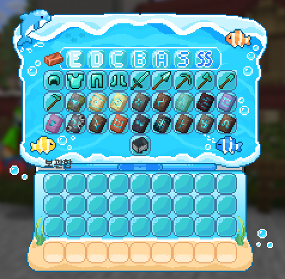
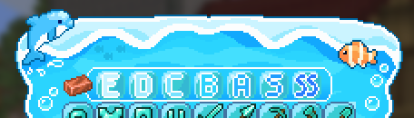

# 🔖 도감

<figure><figcaption></figcaption></figure>

> **안내**: 야생 및 직업 활동 중 획득한 다양한 바닐라/커스텀 아이템과 물고기를 납품하여 보상을 획득하는 **도감 수집 콘텐츠 가이드**입니다.  
> 🌟 **기타 컨텐츠 목록**: 칭호는 **[🏷️ 칭호](09-2.md)**, 장비 강화는 **[💎 강화](09-4.md)**를 참고하시기 바랍니다.

---

## 📑 목차 바로가기

1. [📚 도감 시스템 개요 및 명령어](#1--도감-시스템-개요-및-명령어)
2. [📦 아이템 도감 납품 방식](#2--아이템-도감-납품-방식)
3. [🎣 커스텀 물고기 전용 도감 (`/도감 물고기`)](#3--커스텀-물고기-전용-도감-도감-물고기)
4. [🃏 와일드카드 활용법](#4--와일드카드-활용법)

---

## 1. 📚 도감 시스템 개요 및 명령어

도감은 서버 내에 존재하는 수많은 광물, 농작물, 사냥 전리품, 커스텀 물고기 등을 모아 등록하는 종합 수집 콘텐츠입니다.  
도감의 카테고리를 하나씩 완성할 때마다 막대한 코인(돈), 경험치, 특별 보상을 획득할 수 있습니다.

<table>
  <thead>
    <tr>
      <th width="180">명령어</th>
      <th width="160">별칭 (Alias)</th>
      <th width="140">기능</th>
      <th>상세 설명</th>
    </tr>
  </thead>
  <tbody>
    <tr>
      <td><strong>/도감</strong></td>
      <td><code>/collection</code>, <code>/col</code></td>
      <td>아이템 도감 열기</td>
      <td>전체 아이템 수집 카테고리 GUI 창을 열어 등록 현황을 확인하고 납품합니다.</td>
    </tr>
    <tr>
      <td><strong>/도감 물고기</strong></td>
      <td><code>/물고기도감</code>, <code>/fishcol</code></td>
      <td>물고기 전용 도감 열기</td>
      <td>커스텀 물고기 전용 도감 창을 즉시 엽니다. (한글 명령어 <code>/물고기도감</code> 지원)</td>
    </tr>
  </tbody>
</table>

---

## 2. 📦 아이템 도감 납품 방식

<figure><figcaption></figcaption></figure>

1. **카테고리 선택**: `/도감` 명령어를 입력하고 채광, 농경, 사냥 등 원하는 카테고리를 클릭합니다.
2. **요구 재료 확인**: 각 도감 슬롯에 마우스를 올리면 필요한 아이템의 종류와 수량이 표시됩니다.
3. **납품 진행**:
   * 인벤토리에 목표 아이템과 수량을 소지한 상태로 슬롯을 클릭합니다.
   * 소지품에서 아이템이 차감되며 해당 도감 슬롯이 **[완료]** 상태로 변경됩니다.
4. **보상 수령**: 슬롯 또는 카테고리 전체를 완성하면 즉시 보상(코인, EXP, 특수 아이템)이 인벤토리로 지급됩니다.

---

## 3. 🎣 커스텀 물고기 전용 도감 (`/물고기도감`)

물고기 도감은 과도한 수집 난이도를 완화하고 빠른 보상 순환을 위해 **2줄 18칸 전용 그리드**로 새롭게 개편되었습니다.

* **화면 구성 (2줄 18칸 수집 + 컨트롤 바)**:
  * **1~2번째 줄 (18칸)**: 납품해야 할 목표 물고기 목록입니다.
  * **3번째 줄 (하단 바)**:
    * **중앙 [보상 수령] 버튼**: 18종을 모두 납품 완료하면 활성화됩니다.
    * **우측 [닫기] 버튼**: 도감 창을 닫습니다.
* **고정 등급 비율 추첨**:
  * 무작위로 선정되던 방식 대신 등급별 균형 비율로 18종이 배치됩니다:
    * **브론즈**: 6종
    * **실버**: 5종
    * **골드**: 4종
    * **다이아몬드**: 2종
    * **플래티넘**: 1종
  * 낚기 극히 어려운 **신화 등급은 도감 추첨 대상에서 완전히 제외**되어 도감 완성 장벽이 대폭 낮아졌습니다.
* **등급별 요구 납품 마릿수 완화**:
  * 각 물고기 칸의 필요 납품 수량이 1마리씩 일괄 하향되었습니다.

| 물고기 등급 | 요구 납품 수량 | 비고 |
| :---: | :---: | :---: |
| **브론즈** | **각 5마리** | 기존 6마리에서 완화 |
| **실버** | **각 4마리** | 기존 5마리에서 완화 |
| **골드** | **각 3마리** | 기존 4마리에서 완화 |
| **다이아몬드** | **각 2마리** | 기존 3마리에서 완화 |
| **플래티넘** | **각 1마리** | 기존 2마리에서 완화 |
| **신화** | **도감 제외** | 극악 난이도 배제 |

* **보상 체계**:
  * **개별 슬롯 완료 보상**: 각 칸을 채울 때마다 50% 확률로 돌고래 꼬리 또는 오징어 촉수가 지급됩니다.
  * **18종 완주 보상**: 18종을 모두 완성하고 하단의 **[보상 수령]**을 누르면 **[낚시 랜덤 보상 상자]**를 획득하며, 즉시 새로운 18종의 물고기 도감 목록으로 자동 리필됩니다.
* **단축 명령어**:
  * 채팅창에 **`/물고기도감`** (또는 `/fishcollection`, `/fishcol`, 타자 오타 방어 `/anfrhrlehrka`) 입력 시 언제든 즉시 도감을 열 수 있습니다.

---

## 4. 🃏 와일드카드 활용법

* **와일드카드란?**: 구하기 힘든 까다로운 아이템 대신 슬롯을 즉시 완료시켜 주는 특수 조커 아이템입니다.
* **사용법**: 등급에 맞는 와일드카드를 커서로 집어 비어 있는 도감 슬롯 위에 올려놓고 클릭하면, 재료 소모 없이 즉시 완료 처리됩니다.
* **획득처**: 서버 이벤트, 퀘스트 보상, 특별 상점 등에서 한정 수량으로 획득할 수 있습니다.
